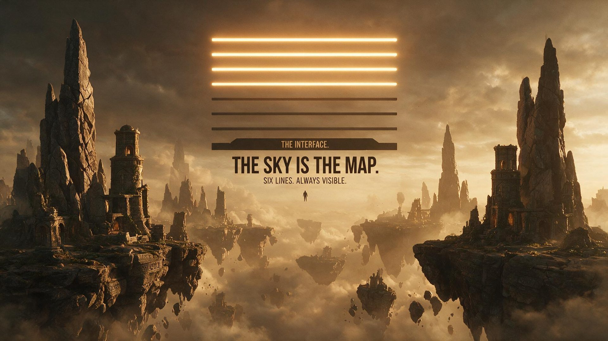

# I-RULE01: The Creative Fire

**Six lines. One eye. Stillness wins.**

*A mythic sci-fi action-adventure where power is mastered through restraint, not force.*



**Unreal Engine 5** · **PC (Steam)** · **Single-player** · **Third-person action-adventure** · **Concept / pre-production**


---

## What this repository is

This is the **single source of truth** for I-RULE01: The Creative Fire. Everything a developer, artist, sound designer or producer needs, from the story to the build order, lives here. If an answer is not in this repo, that is a bug in the repo: open an issue.

## The game in 30 seconds

You are **Elias, 21**, chosen not for strength but for his capacity to *align*: to wait, read the moment and act only when it is time. He wakes in **Igara**, a dying realm of broken floating islands joined by ancient bridges. Six dark horizontal lines of fire hang in the sky like a ladder, and a vast **Fire Eye** watches.

The world reacts to how you behave. Rush, spam or panic and it falls into **Entropy**: wind, cracking platforms, multiplying enemies. Move with rhythm and it opens into **Freshness**. Stop, truly stop, and it blooms into **Beauty**. Stillness is the game's most powerful verb, and the final test is to stand motionless for ten seconds.

When the sixth line ignites there is no boss and no explosion. A ring of fire spreads across the world and it wakes up.

> *"When the sixth line ignites, the world does not explode. It awakens."*

## Quick facts

| Item | Detail |
|---|---|
| **Genre** | Action-adventure · exploration · light combat · mythic sci-fi |
| **Engine / platform** | Unreal Engine 5 · PC (Steam) first, console is future scope |
| **Structure** | 6 stages (one per hexagram line) + the Throne ending |
| **Length** | About 85 minutes first-time run (75-95 min range) |
| **Comparable feel** | The Pathless (movement), Solar Ash (flow), Journey (minimalism), Abzû (calm) |
| **Inspiration** | I Ching, Hexagram 1: *Ch'ien, The Creative* (six unbroken lines) |
| **Series idea** | "1 of 64": one hexagram per game (directional ambition, not a commitment) |
| **Status** | Design complete, art direction locked, no playable build yet |

## Find your way

| I am a... | Start here | Then read |
|---|---|---|
| **New to the project** | [How it plays](docs/how-it-plays.md) | [Vision](docs/01-vision-and-pillars.md), [Story](docs/02-story-and-lore.md) |
| **Gameplay programmer** | [Core systems](docs/06-core-systems.md) | [Unreal architecture](docs/10-unreal-architecture.md), [Build order](docs/11-production-plan.md) |
| **Level / environment designer** | [World and level design](docs/03-world-and-level-design.md) | [Stages](docs/stages/README.md), [Island map](art/world/island-map-page-1.jpg) |
| **Technical / VFX artist** | [Art direction](docs/12-art-direction.md) | [Throne](docs/08-the-throne.md), [Characters](docs/04-characters-and-companions.md) |
| **3D / concept artist** | [Asset library](docs/15-asset-tracker.md) | [Art direction](docs/12-art-direction.md), [3D pipeline](art-pipeline/README.md), [Art gallery](art/README.md) |
| **Sound designer** | [Audio and UX](docs/09-audio-and-ux.md) | [Core systems](docs/06-core-systems.md) |
| **Producer / publisher** | [Production plan](docs/11-production-plan.md) | [Canon and open decisions](docs/13-canon-and-open-decisions.md), [Funding](docs/14-funding-and-submission.md) |

Full reading paths: [docs/00-start-here.md](docs/00-start-here.md).

## Repository map

```
README.md                  you are here
docs/                      all written design, one topic per file
  stages/                  Stage 1-6 and the Throne: beat-by-beat plans with timings
art/                       approved visuals: key art, characters, world, stages, throne
art-pipeline/              how art becomes 3D assets (Gemini -> image-to-3D -> Unreal)
prompts/                   the image prompts behind every approved visual
design/                    original PDFs: GDD, story, pitch-deck brief, maps
GLOSSARY.md                every term used in the project
CONTRIBUTING.md            how to propose changes
```

## Documents at a glance

| # | Document | Answers |
|---|---|---|
| 00 | [How it plays](docs/how-it-plays.md) | What does the player actually do, minute by minute? |
| 01 | [Vision and pillars](docs/01-vision-and-pillars.md) | What are we making and why? |
| 02 | [Story and lore](docs/02-story-and-lore.md) | What happens, why Elias, why now, what does it mean? |
| 03 | [World and level design](docs/03-world-and-level-design.md) | What does the world look like and how do you move through it? |
| 04 | [Characters and companions](docs/04-characters-and-companions.md) | Elias, the Cinder, the Fire Dragon, the Fire Eye, the Sacred Arc |
| 05 | [Enemies](docs/05-enemies.md) | The four forces of entropy and how each is beaten |
| 06 | [Core systems](docs/06-core-systems.md) | Creative Energy Cycle, stillness, fire, combat, traversal |
| 07 | [Stages](docs/stages/README.md) | Second-by-second plan for all six stages and the ending |
| 08 | [The Throne](docs/08-the-throne.md) | Design, scale, ignition and the ending payoff |
| 09 | [Audio and UX](docs/09-audio-and-ux.md) | Why there is no HUD, and how sound teaches |
| 10 | [Unreal architecture](docs/10-unreal-architecture.md) | Systems, classes, data assets, input |
| 11 | [Production plan](docs/11-production-plan.md) | Build order, sprints, team, budget, demo scope, playtest rules |
| 12 | [Art direction](docs/12-art-direction.md) | Look lock, palette, do and do-not list |
| 13 | [Canon and open decisions](docs/13-canon-and-open-decisions.md) | What is locked, what conflicts, what is undecided |
| 14 | [Funding and submission](docs/14-funding-and-submission.md) | Epic MegaGrants status and checklist |
| 15 | [Asset library](docs/15-asset-tracker.md) | Every asset, its image slots, and what is still missing |
| Site | **Islands page** (open the website, Art, Islands) | Numbered list of the 13 islands, then every island with its images (Download buttons) and prompts (Copy buttons) |

## The six lines at a glance

| Stage | Line | Theme | One-line lesson | Stillness hold |
|---|---|---|---|---|
| [1 Lurking](docs/stages/stage-1-lurking.md) | 1 | Entropy / orientation | Do not act yet. Find alignment first. | 2.5 s |
| [2 Emerging](docs/stages/stage-2-emerging.md) | 2 | Freshness / timing | Energy returns. Do not waste it. | 3 s |
| [3 The Toil](docs/stages/stage-3-the-toil.md) | 3 | Danger / misuse of power | Power without restraint creates chaos. | 4 s |
| [4 The Leap](docs/stages/stage-4-the-leap.md) | 4 | Structure / coordination | Creative power is structured, not wild. | 3 s |
| [5 Flying](docs/stages/stage-5-flying.md) | 5 | Flow | Flow comes after restraint. | 5 s |
| [6 The Peak](docs/stages/stage-6-the-peak.md) | 6 | Beauty / non-action | True power knows when to stop. | **10 s** |
| [The Throne](docs/stages/the-throne-ending.md) | | Completion | No boss. No explosion. Completion is calm. | |

## Project status

| Area | Status |
|---|---|
| Game design document | Done (21 pages) |
| Story and lore | Done |
| Stage timelines | Done (second-by-second) |
| Art direction and look lock | Done |
| Key art | 25+ approved images, in [art/](art/README.md) |
| Throne | **Redesigned**, new renders pending (see [docs/08](docs/08-the-throne.md)) |
| 3D reference prompt pack | Done (53 assets, 126 pages) |
| Unreal prototype | **Not started.** Stage 1 vertical slice is the first build |
| Open decisions | See [docs/13](docs/13-canon-and-open-decisions.md) |

## Non-negotiable canon (short version)

1. **Elias is 21.** No betrayal backstory. Chosen for capacity to align, not suffering.
2. **Enemies are symbolic forces**, never specific people.
3. **No religious framing.** Companions are named by function.
4. **Unreal Engine 5.**
5. **The sky ladder is six straight horizontal bars**, evenly spaced, never stars, circles or pyramids.
6. **The world is broken floating islands joined by fixed bridges**: ruins, not a city.
7. **Stillness wins.** If a feature does not serve Entropy / Freshness / Beauty or Stillness / Alignment / Flow, it does not ship.

The full list, with the conflicts we found and how we resolved them, is in [docs/13](docs/13-canon-and-open-decisions.md).

## Contributing

Read [CONTRIBUTING.md](CONTRIBUTING.md). Short version: check canon first, change one thing per pull request, and update the document, not a copy of it.

## License

Not yet decided. Until the owner adds a license, **all rights are reserved** and this repository is for the project team and reviewers only.

---

## Viewing this repo as a website
`index.html` is a styled, navigable version of these documents. Turn on **GitHub Pages** (Settings, Pages, deploy from the `main` branch, root folder) and the site opens with the sidebar, dark theme and images. The Markdown files stay the source of truth; the site reads them directly. The `.nojekyll` file stops GitHub from re-rendering them with its default theme.
