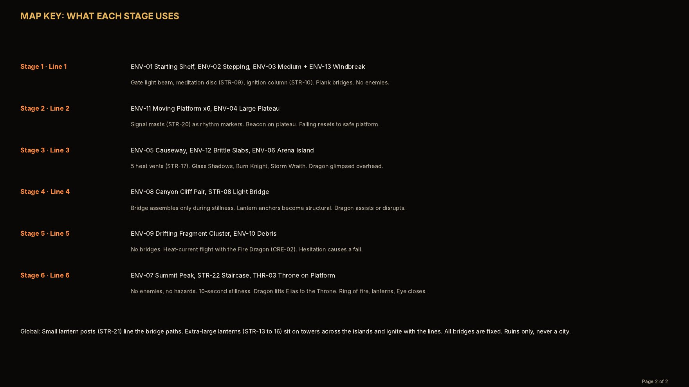

# 3D pipeline: from approved image to game asset

The **[3D Reference Prompt Pack](3D_Reference_Prompt_Pack.pdf)** (126 pages) covers **53 assets**: 13 islands, 26 structures, 5 sky objects, 3 throne assets, 6 creatures. For each asset it gives a multi-angle **sheet prompt** plus **single-angle prompts**, every one labelled with the asset name, and an index with page numbers.

## Workflow
1. **Turnaround sheet first.** Generate the multi-view sheet for the asset (Gemini). Check that it matches the key art.
2. **Lock the design.** Pick the sheet that is right. Do not proceed with a wrong one.
3. **Single-angle prompts.** Generate front / back / side / three-quarter / top as needed from the locked look.
4. **Image-to-3D.** Use a tool such as Meshy, Tripo, Hunyuan3D or Rodin on the best angles.
5. **Unreal cleanup.** Retopologise, UV, bake and set materials from the obsidian / bronze library; build modular snap points for bridges.
6. **Track it.** Update the tracker columns (Sheet, 3D) in the pack index.

## Titles
Every prompt makes the tool print the asset ID and name as the image title (for example `ENV-01 - STARTING SHELF ISLAND`). Reject any image whose title does not match.

## Backgrounds
- Most assets: plain light-gray studio background.
- **Throne assets:** seamless mid-gray backdrop (about 40% gray) with a soft amber rim light, so dark stone edges and glowing cracks both read. White hid the details; near-black swallowed the edges.

## Look lock
Every prompt carries the look lock: weathered stone and bronze, ember-amber light, ruins not a city, no glass, no modern forms. See [art direction](../docs/12-art-direction.md).

## Index
| Group | IDs |
|---|---|
| Islands | ENV-01 ... ENV-13 |
| Structures | STR-01 ... STR-22 |
| Sky | SKY-01 ... SKY-05 |
| Throne | THR-01 ... THR-03 (+ 4 detail prompts) |
| Creatures | CRE-01 ... CRE-06 |

Asset lists with sizes are summarised in [World and level design](../docs/03-world-and-level-design.md).
