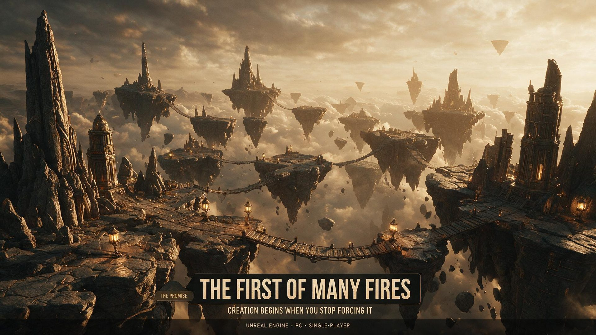

# Vision and pillars

## One-line pitch
A mythic action-adventure where a young carrier awakens his creative fire, not through force but through timing, stillness and mastery over the entropy that tries to steal his light.

## What is different
Most action games escalate power through speed, aggression and builds. I-RULE01 teaches the opposite rule: **the world belongs to those who align.** Stopping is a legitimate, powerful, correct move, and the game is built to make the player discover that without being told.

## Design pillars

| Pillar | Meaning in practice |
|---|---|
| **Stillness wins** | Rushing creates chaos. Pausing reveals the path. The sixth line needs ten seconds of doing nothing. |
| **Fire is meaning** | Fire is not decoration or a currency to hoard. It appears when you are aligned and leaks when you force. |
| **Six lines, one ladder** | Progress is six horizontal bars in the sky, always visible, never hidden in a menu. |
| **No HUD, no lies** | The world is the interface: sound, light, platform behaviour. No minimap, no quest markers, no tutorial text. |
| **Enemies are mirrors** | Each enemy is a force that steals creative power (panic, entropy, grievance, greed), never a person. |
| **The throne is recognition** | There is no villain to defeat. Elias claims what was always his and the world wakes. |
| **Mechanics teach theme** | Every story beat is something the gameplay itself produces. |

## The six pillars of game design (the check)
Every feature must also pass the six pillars of game design: **Fun, Game Loop, Curiosity, Skill, Motivation, Progression.** No exception. See [the six pillars check](27-six-pillars-check.md).

## Development rules (so it stays coherent)

1. **No theme-only features.** If a feature does not connect to Entropy / Freshness / Beauty or Stillness / Alignment / Flow, it does not ship.
2. **Movement feel is gate 1.** If movement is not Pathless-grade, stop everything and fix it.
3. **The six pillars check.** A feature that fails any of the six pillars does not ship ([doc 27](27-six-pillars-check.md)).
4. **The playtest question.** After every session ask only: *"When did you realize you had to stop moving?"*
   - Never realised: feedback is too weak.
   - Too early: too obvious.
   - Too late: clarify or punish earlier.

## Feedback rule for every mechanic
Every mechanic has three feedback layers, and no explicit text tutorial:
1. **Audio**: the primary teacher.
2. **World behaviour**: platform stability, storm onset, lantern flicker.
3. **Minimal visual on Elias / Cinder**: brightness and drift.

## Target player and experience
The ideal player is someone tired of being rushed. They finish the game able to say exactly when they realised they had to stop moving. That moment of realisation is the reward; the lines, the dragon and the throne are the vehicle.

## Market position: "Meditative Mastery"
Between pure atmosphere (Journey, Abzû) and punishing mechanical depth. Challenging but not cruel, artistic but mechanically deep.

| Comparable | Shared | I-RULE01 difference |
|---|---|---|
| The Pathless | Momentum traversal, minimal UI | Adds meaningful combat, stillness mechanic, six-line structure |
| Journey | Atmosphere, emotion, no text | Deeper combat, the Fire Dragon, symbolic enemies |
| Solar Ash | Flow-based movement | Replaces speed fantasy with stillness mastery |
| Abzû | Calm exploration | Adds combat, a hero journey, fire as identity |

**Steam listing draft:** *"A cinematic action-adventure where a young carrier reclaims his sacred creative power through timing, restraint, fire arrows and the silence between strikes."*
Tags: Action-Adventure, Atmospheric, Exploration, Single-Player, Mythic Sci-Fi, Minimal UI, Indie. Price target $24.99-$29.99. Capsule taglines: *"Six Lines. One Eye. Stillness wins."* / *"Master power without forcing."*

## The bigger idea: one of sixty-four
The I Ching holds 64 hexagrams, each a distinct archetype of power, challenge and change. Hexagram 1, The Creative, is pure unforced potential: Elias's story. Hexagram 5 (Waiting) or 15 (Modesty) would teach different lessons through different mechanics. This is a **directional ambition, not a production commitment.** See [Story and lore](02-story-and-lore.md#one-of-sixty-four).
