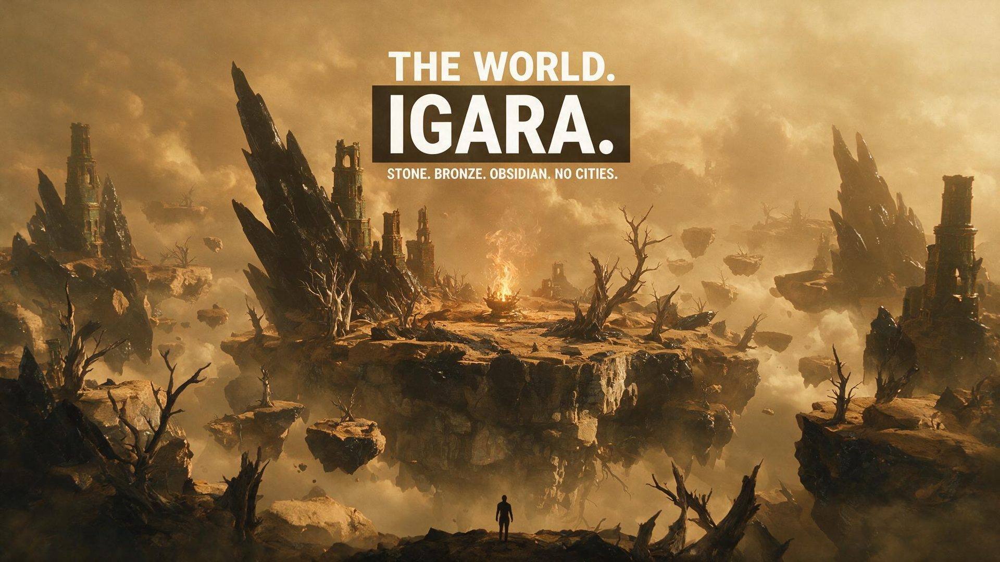

# Story and lore

> *"Creation begins when you stop forcing it."*

## The land called Igara
There is a place between waking and knowing that the ancient masters called **Igara**, the Realm of Unlit Fire. It is the world that lives inside every soul born with a purpose not yet claimed. You can only reach it by being called.

Igara was once powered by balance, not force. Today it is a realm of **broken floating islands** in a sky of deep amber and shadow, joined by narrow bridges that survived the fall. Ancient bronze-and-stone ruins stand on them. High above, the **Fire Eye** watches. Six great lines of fire hang in the sky like a ladder no one has climbed in a thousand years. All six are dark. Igara is dying because its fire has no one to carry it home.

## Why the world broke
Igara was never attacked from outside. It broke from within. Generations ago a previous carrier held the same fire and did the one thing it cannot survive: he **tried to force it**. Not from malice but from impatience. Forced creative power does not yield; it fractures. The world split into the islands Elias now crosses, the six lines went dark, and the Fire Eye, which watched that carrier fail, closed most of the way and has been waiting since, not for a hero to fix what broke but for someone capable of not repeating the mistake.

This is why the enemies are what they are: not an invading army but **what forcing leaves behind when it fails**, the fossils of that collapse still enacting the same panic. There is no named villain. Elias's task and the world's history are the same lesson at two scales.

## Why Elias, why now
Every generation Igara chooses one person. Not the strongest, not the most famous, but the one with the **capacity to align**.

- Elias is **21** and deliberately ordinary. The premise depends on it.
- In his own world his patience read as hesitation, even slowness: the thing people told him to grow out of. He was not chosen because something was taken from him. He was chosen because he already carried, unrecognised, the one thing Igara needs: the capacity not to force something.
- **No backstory trauma, no betrayal.** His arc is universal on purpose. Any player can see themselves as someone who has not yet learned when to stop pushing.
- His suit does not glow because he is powerful. It glows because he is **correct.** This is a mastery fantasy, not a power fantasy.

He wakes on a dark obsidian plain with six unlit lines above him. At the far end, behind a gate of bronze and frozen fire, a single beam of light stands perfectly still. That light is his. It always has been.

## The story in six trials
Each stage teaches one law and ignites one line. See [Stages](stages/README.md) for full beat plans.

| Stage | What happens | Law |
|---|---|---|
| 1 Lurking | Total darkness, no enemies. Standing still reveals what rushing hides. | Do not act yet. Find alignment first. |
| 2 Emerging | Platforms move; timing replaces guesswork. | Energy returns. Do not waste it. |
| 3 The Toil | First real conflict. Do you know restraint or only think you do? | Power without restraint creates chaos. |
| 4 The Leap | Bridges of light form only while he holds still. | Creative power is structured, not wild. |
| 5 Flying | The Fire Dragon mirrors him exactly. | Flow only follows control. |
| 6 The Peak | No enemies, no hazards. Ten seconds of doing nothing. | True power knows when to stop. |

## The ending
Elias sits on the Throne. The six lines ignite bottom to top. The Fire Eye opens fully, the locked gate from Stage 1 finally breaks and the light that was always his transfers into him. A ring of fire spreads across the realm, lighting every lantern, structure and bridge he crossed. **Nothing explodes. The world wakes up.** Then Elias wakes in his own world, not the same.

## Dynamics: the story is told through play
No dialogue, no cutscene lore dumps. The story is what the world does in response to the player.

| If the player... | The world responds... | The story is saying |
|---|---|---|
| Rushes, spams, panics | Entropy: wind, cracking platforms, multiplying enemies | This is what forcing looks like. |
| Moves with rhythm and timing | Freshness: paths clarify, movement smooths | This is what trying, correctly, looks like. |
| Holds still and aligns | Beauty: harmony, calm, clarity | This is what mastery feels like. |

Even audio tells it: harmony builds when aligned, noise intrudes when forcing, and the most important moments are scored with near-silence.

## Meaning
Most of us were taught that power comes from pushing harder. This story argues the opposite: the most decisive thing a person can do is sometimes to stop, and restraint is power's most advanced form. Elias is not fighting a villain who stole something; he is fighting his own instinct to force outcomes, the instinct players recognise the first time they die to a Storm Wraith by trying to fight it. The emotional climax is the moment a player realises the correct move is to stop moving.

Rooted loosely and respectfully in **I Ching Hexagram 1, Ch'ien, The Creative**: six unbroken lines, pure patient unfolding of creative force. The game never explains this; it builds the experience around the same idea. There is **no religious framing** beyond that.

## The goal
- **In the world:** ignite all six lines, reach the Throne, let Igara's fire come home. The deeper goal is recognition, not conquest.
- **For the player:** notice, often for the first time in the genre, that stopping is a legitimate, powerful move.

## One of sixty-four
The I Ching is sixty-four ideas, not one. Hexagram 3 (Difficulty at the Beginning), 5 (Waiting), 15 (Modesty), 24 (Return): sixty-four different situations, each with its own wisdom, already tested over three thousand years. A future entry built on Waiting would teach something Elias's story structurally cannot. This is a directional ambition and not a current production commitment.
