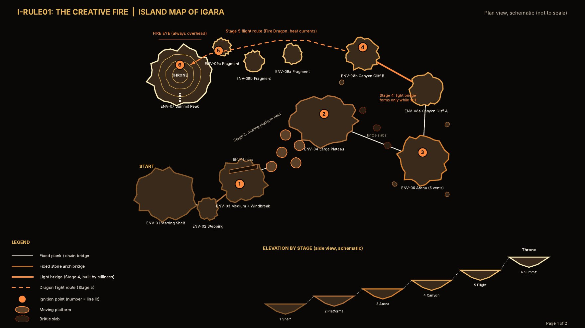

# World and level design

*Schematic plan map of Igara. Page 2 ([stage key](../art/world/island-map-page-2.jpg)) lists what each stage uses.*

## What the world is
A **broken, floating realm**: fragments of a shattered landmass drifting apart, with open sky, cloud and void in the wider gaps. Neighbouring islands are linked by **fixed bridges**: stone arches, plank-and-chain walkways and metal-linked causeways, weathered and firmly built. The world is fractured but crossable.

- **Ruins, not a city.** Carved stone-and-bronze tower ruins and jagged rock spires frame the larger islands. No skyscrapers, no glass, no modern architecture, no crowds, no neon.
- **Materials:** weathered sandstone-tan and dark charcoal-brown layered rock, obsidian-black shards, aged bronze. Warm gold-amber haze fills the space between islands.
- **Fire is engineered**, controlled amber, never chaotic magic.
- **No water**, only energy reservoirs. **Vegetation:** sparse, dry, fossil-like trees and thin dry grass only.
- **Single biome.** Depth comes from tiering, access gating and a lighting curve, not new biomes.

## Sky language (always visible)
| Element | Rule |
|---|---|
| **Six Lines** | Six long straight horizontal bars, evenly spaced and parallel, stacked like a ladder. Ignite bottom to top. **Never** stars, circles, pentagrams, pyramids or rotating symbols. |
| **Fire Eye** | A wide almond-shaped burning eye with a narrow vertical pupil, edged with flame filaments. Eye alone, no face. |
| **Lantern anchors (XL)** | Six extra-large lanterns across the world act as a **progress map**. They ignite with the lines. |
| **Planets** | One ringed and one plain planet for scale and mood. |
| **Throne silhouette** | Visible from late Stage 5. Promise of the end. |

## Island kit (modular, reused for all six stages)
Modular island chunks with snap points for bridges and platforms; danger-edge volumes (fall, soft reset). Full asset list with sizes is in the [3D Reference Prompt Pack](../art-pipeline/3D_Reference_Prompt_Pack.pdf).

| Group | Assets |
|---|---|
| **Islands (ENV-01-13)** | Starting Shelf, Stepping Island, Medium Island with Windbreak, Large Plateau, Causeway Island, Arena Island, Summit Peak, Canyon Cliffs, Drifting Fragment Cluster, Debris Rocks, Moving Platform Slab, Brittle Slab, Windbreak Ridge |
| **Structures (STR-01-22)** | Tower ruins, rock spires, monolith slab, locked bronze gate, stone / plank / light bridge segments, anchor socket, ignition columns (dormant / ignited / peak), XL lantern anchors (hanging, tower, ground, lit), heat vent, energy reservoir, fossil tree, six-line pylon, small lantern post, summit staircase |
| **Sky (SKY-01-05)** | Six-line ladder (dormant, progress states), Fire Eye structure, ringed and plain planet |
| **Throne (THR-01-03)** | [The Throne of Stillness](08-the-throne.md), stairs and platform, throne on summit |
| **Creatures (CRE-01-06)** | Cinder, Fire Dragon, Glass Shadow, Burn Knight, Ember Leech, Storm Wraith |

## Regions
| Stage | Region | Key space |
|---|---|---|
| 1 | Southwest | Dark entry: Starting Shelf, stepping islands, windbreak, first ignition column |
| 2 | South-central | Direction gate (3-path fork), moving platforms, energy reservoir |
| 3 | Southeast | Circular obsidian arena, five heat vents, monolith for line-of-sight breaks |
| 4 | Central-east | Void canyon, three bridge-anchor pairs, narrow combat span |
| 5 | North-central | Three heat-current lanes, drifting fragments, short dragon carry |
| 6 | Far north | Summit peak, ignition column, Throne |

Source layout (positions in metres, from the original spec; **convert axes for Unreal: source Y-up becomes Unreal Z-up**):

| Anchor | Position (x, y, z) |
|---|---|
| HexLineLadder | (0, 320, 0) |
| FireEye | (0, 420, 180), faces world centre |
| Stage 1 spawn | (-290, 0, -290) |
| Stage 1 ignition column (Hold 2.5 s) | (-210, 0, -210) |
| Stage 2 ignition column (Hold 3 s) | (-10, 0, -110) |
| Stage 3 arena centre / ignition (Hold 4 s) | (160, 0, -180) / (170, 0, -180) |
| Stage 4 ignition (Hold 3 s) | (230, 0, 20) |
| Stage 5 ignition (Hold 5 s) | (0, 0, 260) |
| Stage 6 peak platform | (0, 80, 340) |
| Throne seat | (0, 80, 350), yaw 180 degrees (faces back across the world) |

Six XL lanterns, yaw facing inward: (-220,0,-180), (220,0,-180), (-260,0,40), (260,0,40), (-160,0,220), (160,0,220).

## Traversal and verticality

**Source canon:** the world is mostly one level with Stage 6 as the only major elevation shift (summit at y=80; a taller Grand Scale proposal is in docs/17). The island map already shows rising elevation by stage.

**Locked by the island map (elevation by stage):** the whole game is a *climb*, not a walk across a plane. A world of floating islands is most compelling when height is felt.

| Stage | Elevation feel | Verticality device |
|---|---|---|
| 1 Shelf | Lowest | Looking up: the six lines and a distant Throne silhouette dominate |
| 2 Platforms | Slightly up | Moving platforms rise and fall with timing |
| 3 Arena | Mid | Plateau ringed by taller spires that frame the Fire Eye |
| 4 Canyon | Mid-high | Bridges span depth, not just distance; looking down into cloud |
| 5 Flight | High | Heat currents and dragon carry do the vertical work |
| 6 Summit | Highest | The final staircase and the Throne above everything |

Principles: the Throne must be **visible from the first island** so the climb has a visible goal; each stage's end ignites a lantern that is visible from the next stage's start; falling is a soft reset (correction, not punishment).

## Navigation philosophy
No minimap, no quest markers. The player navigates by landmarks (Eye, lines, lanterns, Throne silhouette), the **Cinder** drifting toward alignment points, suit-seam brightness, and audio.

## Design intent
*"The world is the interface."* A new player should always be able to answer "where am I trying to go?" by looking up.
