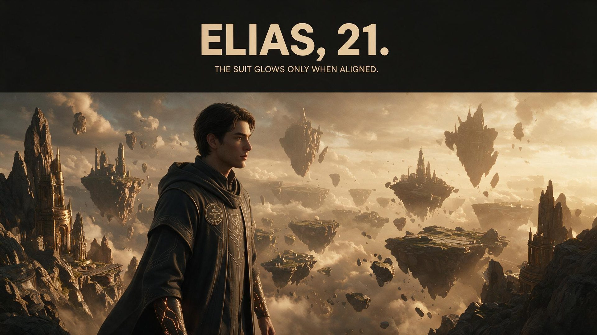
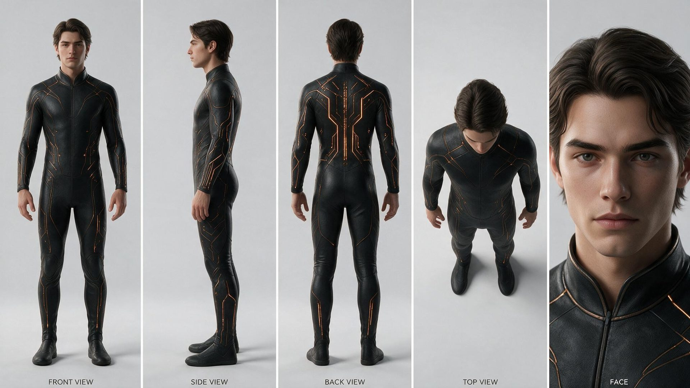
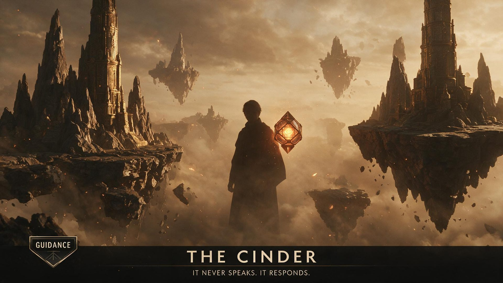
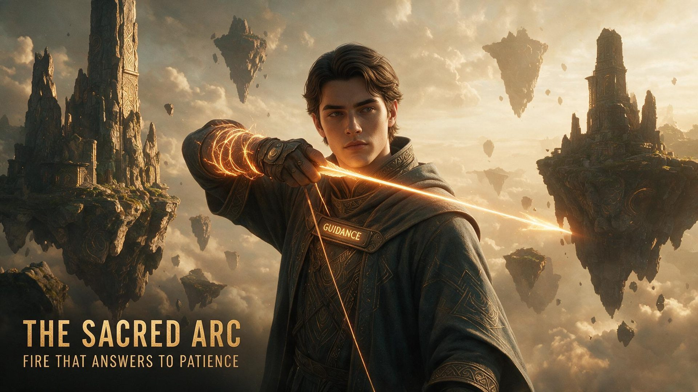
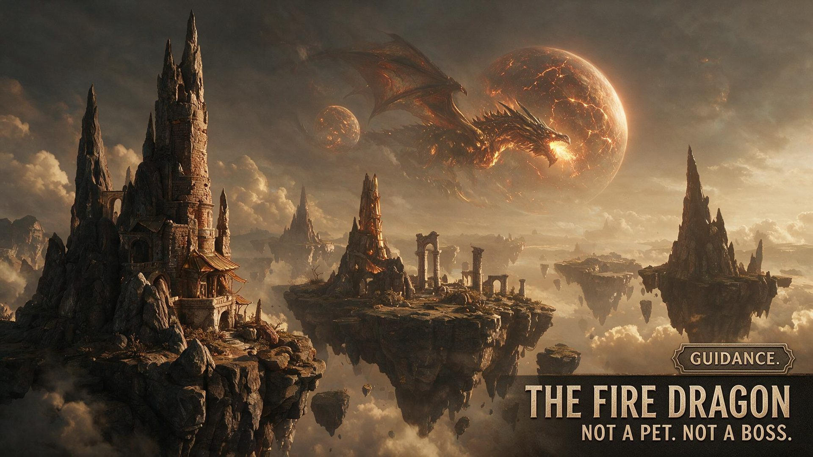
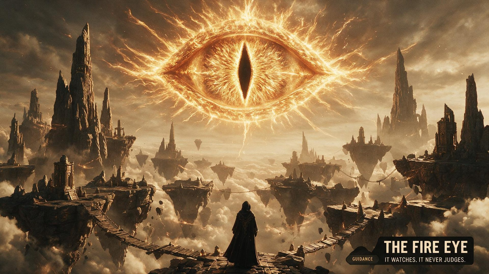

# Characters and companions

## Elias, the Carrier

| Item | Detail |
|---|---|
| **Age** | 21. Locked. |
| **Role** | The Carrier: chosen for capacity to align, not strength |
| **Build** | Lean, athletic, grounded human proportions. Not stylised, not heroic-bulk. Pan-human presentation. |
| **Suit** | Matte obsidian-black technical suit with fine bronze seam-lines like dormant circuitry. **Seams glow amber only when he is aligned.** |
| **Movement** | Calm, deliberate, momentum-based. Explosive only when perfectly aligned. |
| **Expression** | Readable, human, composed. |
| **Start state** | Near darkness, suit inert. |

Turnaround prompts: [prompts/elias-character-reference-prompts.md](../prompts/elias-character-reference-prompts.md). Reference sheet PDF: [design/Elias_Character_Reference.pdf](../design/Elias_Character_Reference.pdf).

**Arc:** Lurking (find the spark) -> Emerging (a beacon, direction) -> The Toil (conflict, precision) -> The Leap (bridge forms as he walks) -> Flying (the dragon lifts him) -> The Peak (the final stillness).

## The three companions
They do not speak. They are forces he feels and learns to align with.

### The Cinder (the compass)

A minimal fire-intelligence fragment bound to the suit. **Not a creature, not a voice, never has a face, never attacks.** Head-sized hovering geometric ember construct: ember core inside a bronze frame. It **replaces all HUD.**

| State | Look | Meaning |
|---|---|---|
| Dim / misaligned | Drifting | You are forcing |
| Bright / aligned | Steady, directed | Correct heading |
| Meditation / anchoring | Expanded pulse, locks position | Stillness zone active |
| Combat / perfect timing | Brief intense flare | Resonance window |

Functions: directional guidance (no arrows), meditation anchor, fire stability buffer (reckless play shows leakage flicker), combat feedback.

### The Sacred Arc (the fire-arrow system)

The primary active companion and the source of Elias's **fire arrows**. A flowing flame presence that wraps the bow arm. Arrows are **ordinary when he rushes**, and become fire arrows only when the Arc is active, which requires stillness, alignment and calm focus. Teaches precision and presence over panic. ("Sacred" is a name only; there is no religious framing. See [canon](13-canon-and-open-decisions.md).)

### The Fire Dragon (the guardian)

A **System Guardian**: not a pet, not a god, not a helper, not a boss. A living mirror of mastery that cannot be fought or commanded, only earned. Appears from Stage 3. Win condition in trials is clean survival and correct action, **not HP depletion.**

| State | Trigger | Effect |
|---|---|---|
| Observing | Stage 3+ | Circles silently at a distance |
| Disrupting | Player in Entropy | Turbulence, collapsing platforms |
| Assisting | Player aligned | Stabilises traversal, creates heat currents |
| Carrying | Stage 6 complete | Lifts Elias to the Throne with no input |

Design: winged, dark bronze-black scales cracked with molten amber. About 60 m long (see 3D pack CRE-02).

## The Fire Eye (the watchful presence)

A world-level system: massive, symmetrical, intelligent geometry, always watching. Not a villain: the goal. It is the world's memory and conscience, a dormant system that once powered creation through balance.

| State | When | Look |
|---|---|---|
| Dormant | Start | Faint pupil, no lines lit |
| Aware | After Line 1 | Subtle pupil contraction |
| Awakening | Lines 2-5 | Progressive brightness, rays reach the ground |
| Full activation | Line 6 | Opens completely, ring of fire spreads |
| Closing | End | Slowly closes: recognition granted |

Design: a wide almond-shaped eye of fire with a narrow vertical pupil like a cat's, radiating flame filaments. No face, no humanoid feature.
