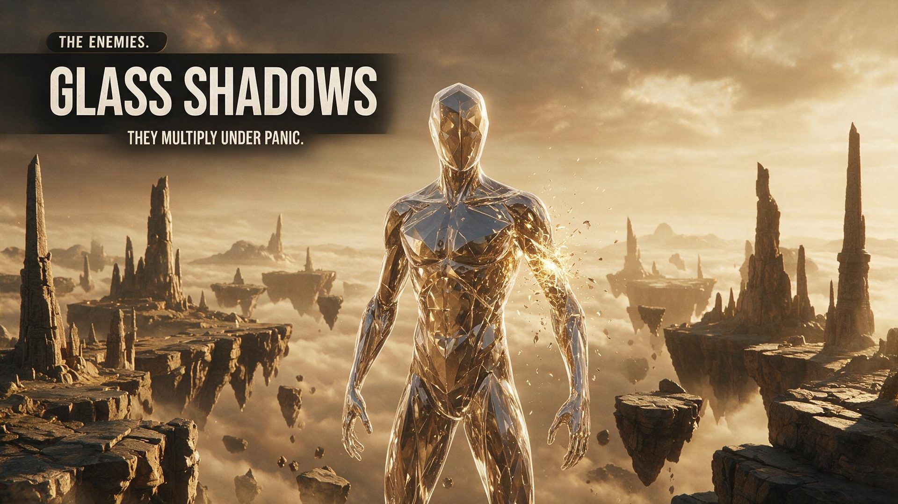
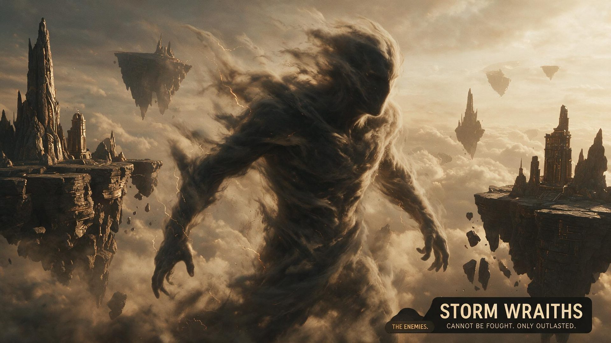
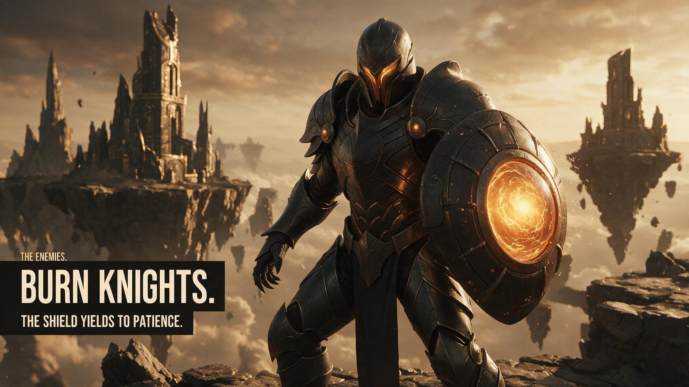
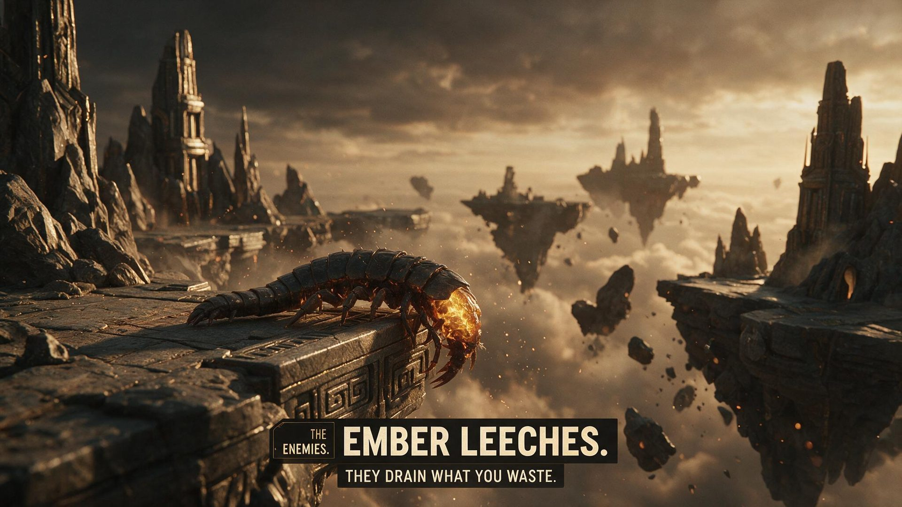

# Enemies: forces of entropy

Every enemy is a **symbolic archetype** of a force that steals creative power. They are not people and never depict specific individuals. Brute force always fails: the player must understand each enemy's nature. Each enemy is the story restating its one idea in a new shape. None is a punishment.

| Enemy | Represents | Beaten by | Lesson |
|---|---|---|---|
| **Glass Shadows** | Panic | Precision strike on an open frame | Precision over panic |
| **Storm Wraiths** | Entropy itself | Break line of sight and hold still 2 s | Some enemies are beaten by not fighting |
| **Burn Knights** | Old grievance made solid | Perfect parry or dodge drops the shield | Timing over damage |
| **Ember Leeches** | Theft of creative energy / greed | Calm, methodical movement starves them | Chaos feeds greed; stillness starves it |

## Glass Shadows (core combat)

Thin, reflective, translucent amber-glass humanoids, about 2 m tall, that **mirror aggression**.
- Spam attacks: they split into two weaker copies and chaos rises.
- Strike on an "open frame": they shatter instantly.

## Storm Wraiths (entropy storm)

Entropy given form: a dust-and-wind humanoid, about 5 m, mostly a **VFX/state** rather than a mesh. Invisible until a forcing threshold is crossed.
- Triggered: wind shear, dust, camera shake, platform edges become unsafe.
- **Cannot be killed.** Cleared by breaking line of sight and holding still for 2 s in a calm pocket.

## Burn Knights (heavy unit)

Slow, armoured black-bronze unit, about 3 m, with a glowing round heat-core shield. The shield drops **only** after a perfect dodge or parry. Direct strikes do nothing.

## Ember Leeches (platform parasite)

Small armoured centipede-like tech-parasites, about 40 cm, that attach to platforms and drain stability. Sprint and panic attract more; calm clearing reduces spawns.

## The Fire Dragon (guardian trial)
Not an enemy. See [characters](04-characters-and-companions.md#the-fire-dragon-the-guardian).

## Wave tables
- **Stage 3 arena:** wave 1, two Glass Shadows. Wave 2, Glass Shadows plus Ember Leeches on the arena edges. Wave 3, one Burn Knight. See [Stage 3](stages/stage-3-the-toil.md).
- **Stage 1, island 1 (ledge, after the bow):** leeches and bat-birds. One arrow stops one. See [docs/19](19-env01-blueprint.md). Not in the old canon.
- **Stage 1, island 2:** one big bat-bird flies over once. It never hurts the player. See [docs/20](20-env02-blueprint.md).
- **Stage 3, island 5 (PROPOSED):** 3 to 5 Ember Leeches climb up from under the causeway. Calm makes them drop. See [docs/23](23-env05-blueprint.md).
- **Stage 4:** two Glass Shadows on the narrow combat span at about t=220 s.
- **Stage 5:** optional encounter zone, bypassable by flow (non-combat success).
- **Stage 6:** no enemies.

## Behaviour rules applied
Applied 15 Nov 2026 from [doc 32](32-rules-of-successful-games.md).

1. **One state table for each enemy (UN-5).** Every enemy has named states and a visible or audible cue for each.
2. **Glass Shadows.** Patrol, notice, mirror, shatter. They patrol random waypoints inside a set area (UN-7).
3. **Storm Wraiths.** Dormant, trigger, storm, clear. The cue is wind and dust.
4. **Burn Knights.** Advance, shielded, shield down, stagger. The cue is the heat-core.
5. **Ember Leeches.** Latch, drain, starve. The cue is the chain glow dimming.
6. **Show enemy damage in the body (UN-4).** Glass cracks. No health bars.
7. **Predictable (GF-1).** The same player action always gives the same enemy answer.
8. **Cinder is the helper (UN-12).** It follows, guides and catches.
