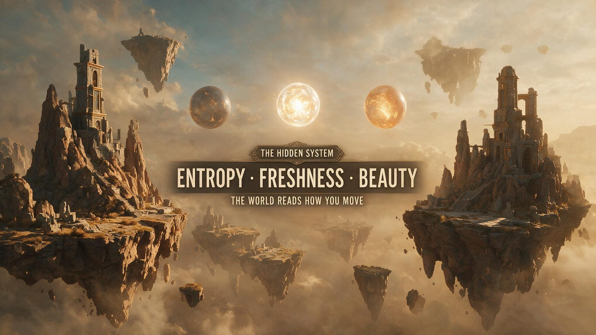
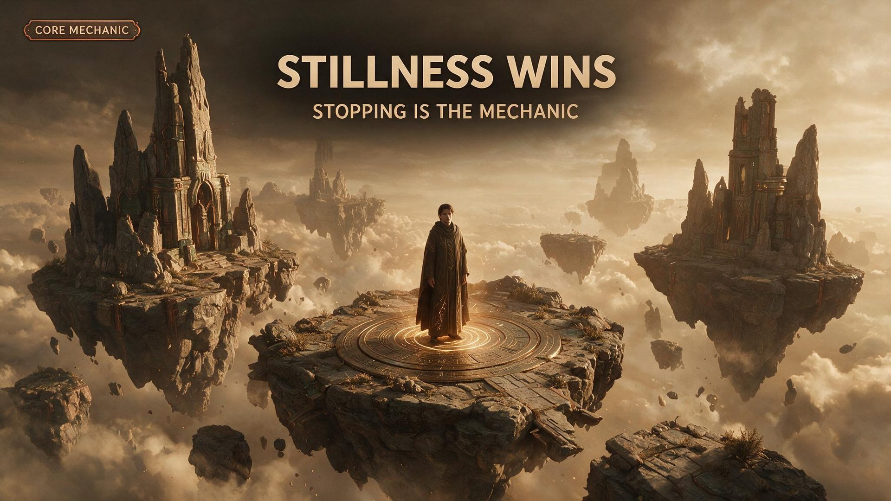
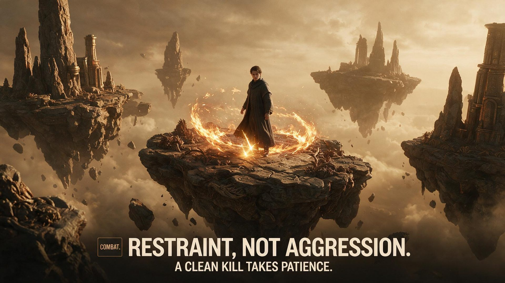
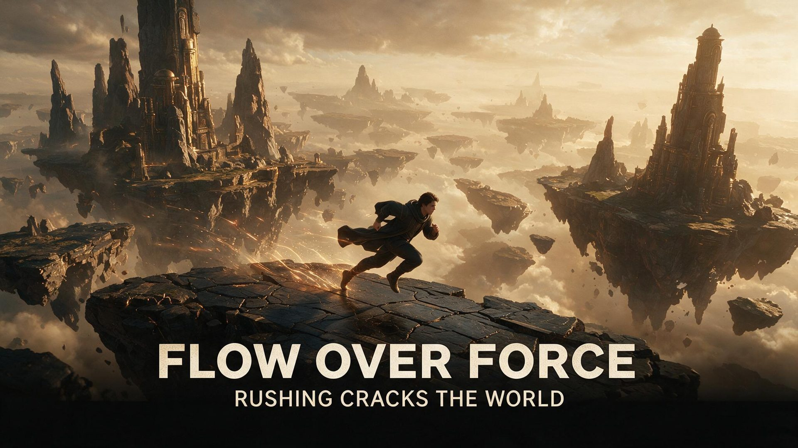

# Core systems

All numbers are **starter defaults for tuning**, not final. Tune in playtests with the debug HUD.

## 1. The Creative Energy Cycle (hidden state machine)
An invisible controller runs under every moment. The player never sees a bar; they feel it through the world.



| State | Trigger | World effect |
|---|---|---|
| **Entropy** | Rushing, spamming, forcing, panic | Wind shear, dust, noise, slight camera instability, platform edges crumble, enemies multiply and turn aggressive, Storm Wraiths trigger |
| **Freshness** | Rhythmic movement, correct timing | Traversal smooths, heat currents readable, suit glows, path reveals |
| **Beauty** | Stillness plus full alignment | Maximum clarity, calm stable platforms, reduced aggression, the Dragon cooperates, audio harmony blooms |

*Designer note: the game forces the player to calm down by making the world harder when they panic.*

### Outputs by state
| Output | Entropy | Freshness | Beauty |
|---|---|---|---|
| Platform stability | Crumbling edges | Steady, predictable | Perfectly still |
| Enemy behaviour | Multiply, aggressive | Normal | Passive, wide openings |
| Audio | Noise, distortion | Rhythmic clarity | Full harmony |
| Fire arrows | Ordinary | Warm glow | Full sacred fire |
| Cinder | Dim, drifting | Bright, directed | Expanded, pulsing |

### The one internal meter: ForcingIndex (0..1)
Updated every frame. It is the **only** driver for state shifts, storm thresholds, enemy escalation and platform brittleness.

**Raises forcing**
- Movement: `moveF = MoveMagnitude^1.6 * 0.22`
- Turning: `turnF = Clamp01(DirectionFlipScore) * 0.18` (a flip is a direction change over 120 degrees within 0.25 s)
- Combat spam: `aps = attacksLast2s / 2.0`, `combatF = Clamp01((aps - 1.4) / 2.0) * 0.35`
- Dash chaining: each extra dash within 2.5 s adds +0.06 (cap 3)
- Whiffed heavy strike: +0.05

**Reduces forcing (per second)**
- Stillness: -0.28
- Meditation (only while ForcingIndex < 0.35): -0.22
- Perfect actions: -0.10 per event. Open-frame hit: -0.08 immediately. Parry: -0.12. Perfect dodge: -0.08.

**Update each frame**
```
ForcingIndex += (moveF + turnF + combatF + dashF) * dt
ForcingIndex -= (stillR + medR + perfR) * dt
clamp 0..1, then ForcingIndex = Lerp(prev, current, 0.18)   // anti-jitter
```

**State thresholds**
- Entropy: ForcingIndex >= 0.62
- Freshness: between 0.28 and 0.62
- Beauty: ForcingIndex <= 0.28 **and** StillnessStreak >= 1.8 s
- A new state's condition must hold for **0.75 s** before switching (no flicker).

> An earlier spec used two scores (forcingScore and alignmentScore) with hysteresis. It is kept in [canon and open decisions](13-canon-and-open-decisions.md#technical-spec-variants) as an alternative. **Implement ForcingIndex first.**

## 2. Stillness (the core mechanic)


Stillness is not passive. It is the most powerful action in the game. Every stage uses it in a different "skin".

**Detection (deterministic)**
- Counts as movement: Move magnitude > 0.10; Look magnitude over the frame > 0.35 (mouse) / 0.20 (stick); any action button press.
- Physics: velocity magnitude > 0.06. External wind is ignored if grounded and velocity stays below threshold.
- Stillness begins when all conditions hold for 0.20 s (debounce). It resets if any movement breaks for more than 0.06 s.
- Inside a **Calm Pocket** volume: debounce 0.12 s, velocity tolerance widened to 0.09. This makes storm resets reliable behind monoliths.

**Uses**
| Use | Rule |
|---|---|
| Meditation zones | Hold to enter; the Cinder stabilises and hidden ignition paths are revealed |
| Still Window | 2 s of stillness (with line of sight broken) clears an Entropy storm |
| Ignition alignment | Every line ignition needs a stillness hold at the column (see per-stage hold times) |
| Bridge building | Stage 4 bridges form only while Elias is still |
| Final test | Stage 6: **10 s** of continuous stillness; any movement resets |

Movement cancels and resets progress. Do not reduce the 10 s requirement except in a demo-only build.

## 3. Fire
Fire is **temporary, engineered, ceremonial**. It appears when aligned and leaks when forcing.
- Uses: lantern ignition, short combat effects, bridge activation, Eye progression.
- No shops. Minimal items only: **Ember Capsules** (restore stability after combat), **Cooling Vials** (temporarily reduce storm build-up).

## 4. Combat: controlled conflict


A rhythm game disguised as an action game. Anti-spam by design.

| Move | Description | Timing |
|---|---|---|
| Light strike (fire arrow) | Fast, low cost. Teaches enemy rhythm. | Wind-up 0.12, active 0.10, recover 0.22 s |
| Heavy strike (charged arrow) | Slow. Breaks shields only on an open frame. Requires brief stillness. | Wind-up 0.35, active 0.10, recover 0.35 s |
| Resonance strike | Needs full alignment; triggered by a Cinder flare. One-shot against most enemies. | |
| Resonance guard (parry) | Essential against Burn Knights. | Window 0.18 s |
| Perfect dodge | Optional. | Window 0.16 s |
| Stillness reset | Not an attack: hold still 2 s to clear storms and reset aggression. | |

Input buffer 0.10 s, **one** queued action only. Light recovery cancels into parry at 40%.

**Stage input locks:** Stage 1 combat off, dash penalised (+0.08 forcing each). Stage 2 combat off, dash cooldown rises to 1.4 s if used twice in 3 s. Stage 3+ full kit. Stage 6 combat and dash off; jump only if "panic temptation" is wanted, and it resets stillness instantly.

## 5. Traversal: flow over force


Momentum-based, inspired by The Pathless. **Movement feel is gate 1.**

| Parameter | Starter value |
|---|---|
| Walk / run speed | 4.6 / 8.2 |
| Dash | 12.8 impulse, 0.18 s burst, cooldown 1.1 s, disabled while meditating |
| Air max speed / air control | 8.0 / 0.45 |
| Ground accel / decel / air accel | 18 / 16 / 8 |
| Turn responsiveness / max angular speed | 0.72 / 540 deg per s |
| Jump | height 1.6 m, coyote 0.12 s, buffer 0.10 s |

Also: slide that preserves momentum; **heat-current glide** from Stage 5 when the Dragon assists; **alignment boost** (brief surge when perfectly aligned). **No grapple, no stamina bar, no jump in Stage 1.**

### Camera
Third person, calm and grounded. FOV 68 (74 in flow). Follow offset (0.55, 1.85, -4.35), look-at offset (0, 1.55, 0). Damping: position 0.14, rotation 0.10, vertical 0.18 (prevents nausea over platforms). Shake: entropy storm max 0.12, combat hit 0.08, never stacked (take the max). No shoulder swap.

### Input (Enhanced Input)
Move, Look, Jump, Dash, Interact, MeditateHold (hold), LightStrike, HeavyStrike, GuardParry, optional FocusWalk. Keyboard+mouse and controller, rebind-ready.

## 6. Storms
- Trigger: Entropy state in a zone with storms enabled, **or** ForcingIndex >= 0.72 for 0.7 s inside an arena volume.
- Reset: line of sight broken (cover volume) **and** in a calm pocket **and** stillness >= 2.0 s. The storm decays over 1.5 s and returns to a Freshness bias.

## 7. Ring of Fire (world ignition)
A world ignition that reads as **activation, not destruction**: internal circuitry waking up. No explosions, no debris, no burning decay.

- Graph of **IgniteNodes** (lanterns, structures, platforms, ground veins, landmarks) joined by **IgniteLinks** with travel times.
- Start at the Throne node at t=0. Propagate by earliest arrival time. Lanterns ignite in sequence, then an **All Together** event sets every lantern to stable max intensity.
- Planet reflections get a global post-pass boost. The Fire Eye is fully open at start and closes over the last 90 s.
- Ending budget is 360 s: 0-60 sit, Eye opens, first spread; 60-170 propagation and lantern sequence; 170-210 harmony peak, all lanterns together; 210-270 propagation completes; 270-330 Eye closes, harmony decays; 330-360 fade out.

## 8. Playtest logging
Every session logs: time to first stillness realisation; number of storm triggers before the first successful calm reset; average ForcingIndex per stage; Stage 6 attempts before success. If Stage 6 resets feel unfair, widen look tolerance (mouse 0.35 -> 0.45) and velocity tolerance (0.06 -> 0.08).

**Dev-only debug HUD (never ship):** F1 toggle; ForcingIndex bar, state label, stillness streak, APS, direction-flip flag, storm threshold marker; F2 force Entropy, F3 force Beauty, F4 spawn Glass Shadow. Gizmos for calm pockets, cover volumes, heat currents and bridge-build progress.

## 9. Feel rules applied
Applied 15 Nov 2026 from [doc 32](32-rules-of-successful-games.md).

1. **Answer fast (GF-7).** Every input shows a result within 100 ms. Aim for 50 ms. The whole path, from key to screen, stays within 3 frames at 60 fps.
2. **Stillness needs two answers.** The hold keeps its 0.20 s debounce and its locked times. But the moment he stops, the world answers within 100 ms: the Cinder glow settles and the sound softens. The count itself starts after the debounce.
3. **Break fast too.** When movement resets a hold, the world answers within 100 ms: rungs dim, the glow lifts.
4. **No ambiguous buttons (GF-2).** Keep one priority table. When two actions arrive in the same frame, the higher one wins. Order: Guard/Parry, Dash, Jump, Strike. The 0.10 s buffer stays. Write the table into the Enhanced Input setup.
5. **Few states, all visible (GF-3).** Every state change has a cue the player can see or hear.
6. **Frame rate (GF-9).** Target 60 fps on PC. Never below 30. Stillness and bridge logic run on a fixed tick, so they do not change with frame rate.
7. **Empty-room test (GF-14).** Movement must be a joy on grey boxes, before art. This is part of gate 1.
8. **Keep it fresh (GF-13).** Make at least 3 variants of footsteps for each surface, of chain clinks, of rung-lighting timing, and of the idle and settle animations.
9. **Failure is worth watching (GF-15).** Make at least 3 versions each of a bridge breaking, a fall and the Cinder catch.
10. **Move in arcs (GF-16).** Use velocity and force, not set positions. Chains sag on arcs. The suit follows through.
11. **Harmony (GF-17, GF-18).** Look, sound, motion and rules say the same thing. Keep the mythic, iconic look. Do not chase photo-real.
12. **No clipping (GF-19).** Check every island for clipping and loose physics objects before sign-off.
13. **Weight cues (GF-21).** Big things get slow motion, deep sound, dust and a small shake: the Dragon, bridge chains, the Throne.
14. **Feel sheet (GF-25).** For each mechanic record input, response, context, polish, metaphor and rules. Log it in playtests.
15. **Debug readout.** Add a response-time readout to the dev-only HUD.
