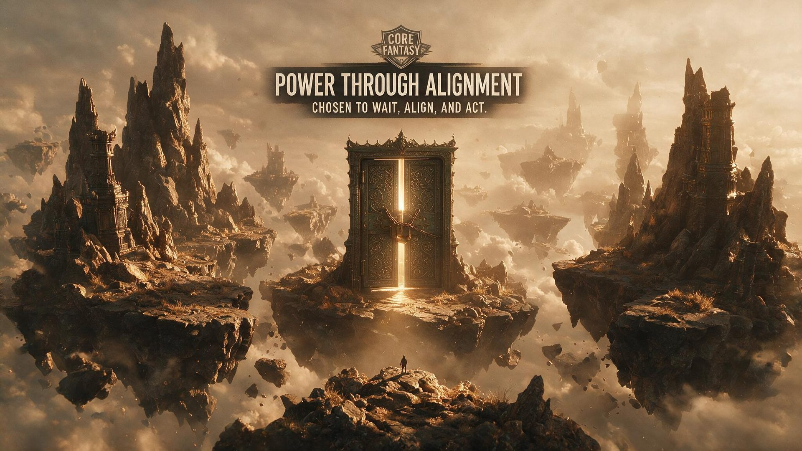

# Art direction

## Look in one line
Ancient and weathered, **dark volcanic stone and aged bronze, warm gold-amber haze and ember light, hot molten cracks**, photoreal and cinematic. Mythic and severe, closer to *Dune* than to fantasy spectacle.

## Palette and materials
| Item | Detail |
|---|---|
| **Rock** | Weathered sandstone-tan and dark charcoal-brown layered rock with obsidian-black shards, eroded fractured edges, inverted-cone undersides |
| **Metal** | Aged bronze: edges, plates, ribs, anchors |
| **Light** | Warm gold-amber haze, ember glow, engineered amber fire |
| **Sky** | Deep amber and shadow, cloud seas, a ringed planet and a plain planet |
| **Suit** | Matte obsidian black, bronze seam glow only when aligned |
| **Vegetation** | Sparse dry fossil-like trees and thin dry grass only |

## Always
- Floating islands joined by **fixed bridges**; ruins, not a city.
- Six lines as **straight horizontal bars**, evenly spaced.
- Short, bold, high-contrast text, appearing only once per image.
- Every approved image carries the **name of what it is** as a label.
- Mood: calm, severe, mythic.

## Never
- Skyscrapers, glass towers, neon, modern architecture, lush green vegetation, water, crowds.
- Stars, circles, pentagrams, pyramids or rotating symbols for the six lines (a star-shaped sky symbol appeared in early exploration and is **rejected**).
- A face on the Fire Eye, a face or voice on the Cinder, religious imagery.
- Glossy, chrome, mirror-polished or "modern clean" treatment on the Throne.
- Enemies depicted as specific people.

## Gallery
Browse everything approved in [art/README.md](../art/README.md).

## How the art was made
All art is generated by the owner in Gemini / Freepik / Magnific from prompts in [`prompts/`](../prompts/). Prompts are self-contained, name the asset, give explicit negatives, and avoid words that trigger the wrong concept (for example hexagram, pyramid, ritual circle, slit, rope, swaying). The workflow from approved image to game asset is in the [3D pipeline](../art-pipeline/README.md).

## Text and typography in key art
Badge plus bold title with a dark contrast panel plus one short bold subtitle. Warm cream on dark panels. Consistent badge vocabulary: THE WORLD, THE ENEMIES, GUIDANCE, THE INTERFACE, CORE MECHANIC, COMBAT, STAGE N LINE N, FINAL ACTIVATION, THE PROMISE.
