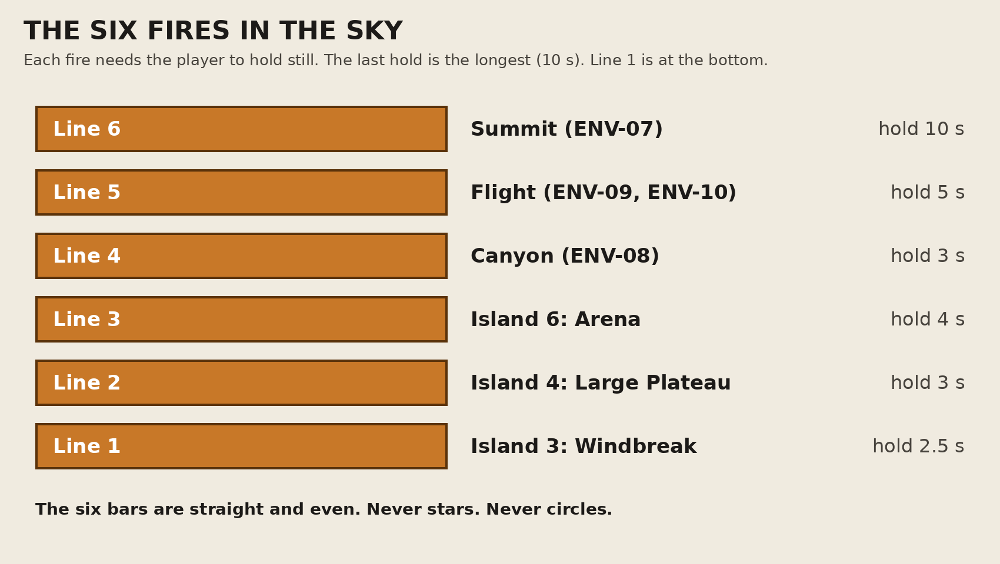
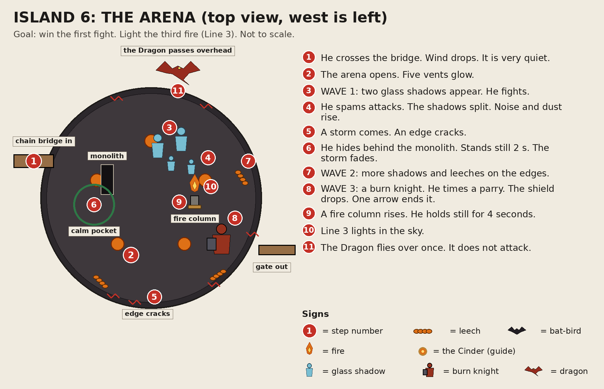
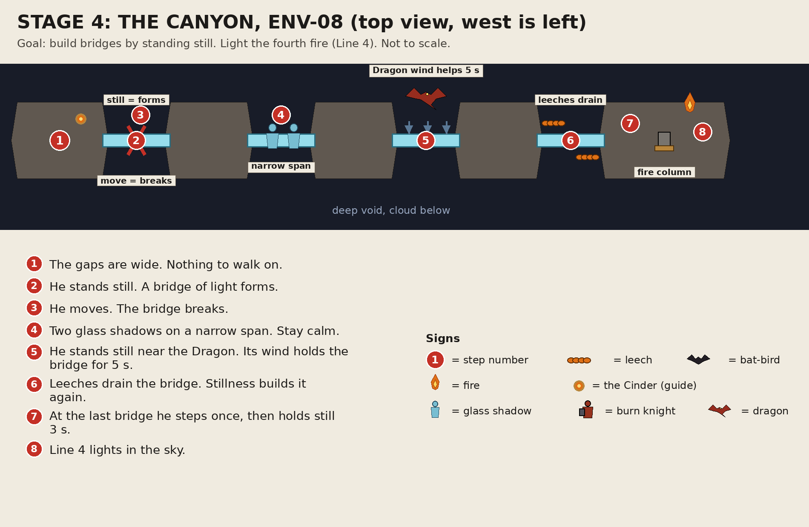
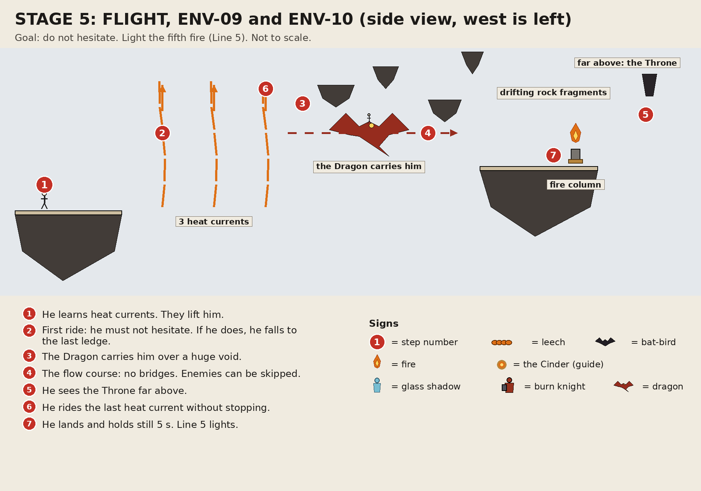
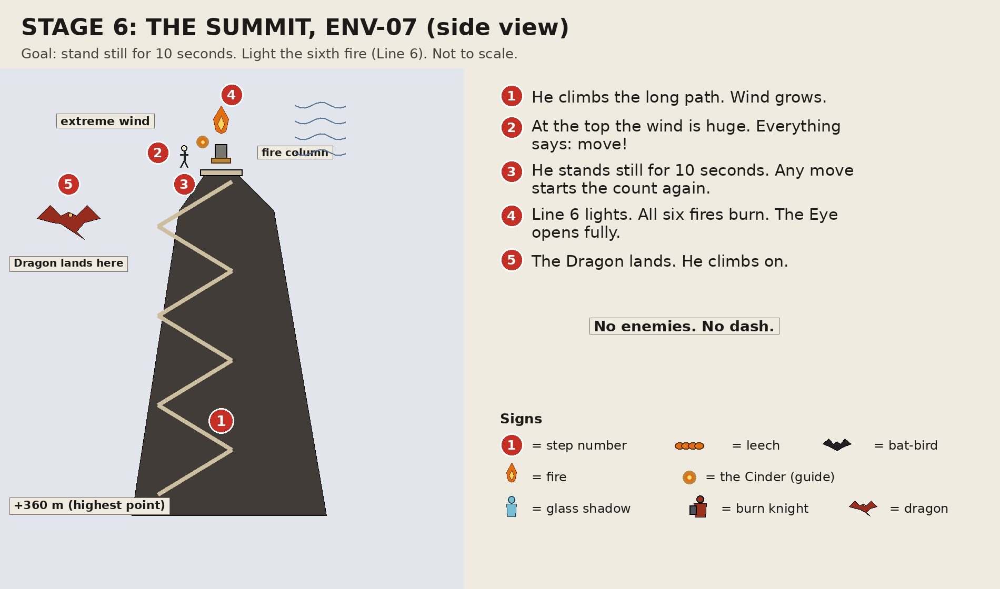
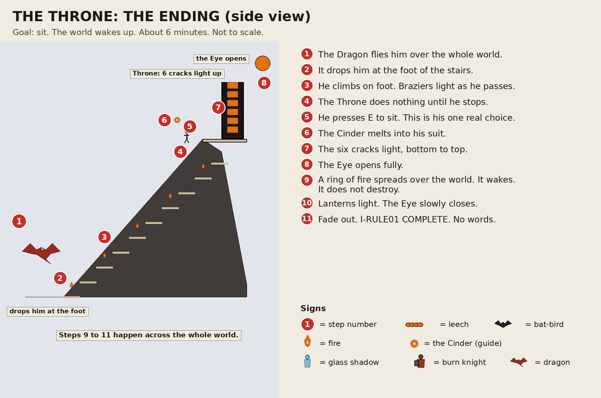

# Playthrough: from the arena to the Throne

This page covers what happens **after island 5**.
Islands 1 to 5 are on [the simple playthrough page](24-playthrough-simple-01-05.md). Read that page first.

The old long version is saved here: [old long playthrough](archive/17-playthrough-long-OLD.md).

---

## The six fires
The player lights six fires in the sky. One fire per stage.

1. The six bars are straight and even. Never stars. Never circles.
2. Each fire needs the player to **stand still**.
3. The last hold is the longest: **10 seconds**.
4. Above the world, the **Fire Eye** watches. It opens a little wider with each fire. After Line 6 it is fully open.

---

## The enemies in simple words
1. **Glass shadow.** A glass figure. If the player spams attacks, it splits into more. A calm shot breaks it.
2. **Ember leech.** A small armoured crawler. It drains the platform. A calm player gets fewer of them.
3. **Burn knight.** A heavy fighter with a shield. Hitting the shield does nothing. A well-timed parry drops it. Then one arrow ends it.
4. **Bat-bird.** Only on islands 1 and 2.
5. **The Dragon.** Not an enemy.
   - It flies over once in the arena.
   - It helps in the canyon if the player is still.
   - It carries the player in the flight stage.
   - It carries the player to the Throne.

---

## Island 6: The Arena (ENV-06)
**Stage 3: The Toil. Goal:** win the first big fight. Light Line 3. About 16 minutes.

1. He crosses the bridge. The wind drops. It is very quiet.
2. The arena opens. Five vents glow.
3. **Wave 1:** two glass shadows appear. He fights.
4. He spams attacks. The shadows split. Noise and dust rise.
5. A storm comes. An edge cracks.
6. He hides behind the monolith. He stands still for 2 seconds. The storm fades.
7. **Wave 2:** more glass shadows, and leeches on the edges.
8. **Wave 3:** a burn knight. He times a parry. The shield drops. One arrow ends it.
9. A fire column rises. He holds still for **4 seconds**.
10. **Line 3** lights in the sky.
11. The Dragon flies over once. It does not attack.

**He learns:** rushing makes more enemies. Stillness ends the storm.

**If he fails:** a fall is a soft reset. The fix is always the same: hide, then stand still for 2 seconds.

**Build:**
- A round plateau with broken edges, 5 vents, a monolith to hide behind, and a calm pocket.
- 3 waves. Wave 1: 2 glass shadows. Wave 2: glass shadows and leeches. Wave 3: 1 burn knight.
- The fire column with a 4 s hold.
- Details: [Stage 3](stages/stage-3-the-toil.md).

---

## Stage 4: The Canyon (ENV-08)
**Goal:** build bridges by standing still. Light Line 4. About 14 minutes.

1. The gaps are wide. Nothing to walk on.
2. He stands still. A bridge of light forms.
3. He moves. The bridge breaks.
4. Two glass shadows on a narrow span. He stays calm.
5. He stands still near the Dragon. Its wind holds the bridge for 5 seconds.
6. Leeches drain the bridge. Stillness builds it again.
7. At the last bridge he steps once, then holds still for **3 seconds**.
8. **Line 4** lights in the sky.

**He learns:** calm builds. Rushing breaks.

**If he fails:** the bridge breaks. He goes back to the last anchor. A calm spot is always near.

**Build:**
- 2 cliffs and 3 pairs of bridge anchors (STR-08 light bridge).
- A bridge that only exists while the player is still.
- 2 glass shadows on one narrow span.
- Details: [Stage 4](stages/stage-4-the-leap.md).

---

## Stage 5: Flight (ENV-09 and ENV-10)
**Goal:** do not hesitate. Light Line 5. About 17 minutes.

1. He learns heat currents. They lift him.
2. First ride: he must not hesitate. If he does, he falls to the last ledge.
3. The Dragon carries him over a huge void.
4. The flow course. No bridges. Enemies can be skipped.
5. He sees the Throne far above.
6. He rides the last heat current without stopping.
7. He lands and holds still for **5 seconds**. **Line 5** lights.

**He learns:** after calm, action feels easy.

**If he fails:** a fall puts him back on the last ledge. Too much fixing makes wind. The cure is to stop and trust the flow.

**Build:**
- 3 heat current lanes, drifting rock fragments, a Dragon carry.
- No bridges.
- Details: [Stage 5](stages/stage-5-flying.md).

---

## Stage 6: The Summit (ENV-07)
**Goal:** stand still for 10 seconds. Light Line 6. About 9 minutes.

1. He climbs the long path. The wind grows.
2. At the top the wind is huge. Everything says: move!
3. He stands still for **10 seconds**. Any move starts the count again.
4. **Line 6** lights. All six fires burn. The Eye opens fully.
5. The Dragon lands. He climbs on.

**He learns:** true power knows when to stop.

**Rules:** no enemies. No dash. No combat.

**If he fails:** if the 10 seconds feels unfair, make the movement check a little looser. Do not make the 10 seconds shorter. The demo version uses 6 seconds.

**Build:**
- A summit platform with a wind zone, a fire column and a stillness timer.
- The timer resets on any move.
- Details: [Stage 6](stages/stage-6-the-peak.md).

---

## The Throne: the ending
**Goal:** sit. The world wakes up. About 6 minutes.

1. The Dragon flies him over the whole world.
2. It drops him at the foot of the stairs.
3. He climbs on foot. Braziers light as he passes.
4. The Throne does nothing until he stops.
5. He presses E to sit. This is his one real choice.
6. The Cinder melts into his suit.
7. The six cracks in the Throne light, bottom to top.
8. The Eye opens fully.
9. A ring of fire spreads over the world. It wakes. It does not destroy.
10. Lanterns light. The Eye slowly closes.
11. Fade out. **I-RULE01 COMPLETE.** No words.

**Rules:**
1. No boss. No explosion.
2. The fire is **waking up**, not burning down. No debris.
3. No text. No reward screen.

**Build:**
- A long stairs with braziers that light when he is near (within 2 m).
- A seat, a sit trigger, and 6 cracks that light one by one.
- The ring of fire that spreads outward from the Throne.
- Details: [The Throne](08-the-throne.md), [Ending](stages/the-throne-ending.md).

---

## How long it takes
| Part | About |
|---|---|
| Islands 1 to 3 (Stage 1) | see [Stage 1](stages/stage-1-lurking.md) |
| Moving platforms and Island 4 (Stage 2) | see [Stage 2](stages/stage-2-emerging.md) |
| Arena (Stage 3) | 16 minutes |
| Canyon (Stage 4) | 14 minutes |
| Flight (Stage 5) | 17 minutes |
| Summit (Stage 6) | 9 minutes |
| Throne | 6 minutes |
| Whole game | about 85 minutes |

---

## Ideas not decided yet
Do **not** build these until the producer says yes.

1. **The Shadow fight on island 1.** The player meets a copy of himself made of glass. He tries three floating weapons. They all fail. Then he finds a ring and stands still. A short film plays inside his mind. The locked island 1 plan (a door, a cave, a bow and a ledge fight) does not have this.
2. **A short stillness fight at the burn knight.** The player can drop the shield by standing still for 10 seconds, instead of a parry.
3. **A faint echo of the film at the Summit,** during the 10 second hold.
4. **The three floating weapons and the ring.** Names are only placeholders.

All the detail for these ideas is in the [old long playthrough](archive/17-playthrough-long-OLD.md).

### Questions for the producer
1. Do we keep the Shadow fight on island 1? Yes or no.
2. Does the Dragon drop him at the foot of the stairs (the plan on this page) or at the seat?
3. Do leeches appear on island 5? See [the simple playthrough](24-playthrough-simple-01-05.md).

---

Related: [Playthrough, islands 1 to 5](24-playthrough-simple-01-05.md) · [Core systems](06-core-systems.md) · [Enemies](05-enemies.md) · [Canon and open decisions](13-canon-and-open-decisions.md)
