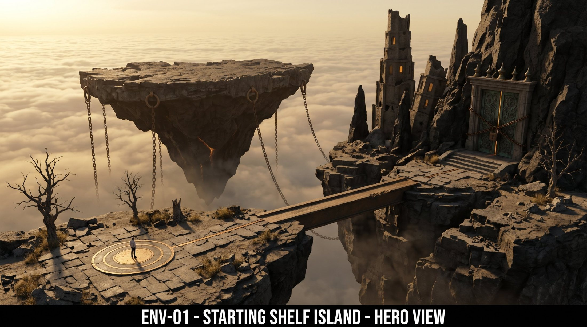

# 19. ENV-01 blueprint (LOCKED, design v2)

The Starting Shelf Island is approved. The approved hero render is `art/assets/ENV-01/hero.jpg`. This page is the exact map. Coordinates are metres: x east from the west edge, y north from the near (spawn) rim, height 0 = shelf top.

Note on the hero render: it shows a second floating rock with chains in the background. That rock is an artefact and is **not** part of the design; the chains belong to the ENV-01 rim. Every ENV-01 prompt says to add no second island.

## Key distances
| From | To | Distance |
|---|---|---|
| Disc centre (13.5, 7) | beam start (18, 15.5) | about 11 m along the broken road |
| Beam | (18, 15.5) to (22.3, 30.9) | 16 m long, 2.5 m wide, about 15 degrees off north, level |
| Crack | rim to rim | 8 to 11 m wide, 60 m+ drop |
| Forecourt | irregular, about 13 x 4 m | y 31 to 35 |
| Steps | 3 worn steps, about 9 m wide, 1.2 m deep, 0.4 m rise | y 35 to 38.6 |
| Spawn to door | total walk | about 35 m |
| Door | 8 m high, leaves 5.2 m, frame 7.6 m, crown 10.5 m | cliff face y 38.6, leaves x 17.9 to 23.1 |
| Door passage | 3 m deep | y 38.6 to 41.6 |
| Antechamber | about 16 x 11.5 m, ceiling 11 m | x 12.5 to 28.5, y 41.6 to 53 |
| Arms dais | 4.5 m round, 0.4 m high | (20.5, 50) |
| Ceiling hole | 3.6 m across, one shaft of light | (19, 47.8) |
| Exit tunnel | 4 m wide, 5 m high | east wall, y 45 to 49 |
| Exit ledge and bridge head | open rock terrace | x 32.2 to 40, y 42 to 52; bridge leaves at (40, 47) toward Island 2 |

## Elements
| Element | Position (x, y) | Size |
|---|---|---|
| Arrival disc | (13.5, 7) | 3.6 m, three rings, slightly sunken and cracked |
| Tower A | (26.5, 44) | radius 4.2 m, top 60 m |
| Tower B | (10.5, 43.5) | radius 3.2 m, top 36 m, leaning 12 degrees west |
| Rock spire S1 | (7, 46) | 42 m |
| Rock spire S2 | (14, 52.5) | 33 m |
| Rock spire S3 | (21, 54) | 36 m |
| Rock spire S4 | (30, 53) | 48 m |
| Rock spire S5 | (31.5, 41) | 28 m |
| Rock spire S6 | (5, 41) | 20 m |
| Column (whole) | (15.6, 45.2) | 1.6 m across |
| Column (broken) | (25.4, 45.0) | 1.6 m across |
| Column (broken) | (15.4, 50.4) | 1.6 m across |
| Column (whole) | (25.6, 50.6) | 1.6 m across |
| Dead tree or stump T1 | (5, 11) | 6.0 m |
| Dead tree or stump T2 | (31.5, 10.5) | 4.5 m |
| Dead tree or stump T3 | (9, 34) | 2.8 m |
| Dry grass clusters | (4.2, 13), (6.6, 9.6), (30, 12), (33.5, 8), (8.5, 31.5), (30.5, 32), (28, 5), (35, 20), (4, 36) | 0.3 to 0.5 m |
| Rubble pile | (10, 35.5) | 3.0 m across, uneven stones |
| Rubble pile | (29.5, 35) | 3.5 m across, uneven stones |
| Rubble pile | (8, 14.5) | 2.5 m across, uneven stones |
| Rubble pile | (33, 13) | 3.0 m across, uneven stones |
| Rubble pile | (31, 27.5) | 2.2 m across, uneven stones |
| Rubble pile | (6, 30) | 2.4 m across, uneven stones |
| Single fallen blocks | (12, 31), (28, 30), (24.5, 9.5), (34, 28.5) | single slabs |
| Chain C1 | (2.2, 14.5) rim ring | 28 m long |
| Chain C2 | (3.8, 6) rim ring | 22 m long |
| Chain C3 | (38, 17) rim ring | 30 m long |
| Chain C4 | (36, 5) rim ring | 20 m long |
| Chain C5 | (28, 0.5) rim ring | 18 m long |
| Chain C6 | (12, 0.5) rim ring | 24 m long |
| Chain C7 | (39.5, 33) rim ring | 26 m long |
| Chain C8 | (3, 40) rim ring | 21 m long |

## Surface rules (why it must not look staged)
No mirror symmetry. Ragged outline. The beam is level but crooked, dented, rust-streaked and chipped, never polished. The crack is jagged and meandering with stepped lips. The terrace, road and forecourt are broken, uneven patches of different-sized slabs. Rubble is scattered, not piled in neat heaps. Towers and spires grow out of the cliff.

## Prompts
ENV-01 now has an all-sides sheet (front, back, left, right, top, underside in one image) and 14 separate detail prompts, in the 3D Reference Prompt Pack, in `prompts/assets/ENV-01/`, and in `art-pipeline/ENV-01_Blueprint_and_Prompts.pdf`. Attach the hero image and both blueprint sheets to every prompt. The details are: 1 locked door, 2 weathered beam, 3 spawn terrace, 4 underside cone, 5 door and towers, 6 door unlocked, 7 door open, 8 forecourt and steps, 9 the crack, 10 towers on the cliff, 11 antechamber hall, 12 Arms dais, 13 exit tunnel and ledge, 14 rim props.

## Gameplay beat (PROPOSED)
Elias appears on the disc, follows the road, crosses the beam, climbs the steps and stands still before the locked door; the Cinder opens the padlock and the chains fall. He walks through the passage into the antechamber (the Arms float above the dais), then takes the east tunnel to the ledge and the bridge to Island 2.

Step-by-step developer walkthrough with the filed images: `docs/20-env01-developer-walkthrough.md`.

## Sound note: the chains
Chains are heavy rusted iron. In the wind they make a small, low, irregular clink and creak; they sway only a few degrees. Full builder note in `docs/20-env01-developer-walkthrough.md`.
