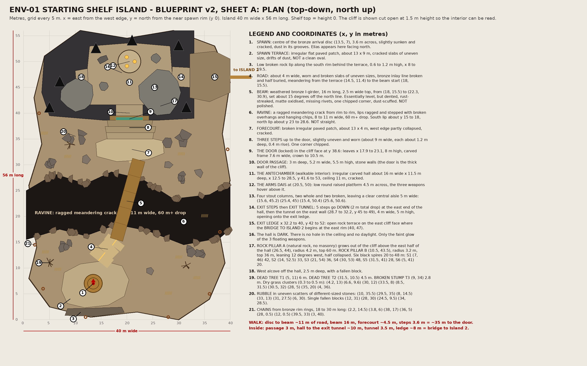
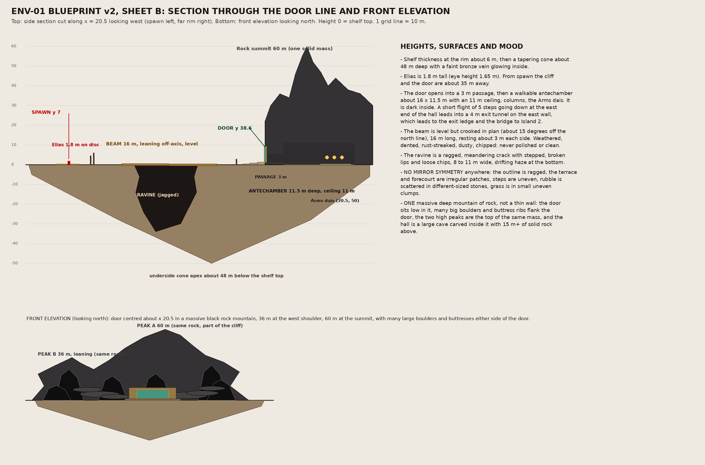

# ENV-01 Starting Shelf Island (LOCKED)

**Units:** metres. **x** = east, 0 to 40. **y** = north, 0 to 56 (0 is the south rim where the player starts). **Height 0** = the top of the island.

## 1. What this island is
1. A floating island of dark rock, 40 m wide and 56 m long.
2. The player starts at the south end.
3. One big rock mountain stands at the north end. The bronze door is at the foot of it.
4. The player goes through the door, into a big cave room, then down steps to an exit tunnel.
5. The tunnel leads to a bridge to the next island (ENV-02).

## 2. The player's route
Follow the steps in order. "Build" tells you what to make.

1. **Start.** Elias stands on a round bronze disc. The camera looks toward the door.
   - **Build:** the spawn point. Add soft invisible walls at the edge so he cannot fall by mistake.
2. **Follow the road.** A thin bronze line in the broken road leads to the beam. There is no marker and no arrow.
   - **Build:** a line mesh that does not glow.
3. **The crack.** The ground ends at a deep crack. If he falls, he returns to the disc.
   - **Build:** crack collision, a kill volume far below, fog.
4. **The beam.** A rusty steel beam lies across the crack. It is level and safe to walk on.
   - **Build:** a static mesh. Make the walk area a little wider than the beam. No rails.
5. **The forecourt and steps.** Broken stone ground, then a few worn steps up to the door. The bronze line goes up to the door.
   - **Build:** the ground, the steps and the bronze line.
6. **The locked door.** A bronze double door in the mountain. Chains and one padlock hold it shut. A thin amber line shows between the two doors.
   - **Build:** a door with 3 states: Locked, Unlocked, Open.
7. **Unlock.** Elias stands still in front of the door. The Cinder stays above him and glows. The padlock opens. The chains fall onto the steps. See section 3.
   - **Build:** a trigger at the top step, a hold-still timer, a padlock and chain sequence.
8. **The door opens.** The two doors swing inward. It is dark inside. No light comes out. He walks through a short passage.
   - **Build:** the door animation and the passage.
9. **The cave room.** A big dark room carved inside the mountain. Columns stand in it. There is no daylight. A round platform holds three floating weapons: a bow, a dagger and a spear. Only their faint glow lights the room.
   - **Build:** a dark interior, a very faint glow from the weapons, floating dust, a pickup on the platform.
10. **Down the steps and out.** He walks to the far end of the room. Worn steps go down to an exit tunnel. The tunnel leads out to a rock ledge.
    - **Build:** the steps, the tunnel and the ledge.
11. **The ledge fight.** On the ledge, leeches crawl on the rock. Bat-birds dive at him. He shoots them with his bow. A stone bridge to ENV-02 starts here. When the way is clear, he crosses. The level ends here.
    - **Build:** enemy spawns, the bridge, and a trigger to load ENV-02. See section 8.

## 3. The Cinder and the door
1. The Cinder is Elias's fire companion. He has it from the start of the game.
2. It is a small floating fire core, about the size of his head. It has an ember centre and a bronze frame.
3. It floats near his shoulder. It does not speak. It is not a pet.
4. On this island it is dim and quiet.
5. It moves toward the right direction and gets a little brighter when he moves well.
6. When he stands still, it stops moving and stays in place. It gives a low hum.
7. At the door, he stands still on the top step for a few seconds.
8. The Cinder stays above him and glows brighter.
9. The padlock opens by itself. The chains slide off and fall on the steps.
10. The two doors swing inward slowly. Elias does not push them.
11. It is dark inside. The Cinder stays with him as he walks in.
12. If he moves too early, the timer starts again.

## 4. Door states
| State | What you see | What the player can do |
|---|---|---|
| Locked | Chains crossed, padlock closed | Walk up to it only |
| Unlocked | Chains and padlock on the steps | See that the way is open |
| Open | Doors swung in, dark inside | Walk in |

## 5. Main sizes
| Part | Size | Place |
|---|---|---|
| Island | 40 x 56 m, 6 m thick at the rim | whole map |
| Underside | rock cone, 48 m deep | below the island |
| Road to the beam | 11 m | from the disc |
| Beam | 16 m long, 2.5 m wide | (18, 15.5) to (22.3, 30.9) |
| Crack | 8 to 11 m wide, 60 m+ deep | y 15 to 31 |
| Forecourt | 13 x 4 m | y 31 to 35 |
| Steps to the door | 3 steps, 9 m wide | y 35 to 38.6 |
| Walk from start to door | about 35 m | |
| Door | 8 m high, 5.2 m wide | y 38.6, x 17.9 to 23.1 |
| Door passage | 3 m long | y 38.6 to 41.6 |
| Cave room | 16 x 11.5 m, 11 m high | x 12.5 to 28.5, y 41.6 to 53 |
| Weapons platform | 4.5 m round, 0.4 m high | (20.5, 50) |
| Steps down | 5 steps, 5 m wide, 2 m total drop | east end of the room |
| Exit tunnel | 4 m wide, 5 m high | east wall, y 45 to 49 |
| Exit ledge | open rock | x 32.2 to 40, y 42 to 52 |
| Bridge start | | (40, 47) |

## 6. Rock rules
1. The mountain, the peaks and the outcrops are all one dark brown-black rock. Use one rock material.
2. The mountain is thick and solid, with the cave room carved inside it. There is 15 m or more of rock above the room.
3. The mountain is made of many big boulders, slabs and ribs. Many large rocks stand next to the door.
4. Nothing on the mountain is built. No bricks, no windows, no towers, no battlements.
5. Do not make it symmetrical. The edge is ragged. The stones are different sizes.
6. The beam is rusty, dented and never clean.

## 7. Sounds and mood
The island is quiet, large and alive. Sound tells the player where they are.

### Always on
1. Wind. Low and slow. It never stops.
2. Clouds and fog. A soft, deep air sound. Fog drifts over the crack and around the rim.
3. Fire, here and there. A few small amber fires burn on the island. Each has a soft crackle you hear only when you are near.
4. Birds far away. Dark shapes circle in the distance. You hear a cry now and then.
5. Leeches. A dry scratching sound on the rock, in a few places.

### Chains
The chains are heavy iron. They make small, low sounds.
1. Each chain plays one quiet, heavy clink at its own place.
2. Wait 3 to 9 seconds (random) between clinks. Never make a rhythm.
3. In a gust of wind, make the clinks a little closer and louder, then calm again.
4. The player hears a chain from 12 m. Past 25 m it is almost silent. Under the island it is louder.
5. Door chains: a soft creak while the player is on the forecourt. When the padlock opens, play one heavy chain drop onto the steps. No music.

## 8. Enemies and the bow
1. Elias gets the bow from the platform in the cave. Before that he has no weapon.
2. Outside, before the cave, nothing attacks him. Birds circle far away. Leeches crawl far away on the cliff. They are only life and mood.
3. After he picks up the bow, enemies can attack. The fight happens on the exit ledge and the bridge.
4. **Leeches.** Small, dark, armoured crawlers. They creep on the rock and the bridge. One arrow stops one leech.
5. **Bat-birds.** Large, dark birds with wide bat-like wings. They dive from above, then pull away. Elias must shoot them. They come in short attacks, not all the time.
6. **The bow.** Rush and spam give weak, ordinary arrows. Stand still and aim, and the arrow burns with fire and hits harder.
7. Enemies do not follow him across the bridge into ENV-02.

## 9. Blueprint pictures

## 10. Notes for builders
1. The pictures are looks only. If a picture and these numbers disagree, use the numbers.
2. **Inside the cave it is dark.** When he enters, there is no light. Only the weapons glow, very faintly.
3. Details 2 and 3 show ruined buildings with windows in the background. Ignore them. Build raw rock only.
4. The hero, the underside picture and detail 4 show a small arched stone door on the cliff. Ignore it. The exit tunnel is a plain rough hole.
5. Detail 13 may show skeletons. Do not build them.
6. The top view shows a round pit on the west side. Do not build it.
7. The bridge to ENV-02 is stone with chain rails, as in detail 13.
