# 20. ENV-01 developer walkthrough (what happens, step by step)

For Unreal Engine 5 builders. Map and coordinates are in `docs/19-env01-blueprint.md` (metres, x east 0-40, y north 0-56, shelf top z = 0). Reference images are in `art/assets/ENV-01/`. Steps marked PROPOSED need owner approval.

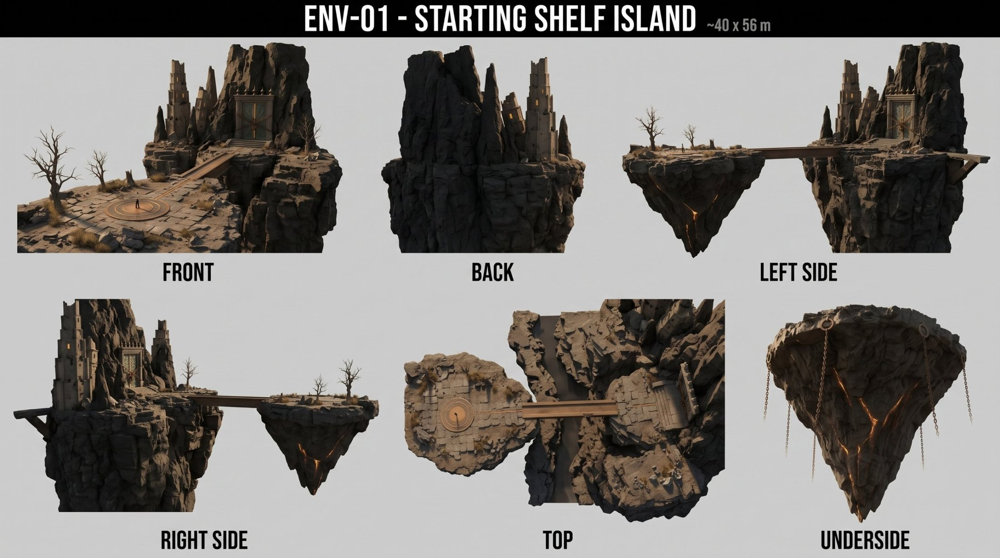

## The player's path in 10 steps

**1. Arrival (about 0 s).** Elias appears standing on the arrival disc at (13.5, 7): three bronze rings, 3.6 m across, slightly sunken and cracked. Camera looks north. The terrace around it is broken slabs, two dead trees and dry grass. The rim is open air; chains hang from rim rings (see the underside). No enemies, no UI prompt yet. Build: spawn point, soft invisible rim colliders so he cannot fall off by accident.
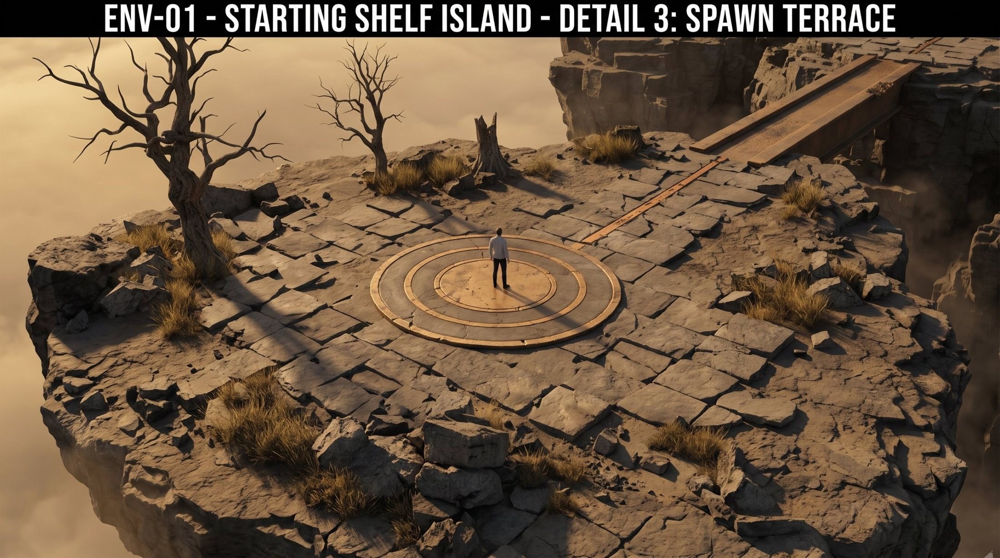

**2. Follow the road (11 m).** A thin bronze line is inlaid in the broken road and runs from the disc toward the beam at (18, 15.5). It is the only guide: it tells the player where to go without a marker. Build: decal or inlay mesh with emissive off at rest.

**3. The ragged crack (8-11 m wide, 60 m+ drop).** The terrace ends at a jagged ravine with stepped lips. Falling is a respawn at the disc. Build: ravine collision, kill volume far below, fog fill.
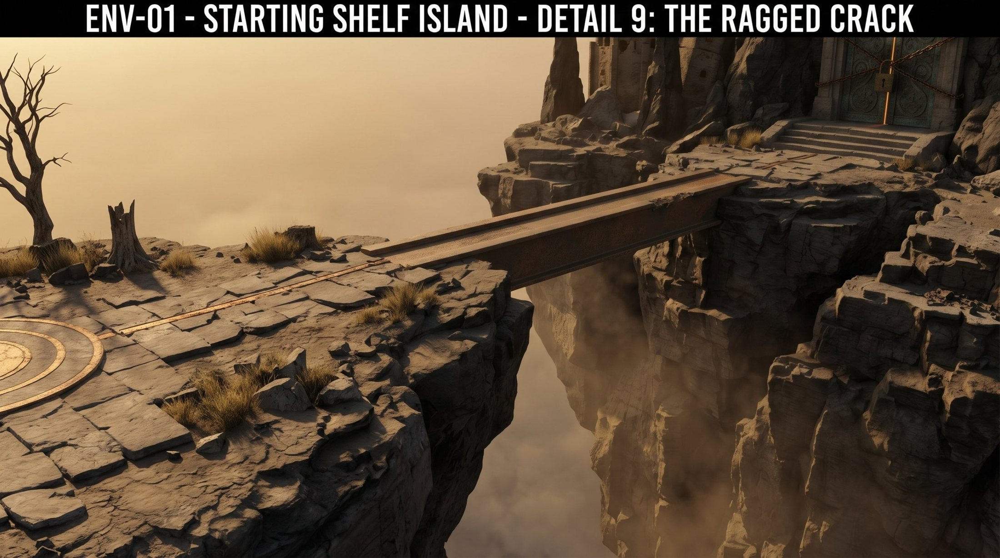

**4. Cross the weathered beam (16 m long, 2.5 m wide).** A level, crooked, rust-streaked steel beam from (18, 15.5) to (22.3, 30.9), about 15 degrees off north. It is level and safe to walk (no balance mini-game). Build: static mesh, walkable collision slightly wider than the visible beam, no rails.
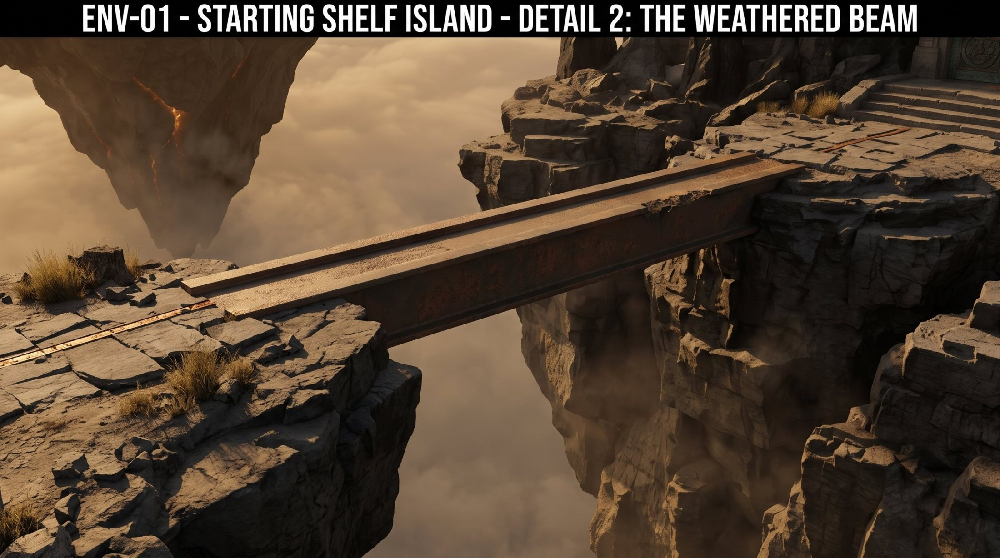

**5. Forecourt and steps (y 31 to 38.6).** An irregular broken forecourt about 13 x 4 m, then 3 worn steps (9 m wide, 1.2 m deep, 0.4 m rise). Rubble is scattered, not piled. The bronze inlay line continues up to the door.
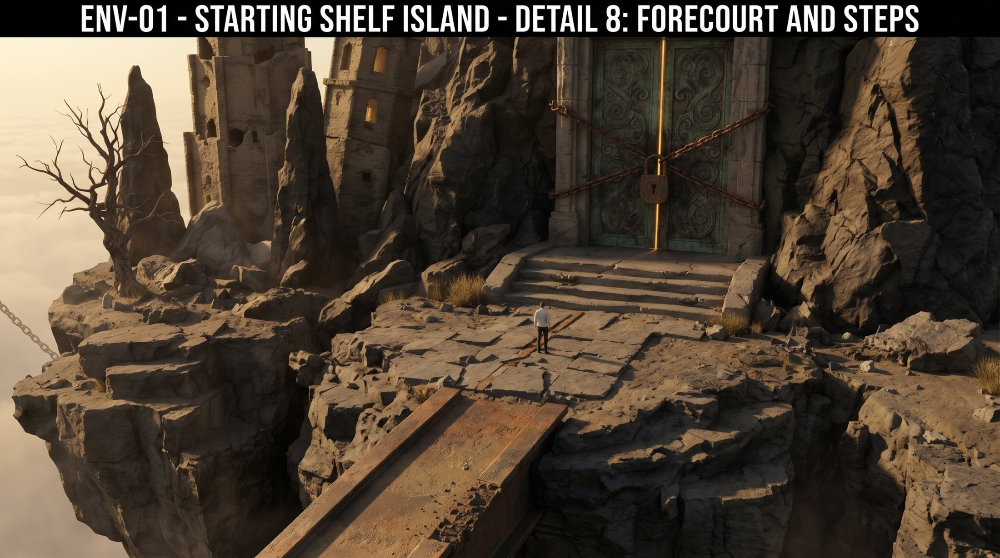

**6. The locked door.** Double bronze door in the cliff face at y 38.6, x 17.9 to 23.1 (leaves 5.2 m wide, 8 m high, frame 7.6 m, five finials, crown 10.5 m). Crossed rusty chains and one padlock hold it; a thin amber line shows between the leaves. The door cannot be opened by force. Two broken towers (A at (26.5, 44), 60 m; B at (10.5, 43.5), 36 m, leaning west) grow out of the cliff beside it, with a few lit windows. Build: door actor with states Locked, Unlocked, Open.
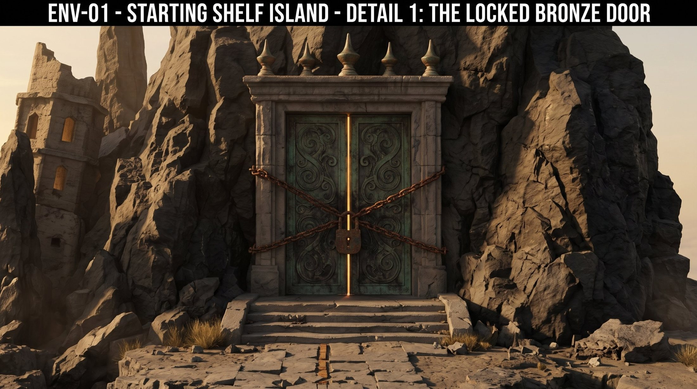
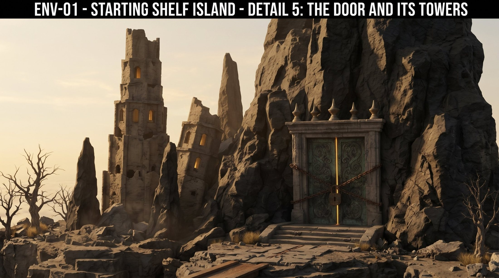

**7. Unlock (PROPOSED: stillness mechanic).** The player stands still in front of the door for a few seconds; the Cinder (his companion fire) answers, the padlock opens and the chains fall to the steps. The amber line brightens. Build: trigger volume at the top step, a hold-still timer, a sequence for padlock and chain drop. State becomes Unlocked.
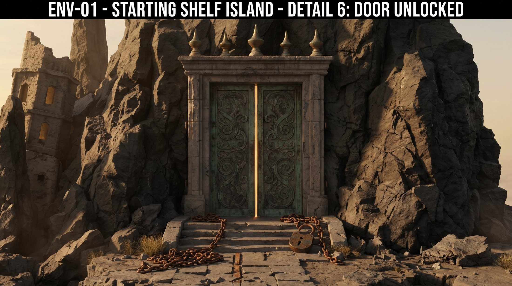

**8. The door opens, he walks in.** The two leaves swing inward, warm dusty light spills out. He walks through a 3 m deep passage (y 38.6 to 41.6). State becomes Open. Chains and the padlock stay on the steps as set dressing.
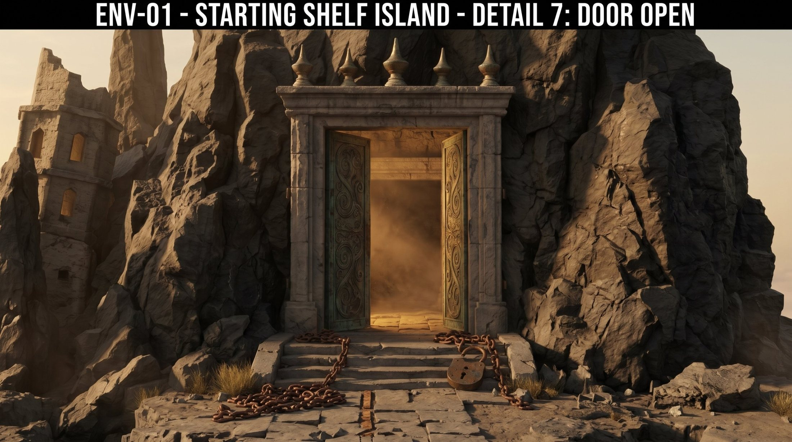

**9. Antechamber (PROPOSED: interior is walkable).** A room about 16 x 11.5 m, ceiling 11 m (x 12.5 to 28.5, y 41.6 to 53). Four columns, two whole and two broken, and a 3.6 m hole in the ceiling at (19, 47.8) that lets in one shaft of light with floating dust. At (20.5, 50) a round dais 4.5 m wide and 0.4 m high holds the Arms: a bow, a dagger and a spear floating above it. Build: interior level streamed in or sublevel, one directional light shaft, volumetric dust, pickup interaction on the dais.
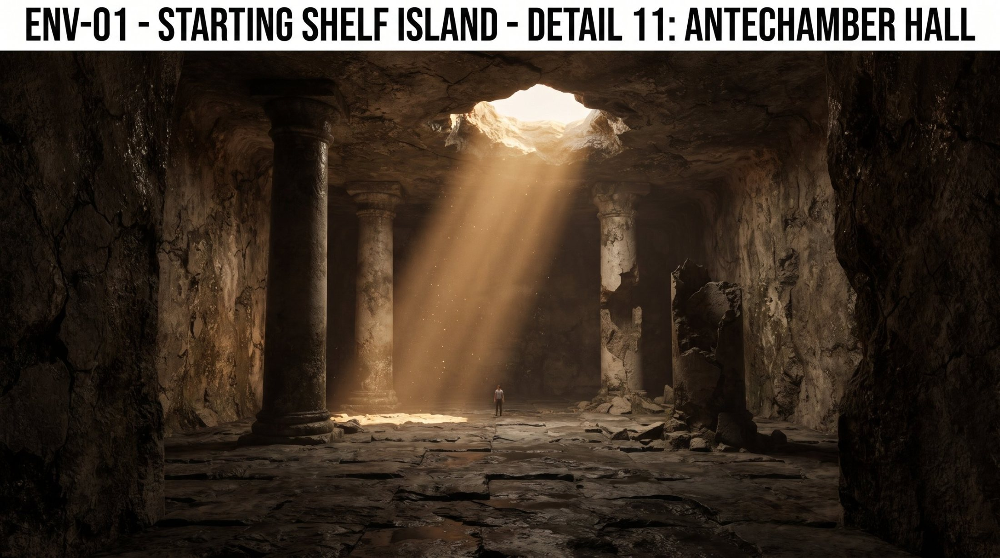
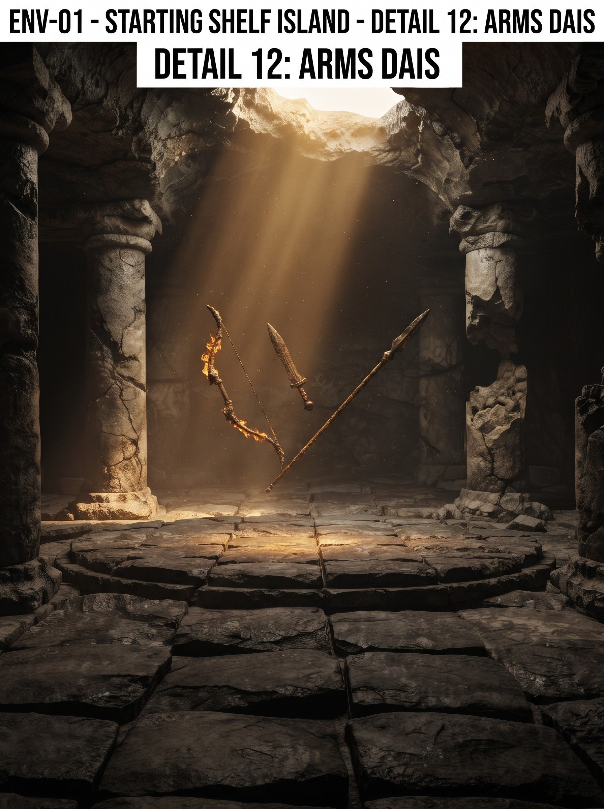

**10. Exit tunnel, ledge and bridge (PROPOSED).** A tunnel 4 m wide and 5 m high leaves the east wall (y 45 to 49) and opens onto a rock terrace (x 32.2 to 40, y 42 to 52). A chain-and-post rail marks the edge and a stone bridge head leaves at (40, 47) toward Island 2. This is where the level ends; load or stream ENV-02 here.
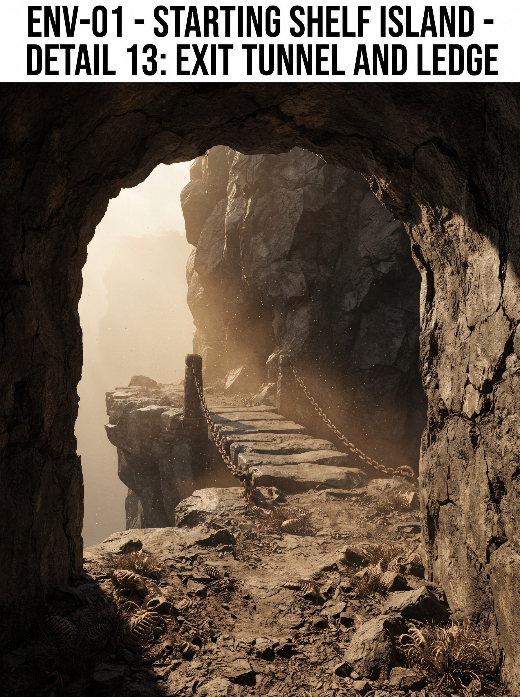

## Things that are always there (not part of the path)
- **Towers and spires:** the towers and six rock spires (heights 20 to 48 m) grow out of the cliff behind the door. Spire positions are in the table in doc 19.

- **Underside:** an inverted rock cone with glowing ember cracks, hung by chains from rim rings (C1 to C8 in doc 19). Visible from below and in the far camera shots. Build: static mesh with emissive crack material, chain meshes with light sway.
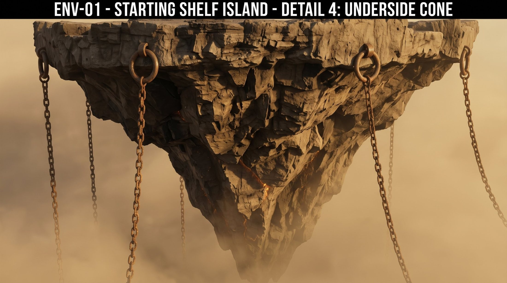
- **Rim props:** dead trees, stumps, dry grass, rubble, bronze rim ring with hanging chain. Scatter by hand using the positions in doc 19.
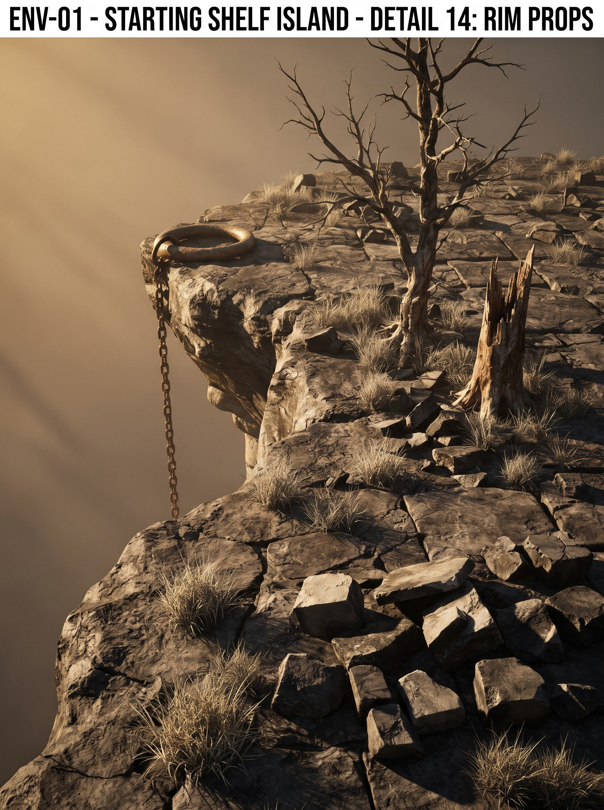

## State summary for the door
| State | Visual | Player can |
|---|---|---|
| Locked | chains crossed, padlock closed, amber line thin | nothing, approach only |
| Unlocked | chains and padlock on the steps, leaves closed, line bright | see the way open |
| Open | leaves swung in, warm light inside | walk into the antechamber |

## Image notes for the builders
- Filed images are Gemini renders. Treat them as look and layout references; the numbers in doc 19 win if an image disagrees.
- Detail 13 shows small animal skeletons on the ground; they are not in the design, so leave them out or use sparingly.
- Detail 10 (towers on the cliff) is not filed yet; detail 5 covers the towers for now.
- Detail 12 has a duplicated title bar; the content is usable but the image should be regenerated for the gallery.

## Audio: the chains (builder note)
The chains hang from the rim rings (C1 to C8 in doc 19) and from the underside. They are **heavy iron**, not light jewellery chain.
- Constant bed: a low, slow wind through the chasm, with the chains moving only a little.
- Chain loop: each hanging chain plays a quiet, heavy link-on-link clink, spatialised at the chain's position, with long random gaps (3 to 9 seconds) so it never sounds like a rhythm. Pitch low, never a jingle.
- Gusts: when the wind rises, the clinks come a little closer together and a little louder, then settle. Sway is small and slow (a few degrees), never swinging freely.
- Door chains (locked state): a faint tighter creak and clink while the player is on the forecourt. When the padlock opens, one heavy drop-and-slide of chain onto the steps (no music sting).
- Distance: audible from about 12 m, nearly silent past 25 m. Under the island the chains are louder because the player hears them from below.
