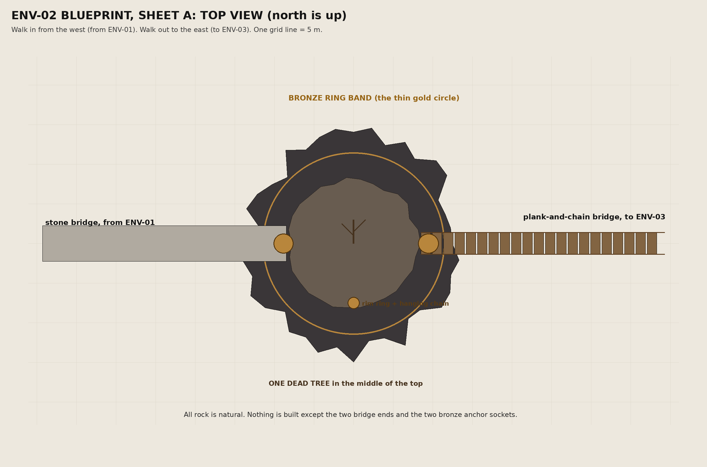
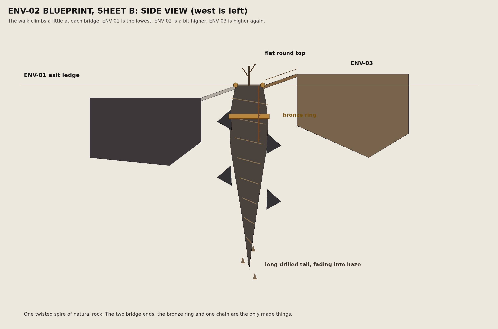

# ENV-02 Small Stepping Island

**Units:** metres. Height 0 is the top of the island.

## 1. What this island is
1. A small floating spire of twisted rock. It is a stepping stone between ENV-01 and ENV-03.
2. The player comes in from the west on a stone bridge. He leaves to the east on a plank-and-chain bridge.
3. The top is a small flat round pad. One dead tree stands in the middle.
4. A bronze ring is wrapped around the spire, below the top. One heavy rusted chain hangs from the rim.
5. It is a quiet place. It is a rest after the fight on the ENV-01 ledge.

## 2. The player's route
Follow the steps in order. "Build" tells you what to make.

1. **Arrive.** Elias walks off the stone bridge from ENV-01 onto the pad. The bridge climbs a little.
   - **Build:** the bridge end, a bronze anchor socket, a gentle slope, soft invisible walls at the edge.
2. **Catch his breath.** The birds and leeches from ENV-01 stay behind. The pad is small and the sky is wide. The camera pulls back a little to show the drop.
   - **Build:** a danger edge around the pad. If he falls, he returns to the pad. Fog around the tail.
3. **The big bird.** A big bat-bird comes in low from the north, passes over the pad once and circles away. It never touches him. If he stays still, it passes calmly. If he runs or shoots, it dives closer and kicks up dust, then leaves anyway.
   - **Build:** a bird flight path over the pad, a trigger on the pad, a gust of wind, dust on the rock, a small camera shake, one long cry. The bird does no damage and has nothing that pushes him.
4. **Look east.** ENV-03 is to the east, a little higher. A far lantern anchor stands dim in the distance. The Cinder drifts toward it and glows a little brighter.
   - **Build:** a trigger on the pad that moves the Cinder toward the east. The lantern anchor is visible far away.
5. **Cross east.** He walks onto the plank-and-chain bridge at the east edge. It creaks and the chains tick, but it holds. It climbs a little again.
   - **Build:** the bridge, a second bronze anchor socket, creak and chain sounds, and a trigger to load ENV-03.
6. **The way on.** He arrives on ENV-03. The first calm place is there.

## 3. In and out
| | Side | Bridge | Goes to |
|---|---|---|---|
| In | West | Stone bridge | From the ENV-01 exit ledge |
| Out | East | Plank-and-chain bridge | To ENV-03 |

1. Both bridge ends have a small bronze anchor socket.
2. The way back to the west stays open. Nothing is locked here.
3. Nothing on this island needs a button press.

## 4. What the player learns here
1. The world goes up, one island after another.
2. The Cinder shows the way. There is no arrow and no marker.
3. If he runs, dust lifts and a faint noise grows. If he walks, it stays quiet.
4. A big shape in the sky is not always a danger. If he stays calm, it passes.

## 5. Main sizes
| Part | Size |
|---|---|
| Island, widest point | about 12 m |
| Top pad | about 7 m across |
| Spire depth | about 46 m |
| Bronze ring | about 8 m below the top |
| Height above ENV-01 | about 3 m |
| ENV-03 above this island | about 3 m |
| Bridge in and bridge out | about 12 m each |

## 6. Rock rules
1. The spire is the same dark brown-black rock as ENV-01. Use the same rock material.
2. It is built from big broken slabs that wind around the spire like a slow whirlwind. Thin lighter seams run between them. Nothing is straight or smooth.
3. Nothing is built. No walls, no windows, no arches, no towers.
4. The only made things are the bronze ring, the two anchor sockets, the two bridge ends and one chain.
5. Do not make it symmetrical. The edge is ragged.

## 7. Sounds and mood
1. Wind. Softer here than on ENV-01.
2. Clouds and fog. A soft, deep air sound.
3. The dead tree gives a dry rustle in gusts.
4. One heavy chain hangs from the rim. It makes a small, low clink now and then, like the chains on ENV-01. Chains on the east bridge tick in the wind. Planks creak when he steps on them.
5. The big bat-bird gives a long, low cry. Then comes the heavy flap of leather wings as it passes. The wind gusts and dust hisses on the rock.
6. Later, one bird cries far away now and then.
7. No music.

## 8. Enemies
1. Nothing attacks him here.
2. The leeches and bat-birds from the ENV-01 ledge do not follow him across the bridge.
3. The pad is small. A fight here would knock him off the edge.
4. One big bat-bird flies low over the pad once. Its wings are about as wide as the whole island, bigger than the bat-birds on ENV-01.
5. It never touches him and never pushes him toward the edge. It does no damage.
6. If he stays still, it passes calmly and circles away. If he runs or shoots, it dives closer and kicks up dust, then leaves anyway.
7. It plays once. After that, it circles far away in the sky.
8. Do not build a real fight here. A real fight with a big bird belongs on a later island.

## 9. Blueprint pictures

## 10. Notes for builders
1. The pictures are looks only. If a picture and these notes disagree, use the notes.
2. The bridges are fixed and weathered. They never break.
3. The big bat-bird has its own picture. Use it for the look and the size. Its wings are leather, never feathers.
4. In the pictures, the west stone bridge end looks light grey. Make it weathered and darker, to match the rock.
5. The two anchor sockets look like short bronze posts. Any simple socket shape is fine.
6. Hang the heavy chain on the east edge, close to the bridge socket.
7. The sizes are a starting point. Change them to fit the level.
