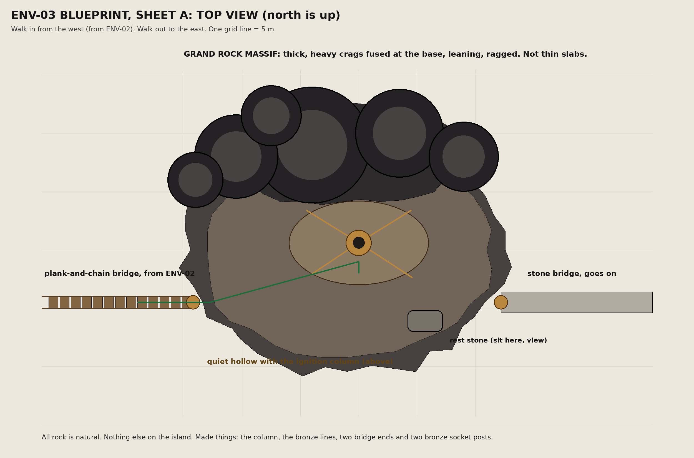
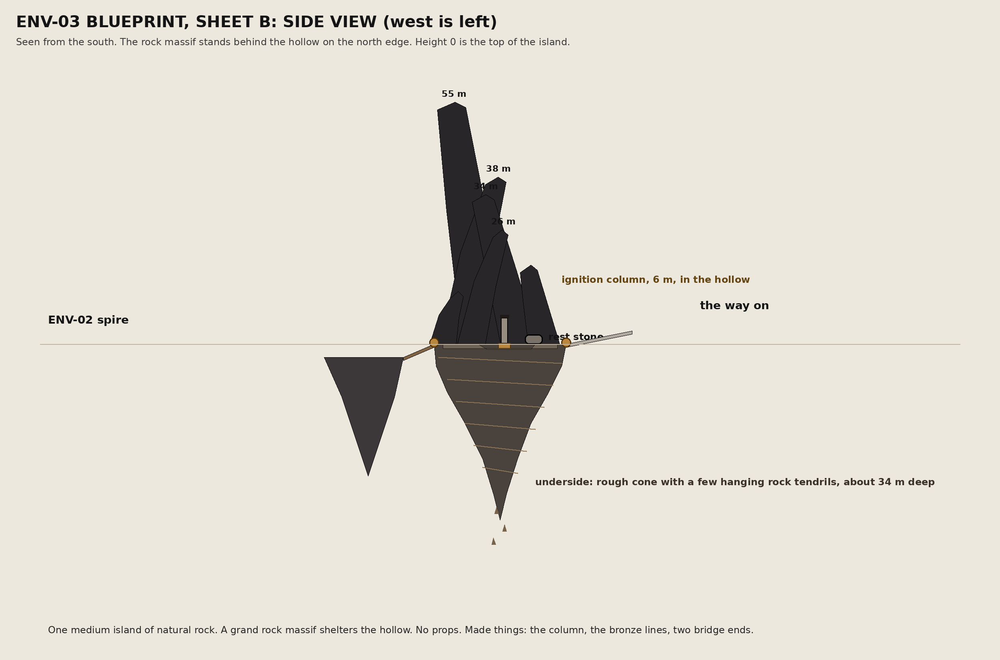

# ENV-03 Medium Island with Windbreak

**Units:** metres. Height 0 is the top of the island.

## 1. What this island is
1. A medium floating island of dark rock, about 30 m wide.
2. One connected crest of huge natural rock spires rises along the north edge. It is crooked and grooved by wind, with needles of very different sizes: extra tall, tall, medium and small. The tallest is about 55 m.
3. In front of the spires the top dips into a small quiet hollow. One stone column stands in it. This is the first ignition column.
4. The player comes in from the west on the plank-and-chain bridge. He leaves to the east on a short stone bridge.
6. A flat-topped rest stone sits on the south-east rim. From it the view is wide and beautiful. He can sit there and catch his breath.
7. It is the first calm place. Nothing attacks him here.

## 2. The player's route
Follow the steps in order. "Build" tells you what to make.

1. **Arrive.** Elias walks off the plank bridge onto the island. The wind is loud and he hears it hit the spires.
   - **Build:** the bridge end, a bronze anchor socket, a gentle slope, soft invisible walls at the edge.
2. **See the spires.** The crest of spires rises on his left. The extra tall needle goes up out of sight. The Cinder drifts toward the hollow in front of them.
   - **Build:** a camera that tilts up a little when he walks in. A trigger that moves the Cinder toward the hollow.
3. **Enter the hollow.** The wind drops. The air goes quiet. Thin bronze lines in the floor lead to the column.
   - **Build:** a quiet zone with its own sound. The wind sound is gone inside the hollow.
4. **Stand still.** He stands still for a few seconds. The last noise fades. The column is dark and does nothing yet.
   - **Build:** a calm check. If he stays still for 2 seconds, the noise clears and the column wakes a little.
5. **Face the column.** He faces it and holds still. The Cinder glows brighter above him.
   - **Build:** a hold trigger in front of the column. It needs 2.5 seconds.
6. **The column lights.** Fire catches in the bowl. The bronze lines in the floor light up one by one. The first bar at the bottom of the screen lights.
   - **Build:** a fire in the bowl, a glow that runs along the bronze lines, and the first bar of the bottom line lighting up.
7. **Rest.** The rest stone sits on the south-east rim. He can walk up and sit on it. The camera pulls back to show the far islands. The wind goes soft. The Cinder glows calmly. He gets up when he wants.
   - **Build:** a sit point on the stone, a sit and stand animation, a wide camera while he sits, softer wind and sound. Sitting is never required.
8. **Cross east.** He walks to the east edge and onto the short stone bridge. It leads on.
   - **Build:** the bridge, a second bronze anchor socket, and a trigger to load the next place.

## 3. In and out
| | Side | Bridge | Goes to |
|---|---|---|---|
| In | West | Plank-and-chain bridge | From ENV-02 |
| Out | East | Short stone bridge | To the next place |

1. Both bridge ends have a small bronze anchor socket.
2. The way back to the west stays open.
3. He can leave before he lights the column. The column stays dark until he does it.

## 4. What the player learns here
1. Standing still is how things happen in this world.
2. The wind is loud outside. It is quiet where the rock shelters you.
3. The Cinder glows more when he is calm.
4. Resting is allowed. A quiet moment is part of the way.
5. Living things here are not enemies. If he stands still, they stay calm.

## 5. Main sizes
| Part | Size |
|---|---|
| Island, widest point | about 30 m |
| Underside, depth | about 34 m |
| Extra tall spire | about 55 m above the top |
| Tall spires | about 38, 34 and 26 m |
| Medium spires | about 18 and 12 m |
| Small stubs and broken blocks | about 10, 8 and 6 m |
| Rest stone | about 3 m wide, about 1 m high, on the south-east rim |
| Hollow | about 12 m across, about 1 m below the top |
| Ignition column | about 6 m tall |
| Height above ENV-02 | about 3 m |
| Bridge in and bridge out | about 12 m each |

## 6. Rock rules
1. Same dark brown-black rock as ENV-01 and ENV-02. Use the same rock material.
2. The spires are natural rock. They share one rough base and overlap. They are tall crooked shards and slabs of fractured rock, heavy at the base and narrowing unevenly, with ragged outlines, ledges, split faces and deep cracks. Every one leans at a different angle, some about 10 degrees and some about 25 degrees. Two lean against each other. Fallen chunks and scree lie at their feet. Their faces have long deep wind grooves.
   - Never straight. Never smooth. Never neat blocks stacked like bricks. Never a sharp cone or icicle. Never a neat row of separate pillars.
   - The rock is dry and dead. No green moss.
3. Nothing is built. No towers, no buildings, no walls, no windows, no arches, no stairs.
5. Make the sizes very different, so the crest looks like a real broken mountain: one extra tall needle, a few tall ones, some medium ones, and small stubs and blocks at the foot.
6. Do not make it symmetrical. The edge is ragged.

### No props

2. Do not add anything without asking.

### The rest stone
1. The rest stone is a natural flat-topped boulder with a worn smooth top. It is not carved and not a bench. It faces the open sky and the far islands.

## 7. Sounds and mood
1. Outside the hollow: loud wind. It howls low between the spires.
2. Inside the hollow: no wind. A soft, deep quiet.
3. Chains tick on the west bridge. Planks creak.
4. When the column lights: a deep whoosh, then soft crackling fire. The bronze lines hum.
5. No music until the column lights. Then a soft low tone starts.

## 8. Enemies
1. Nothing attacks him here.
2. The big bat-bird from ENV-02 is far away. It does not come.
5. Do not add a fight on this island.

## 9. How it connects
1. Order of play: ENV-01, ENV-02, then **ENV-03**, then the moving platforms (ENV-11), then ENV-04.
2. Height here is about +6 m above ENV-01. This is the top of the first tier (the Shelf).
3. **In (west).** The plank-and-chain bridge (STR-07) from ENV-02, about 12 m long. It ends at a bronze anchor socket. The windbreak spires are on the north side, so the bridge end is in their shelter. A free-floating rock blade (ENV-13, [doc 39](39-env13-blueprint.md), proposed) floats north of the bridge and makes a calm pocket on it.
4. **Out (east).** A short stone bridge, about 12 m long, near the monolith slab at the east edge. It leads to the first moving platform (ENV-11). This is the start of Stage 2.
5. He can leave before he lights the column. The column stays dark until he does it. The first calm place is behind him.
6. The way back west stays open.
7. After this island the bridges stop being the main link. The next gaps are crossed on moving platforms that rise from +6 m to +10 m. They need timing.

| From | To | Link | Gap | Height change |
|---|---|---|---|---|
| ENV-02 east | ENV-03 west | Plank-and-chain bridge | about 12 m | up about 3 m |
| ENV-03 east | ENV-11 platforms | Short stone bridge, then moving platforms | about 12 m, then 4 platforms | up about 4 m in total |

## 10. Blueprint pictures

## 11. Notes for builders
1. The pictures are looks only. If a picture and these notes disagree, use the notes.
2. The spires are the main shape. Make them tall. Make the player feel small next to them.
3. The sizes are a starting point. Change them to fit the level.
4. The bridges are fixed and weathered. They never break.

### Rock rule, updated

1. The rock is one grand massif: a very wide base and five or six huge, thick crags, fused together.
2. Each crag is thick, about one third as wide as it is tall. Not thin slabs, planks, fins or teeth.
3. The biggest crag is about 55 m, almost twice as high as the island is wide. It dominates. The others are 38, 34, 26, 18 and 12 m. The skyline must be uneven: one extra tall spire, two or three tall ones, medium ones and low shoulders.
4b. In pictures they must look like towering Dolomite spires: long, tapering, fluted, ragged. Not short blunt boulders.
4. They lean at different angles. Ragged, with ledges, overhangs and deep cracks.

## Known picture differences (developers decide)
1. In the front picture, the east stone bridge end is not drawn. It is on the east edge, as in the top and back pictures.
2. In detail 3, the column is chunkier, with a wider bowl and green-gold trim. For its shape, use the sheet and detail 2: a thin stone shaft, a bronze base and a small bowl.
3. Detail 1 shows 7 or 8 crags in a row. For the number and the order of the crags, use the sheet: 5 or 6 crags in one cluster, the tallest on the west.
4. For everything else, the sheet and the blueprint pictures win.
