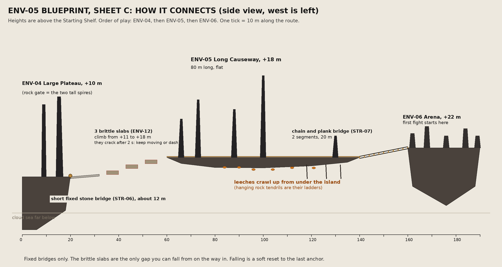

# ENV-05 Long Causeway Island

> **ATTENTION BUILDERS:** the 10 pictures have known mistakes. Read section 12 before you build. The three blueprint sheets win over the pictures.

**Units:** metres. Height 0 is the top of the island.

## 1. What this island is
1. One very long, thin, blade-like floating island of dark rock. It is 80 m long and 10 m wide: eight times as long as it is wide. It is a thin slab, about 8 m thick in the middle, tapering to both ends.
2. The top is rough, cracked, bare rock, with sheer broken sides. It is not a paved road. One thin bronze line runs down the middle, the whole length.
3. Huge natural rock spires stand along both edges and lean toward each other across the path in pairs, tops almost touching. They are like the rock gate of ENV-04. Heights and spacing are uneven: a pair of 16 m, a pair of 24 m, a gap, a broken pair (south spire 20 m, north stump 5 m), the tallest pair of 34 m, and one low single spire of 9 m.
4. The player arrives at the west end from ENV-04 and leaves at the east end toward ENV-06, the arena.
5. This is the quiet entry of Stage 3. Combat starts at the arena, not here.
6. There are no towers, no columns, no buildings and no props. The only made things are the bronze line and two short rock tongues, one at each end, each with one short bronze post.

## 2. What the player does (the gamer loop)
Follow the steps in order. "Build" tells you what to make.

1. **Arrive.** Elias steps from the short stone bridge end onto the west landing. The wind drops. This is the "pressure silence" before combat. He sees the whole 80 m back ahead of him, and heat shimmer far at the end.
   - **Build:** a small flat landing, a respawn point, a wind and music fade-down trigger.
2. **Walk the line.** He walks east along the bronze line. Two close pairs (16 m and 24 m) frame the start. Every pair he walks between gives a low pulse and a brief shadow, then warm light again.
   - **Build:** a pulse trigger and a light dip between each whole pair. Target time for the walk: about one minute.
3. **The broken pair.** In the middle the north spire has snapped to a stump. Fallen rock narrows the way. The edge here is cracked and trembles (the first sign that edges crumble). Then the first Ember Leeches pull themselves up over the edge from below (see section 9).
   - **Build:** a short stretch where the north edge crumbles. A soft reset to the last point if he falls. No damage. 2 leeches climb up at the edge.
4. **The calm pocket.** Between the tallest pair (34 m) the wind is blocked. He stands still for 2 seconds and the Cinder steadies. The leeches on the rock drop away when he is still. This is the safe place to teach the stillness rule.
   - **Build:** a wind-blocked pocket, 6 m wide, with a stillness check. Leeches nearby drop off the island when the check passes. No pickups.
5. **Last stretch.** The low single spire (9 m) and the narrowing end. The wind rises. The heat glow of the arena grows. More leeches climb up here if he sprints.
   - **Build:** wind rises over the last 15 m. Heat shimmer and light change in the distance. 1 to 3 more leeches, only if he sprints.
6. **Leave.** He steps onto the east rock tongue. The chain and plank bridge (STR-07) leads up to the arena (ENV-06).
   - **Build:** a trigger at the east bridge end to load the arena.

## 3. In and out
| | Side | Way | Goes to |
|---|---|---|---|
| In | West | Short rock tongue, then 3 brittle slabs, then the stone bridge | From ENV-04 rock gate |
| Out | East | Short rock tongue, then a chain and plank bridge | To ENV-06 arena |
| Under | Below | Hanging rock tendrils | Leeches climb up here |

## 4. What the player learns here
1. Silence before a fight is a signal. Slow down.
2. Edges can crumble. Stay on the line.
3. A calm pocket is a place to reset before pressure.

## 5. Main sizes
| Part | Size |
|---|---|
| Island | 80 m long, 10 m wide |
| Underside | thin slab, about 8 m thick, tapering to both ends, a few hanging rock tendrils at the east end |
| Spires, west to east | pair 16 m, pair 24 m, broken pair 20 m + 5 m stump, tallest pair 34 m, single 9 m |
| Positions along the island | -30, -22, -2, +9, +30 (0 is the middle) |
| Gap between the tops of the tallest pair | about 4 m |
| West landing | about 7 m long |
| Rock tongues | about 6 m long each |

## 6. Rock rules
1. The rock is the same dark black-brown fractured rock as ENV-01 to ENV-04.
2. The spires are thick at the base and taper. They are crooked and ragged, with sharp angular faces, deep vertical cracks and broken tops. They are hard fractured rock, not soft or bubbly. They are not evenly spaced.
3. The top is clean, open natural rock. Nothing is laid or piled on it. You can see from end to end.
4. Dry and dead. No grass, no trees, no moss.
5. No towers, no walls, no windows, no stairs.

### No props
1. The island has no props. Do not add anything without asking.
2. The old plan had pylons, lantern posts, plank segments and a tree here. They are NOT in the pictures. Add them in Unreal only after approval.

## 7. Sounds and mood
1. Wind low and thin, almost silent at the start. A soft pulse between each pair.
2. Between the tallest pair the sound is muffled and calm.
3. Over the last stretch the wind and a low heat hum rise.
4. The mood is tense and quiet. The light is warm gold.

## 8. Enemies
1. A few Ember Leeches (3 to 5 in total). They climb up from under the island. The island is not a fight. It is a pressure walk.
2. The first real fight is still at the arena (ENV-06).
3. This is a producer decision. It changes the Stage 3 canon, where leeches only appear in wave 2 at the arena. The Stage 3 files are not changed.

## 9. How it connects
Picture: Sheet C (`art/guide/env05-blueprint-C-connection.png`).

1. Order of play: ENV-04, then ENV-05, then ENV-06.
2. **ENV-04 to ENV-05.** The player leaves the ENV-04 plateau (+10 m) through the rock gate. A short fixed stone bridge (STR-06, about 12 m) leads out.
3. Then 3 brittle slabs (ENV-12) climb from +11 m to +18 m. They crack after 2 seconds. This is the only gap you can fall from on the way in. A fall is a soft reset to the last anchor.
4. The last slab meets the west rock tongue of ENV-05. The causeway is flat at +18 m and 80 m long.
5. **ENV-05 to ENV-06.** The east rock tongue meets a chain and plank bridge (STR-07, 2 segments, 20 m). It rises from +18 m to the arena at +22 m. The arena has chain anchors for it.
6. The island is the long breath between the climb and the fight.

### Leeches (idea from the producer)
1. The island is thin. Below it hang rock tendrils. Ember Leeches (about 40 cm) crawl up them and over the edge.
2. They start under the broken pair and under the last stretch. They never come from the front.
3. They drain the stability of the platform and crack the edge.
4. Stillness for 2 seconds makes them drop away. Sprinting and noisy attacks call more.
5. The thin slab and shaggy underside in the pictures are a good nest for them.
6. Camera: when a leech crests the edge, show it first by sound and a shadow, then the body.

## 10. The three blueprint pictures
1. Sheet A, top view: the strip, the spire pairs, the bronze line, both rock tongues and the calm pocket.
2. Sheet B, side view: the spire heights and the thin slab, plus a small end view of the tallest pair.
3. Sheet C, connection: the route from ENV-04 to ENV-06 with the leech path.
4. Attach Sheet A and Sheet B when you make a new ENV-05 picture.

## 11. Notes for builders
1. The west end is the arrival end. In the pictures the west end is on the left.
2. The spires must be very large next to the island. The tallest pair is 34 m high, almost half as high as the island is long.
3. The first Gemini pictures with round spires looked like soft clay tunnels. The spire pairs replace the spires. This is a proposed change to the old plan (fossil ribs).
4. The pictures may differ a little from this page. Developers decide.

## 12. ATTENTION: fix these when you build
The 10 pictures are a mood reference only. They are wrong in the places below. **Do not copy the pictures here. Build it the way this page says.**

| # | The picture shows | Build it like this |
|---|---|---|
| 1 | 8 to 10 spires per side, in rows | 5 groups only: 16 m pair, 24 m pair, broken pair (20 m spire plus 5 m stump), 34 m pair, one low 9 m spire. See Sheet A. |
| 2 | End-on front and back views with an X-cross of spires at the far end | No cross. Pairs lean toward each other over the path. The gap between the tops of the tallest pair is about 4 m. |
| 3 | A thick shaggy underside | A thin blade, about 8 m thick, with a clean keel. Add hanging rock tendrils only at the east end and under the last stretch. See Sheet B. |
| 4 | No clear rock tongues or bridges | A short flat rock tongue at each end. West: from the stone bridge and slabs. East: to the chain and plank bridge. See Sheets A and C. |
| 5 | The detail-4 post is a plain cylinder | A thin bronze post, one at each tongue end. |
| 6 | Title typos: detail-1 "ISL", detail-4 "ISLD", detail-3 "LONGCAUSEWAY" | Ignore the titles. Use the names in the tracker. |
| 7 | The sheet underside cell is really a side view | Use Sheet B for the underside. |
| 8 | Wide, loaf-like rock in places | The path is 10 m wide. Hard fractured rock with flat angular planes, not soft or bubbly. |

**Always use Sheet A, Sheet B and Sheet C as the truth. If a picture and a sheet disagree, the sheet wins.**
