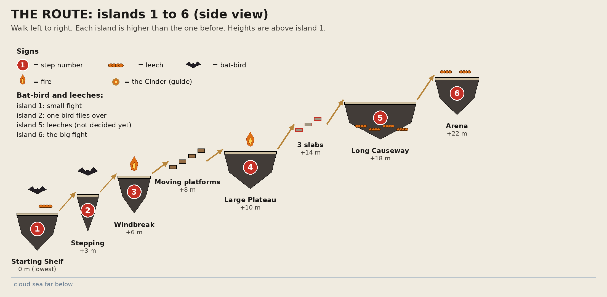
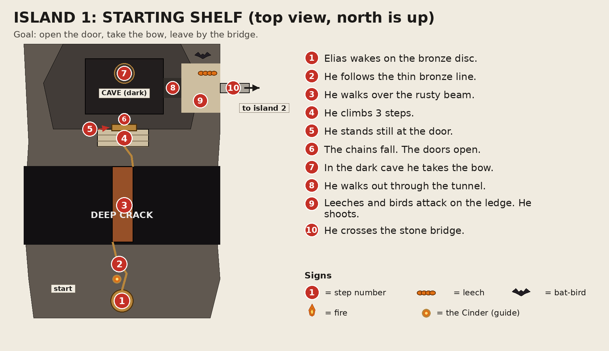
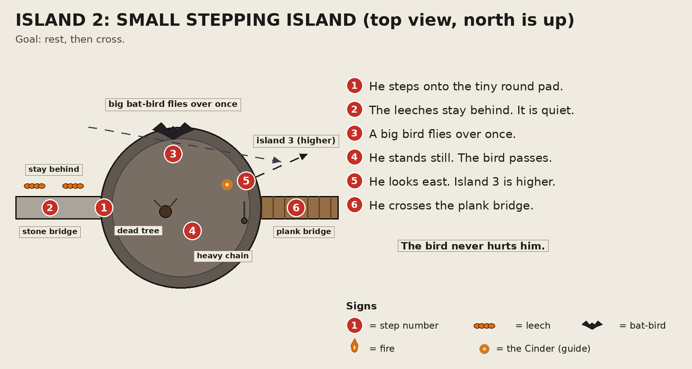
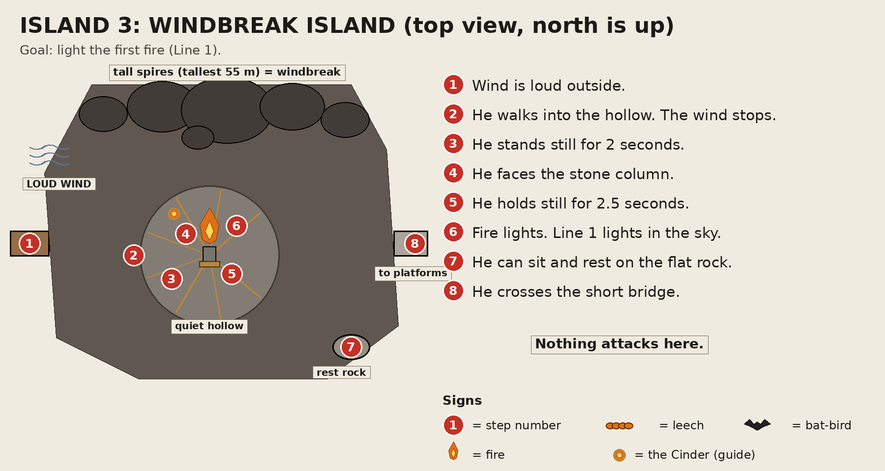
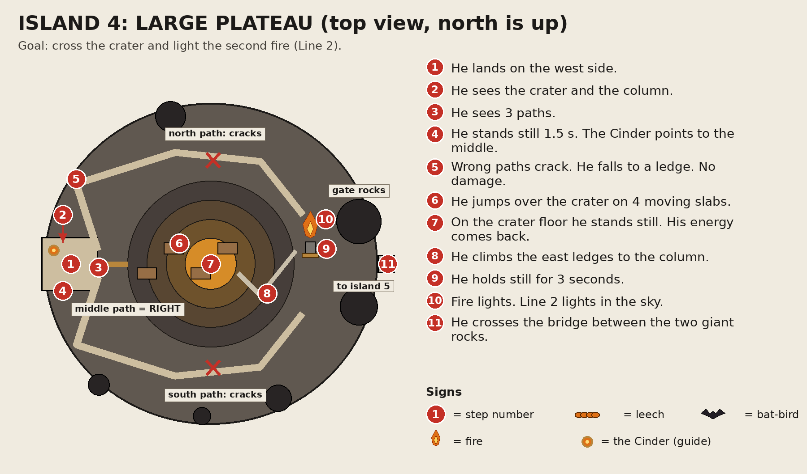
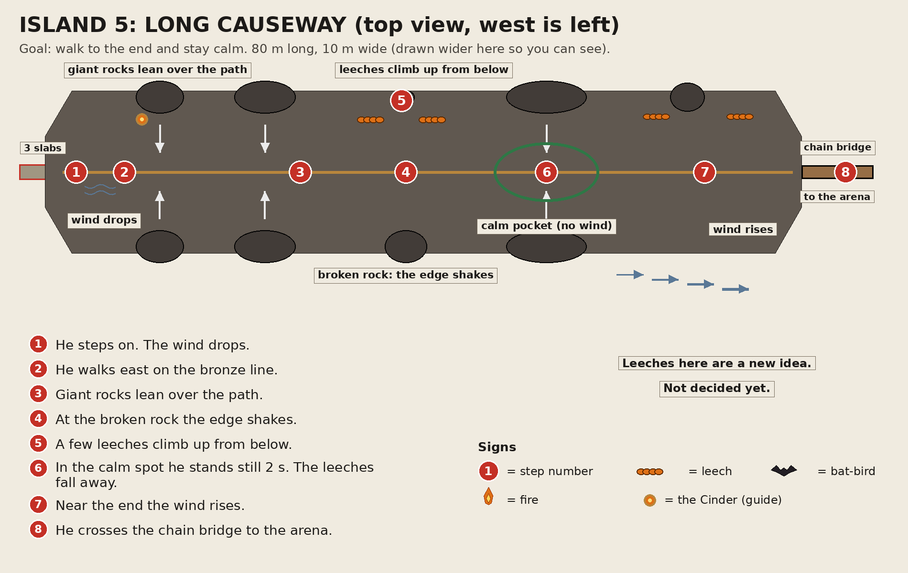

# Playthrough: islands 1 to 5

Elias walks from island 1 to island 5. He always walks **left to right** (west to east). Each island is higher than the one before.

## The rule of the game
1. Rush: the world gets noisy.
2. Stop: the world gets calm.

## Keys
1. **WASD** to move.
2. **F (hold)** to stand still and meditate.
3. **E** to use things.
4. **Space** to dash.
5. No jump until the moving platforms.
6. No health bar. No text on screen.

## The route

The same in words:
1. Island 1. Start.
2. Island 2. Rest.
3. Island 3. First fire.
4. Moving platforms. Learn to jump.
5. Island 4. Second fire.
6. Island 5. Long bridge walk.
7. Island 6. First big fight.

---

## Where are the bat-birds and leeches?
1. **Island 1.** Far away at first. They only decorate the sky and the cliff. After he takes the bow they attack on the ledge and the bridge.
2. **Island 2.** One big bat-bird flies over once. It never hurts him. Leeches stay behind.
3. **Island 3.** None. The bat-bird is far away.
4. **Island 4.** None.
5. **Island 5.** Leeches only (not decided yet). They climb up from under the island. No bat-birds.
6. **Island 6.** Leeches come back with the glass shadows in the arena fight.

---

## Island 1: Starting Shelf
**Goal:** open the door, take the bow, leave by the bridge.

1. Elias wakes on a bronze disc.
2. He follows the thin bronze line.
3. He walks over a rusty beam.
4. He climbs 3 steps.
5. He stands still at the door.
6. The chains fall. The doors open.
7. In the dark cave he takes the bow.
8. He walks out to the ledge.
9. Leeches and birds attack. He shoots them.
10. He crosses the stone bridge.

**He learns:** stand still, and the door opens.

**Build:**
- The disc, the beam, the door, the cave, the ledge, the bridge.
- Details: [doc 19](19-env01-blueprint.md).

---

## Island 2: Small Stepping Island
**Goal:** rest, then cross.

1. Elias steps onto a tiny round pad.
2. The leeches stay behind. It is quiet.
3. A big bird flies over once.
4. If he stands still, it passes.
5. He looks east and sees island 3.
6. He crosses the plank bridge.

**He learns:** calm makes danger pass.

**Build:**
- The pad, one dead tree, one chain, the bird flight.
- Details: [doc 20](20-env02-blueprint.md).

---

## Island 3: Windbreak Island
**Goal:** light the first fire.

1. Wind is loud outside.
2. Elias walks into the hollow. The wind stops.
3. He stands still for 2 seconds.
4. He faces the stone column.
5. He holds still for 2.5 seconds.
6. Fire lights. **Line 1** lights in the sky.
7. He can sit and rest on the flat rock.
8. He crosses the short bridge.

**He learns:** stillness makes things happen.

**Build:**
- The hollow, the column, the rest rock.
- Details: [doc 21](21-env03-blueprint.md).

---

## Moving platforms
1. Four slabs move.
2. Elias jumps from one to the next.
3. They rise to the next island.
4. Not made yet.

---

## Island 4: Large Plateau
**Goal:** light the second fire.

1. Elias lands on the west side.
2. He sees a big crater and a column.
3. There are 3 paths.
4. He stands still for 1.5 seconds. The Cinder points to the middle path.
5. Wrong paths crack. He falls to a ledge. No damage.
6. He jumps across the crater on 4 moving slabs.
7. On the crater floor he stands still. His energy comes back.
8. He climbs to the column.
9. He holds still for 3 seconds.
10. Fire lights. **Line 2** lights in the sky.
11. He crosses the stone bridge between the two giant rocks.

**He learns:** the easy way is not always the right way.

**Build:**
- The crater, 3 paths, 4 slabs, the column, the rock gate.
- Rock only. No towers.
- Details: [doc 22](22-env04-blueprint.md).

---

## Three cracking slabs
1. Three slabs lead up to island 5.
2. Each one cracks after 2 seconds.
3. Elias must keep moving.
4. Not made yet.

---

## Island 5: Long Causeway
**Goal:** walk to the end. Stay calm.

1. Elias steps on. The wind drops.
2. He walks east on the bronze line.
3. Giant rocks lean over the path.
4. At the broken rock the edge shakes.
5. A few leeches climb up.
6. In the calm spot he stands still for 2 seconds. The leeches fall away.
7. Near the end the wind rises.
8. He crosses the chain bridge to the arena.

**He learns:** calm beats panic.

**Build:**
- A thin rock path with 5 rock groups.
- Read the ATTENTION list first: [doc 23](23-env05-blueprint.md), section 12.

---

## Island 6: Arena
1. The first big fight.
2. Not made yet.

---

## Not decided yet
Do not build these yet.

1. The Shadow fight on island 1.
2. Leeches on island 5.
3. The rock gate on island 4.
4. The 3 cracking slabs.
