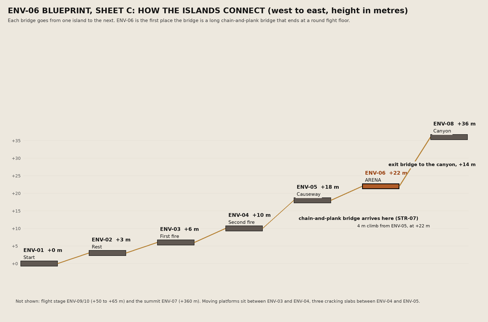

# ENV-06 Arena Island

> **ATTENTION BUILDERS:** the 10 pictures have known mistakes. Read section 12 before you build. The three blueprint sheets win over the pictures. The old Sheet v1 (towers, braziers) is archived and wrong.

**Units:** metres. Height 0 is the floor of the arena.

## 1. What this island is
1. One large round floating island of dark rock. It is 64 m wide. The floor is flat, cracked rock with faint amber light in the cracks.
2. Five great round vents glow ember-orange in the floor. One is near the middle (V1). Four are spread around it (V2 to V5).
3. A low, rough rim of broken rock runs around the edge, like a crater lip. It is 1 to 2.5 m high. It is broken away in several places. There the floor ends in a sheer drop.
4. One tall, thick, natural rock monolith stands near the north-east side. It is 21 m high, about a third of the island width. It leans a little. The player hides behind it.
5. One short stone ignition column (3 m) stands on a round bronze base in the east half.
6. There is a natural gap in the rim at the west end and another at the east end. Each has a short flat rock tongue with two short bronze posts. The west tongue takes the chain and plank bridge from ENV-05. The east tongue is the exit.
7. Under the floor is a thick tapering bowl of rock, 28 m deep. A dull ember glow shines deep inside it.
8. Nothing is built. **No towers. No walls. No braziers.**

## 2. What the player does (the gamer loop)
This is Stage 3: The Toil. About 16 minutes.

1. **Arrive.** He crosses the bridge. The wind drops. It is very quiet. The arena opens ahead.
   - **Build:** a trigger at the west tongue. Fade wind and music down.
2. **Wave 1.** Two Glass Shadows appear. He fights.
   - **Build:** 2 enemies. Splitting if the player spams.
3. **Storm.** If he rushes, noise and dust rise. A storm builds. A rim edge cracks.
   - **Build:** the storm effect. 3 edge bites (red on Sheet A).
4. **Hide.** He runs behind the monolith, breaks line of sight and stands still for 2 seconds. The storm fades.
   - **Build:** the monolith blocks line of sight. A calm pocket (radius 4.5 m) behind it.
5. **Wave 2.** More Glass Shadows. Ember Leeches climb up at the broken edges.
   - **Build:** leech spawns at the 3 red bites. They come up from under the rim.
6. **Wave 3.** One Burn Knight. He times a parry. The shield drops. One arrow ends it.
   - **Build:** 1 knight. Parry window.
7. **Ignite.** The column rises. He holds still for **4 seconds**. **Line 3** lights in the sky.
   - **Build:** the ignition column with a 4 s hold.
8. **The Dragon passes.** It flies over once. It does not attack.
9. **Leave.** He walks to the east gap and crosses the bridge to the canyon.
   - **Build:** the exit trigger at the east tongue.

### What happens if he falls
**Not decided yet. The producer picks one option.** Rule from Stage 3: a fall is a correction, not a punishment. The game has no health bar and no text.

#### Where he can fall (the same for every option)
1. Only at the 3 broken edges (red on Sheet A), off the ends of the two tongues, or off a bridge.
2. The low rim stops him everywhere else.
3. A broken edge glows red and rumbles for 1 second before it gives way. He always has time to step back.

#### How other games do it
| Game | What happens when you fall | How it feels |
|---|---|---|
| Celeste | Back at the start of the screen in under 1 second. Unlimited tries. | Fast. No waiting. |
| Zelda: Breath of the Wild | You take a hit, then stand on solid ground again. | Fair and gentle. |
| Journey | You almost cannot fall. The wind and cloth carry you. | Calm. Never frustrating. |
| Prince of Persia (2008) | A magic hand catches you at the last second. | Gentle. You never really fail. |
| Shadow of the Colossus | You slide down and climb back up. You keep your progress. | Tense, but fair. |
| Ori and the Blind Forest | Back at the last safe ledge, with a small cost. | Light and quick. |
| Hades, Dead Cells | You die, come back, and try again stronger. | Fun because you learn. |
| Super Mario, Sonic | You lose a life and restart the section. | Classic. Quick. |
| Uncharted, Tomb Raider | A short fall animation, then the last checkpoint. | Cinematic. The animation can feel long. |
| Dark Souls, Elden Ring | You die and lose your souls. You run back to get them. | Harsh. Dramatic. |

#### The options for this game
**Option A: The Cinder catch (recommended).**
1. He goes over the edge.
2. The Cinder flares and catches him just under the edge, like a flash of light.
3. He lands in the calm pocket. For 2 seconds nothing can hit him.
4. If he falls twice in a row, the Cinder points toward the pocket.
- **Like:** Prince of Persia (2008) and Celeste.
- **Why it fits:** the Cinder is his guide. A fall feels like help, not failure. It teaches the fix: stand still.
- **Build:** a catch effect, a respawn point at the calm pocket, a 2 second safe timer.

**Option B: Fade and return.**
1. He drops into the cloud. The sound goes muffled. The screen fades to amber-white.
2. He comes back at the calm pocket (west tongue before wave 1, bridge start if he fell from a bridge). For 2 seconds nothing can hit him.
- **Like:** Ori and Zelda.
- **Build:** a fade, 3 respawn points, a 2 second safe timer.

**Option C: Instant return.**
1. He falls. In 1 second he is back on the edge where he fell, a few steps in.
2. No fade. No safe timer.
- **Like:** Celeste.
- **Build:** a respawn point on every edge. The fastest to play. It does not teach the calm pocket.

**Option D: Slide and climb.**
1. He lands on a rock ledge just under the rim.
2. He climbs back up on his own. Leeches can bother him on the way.
- **Like:** Shadow of the Colossus.
- **Build:** ledges under each broken edge and a climb move. The most work. It changes the bowl shape on Sheet B.

**Option E: Lose the wave.**
1. He falls and the whole wave starts again.
- **Like:** Mario and Sonic.
- **Not recommended.** It punishes him. The game is about calm.

#### How the options compare
| | Fast | No damage | Teaches calm | Build work | Fits the story |
|---|---|---|---|---|---|
| A: Cinder catch | Yes | Yes | Yes | Small | Best |
| B: Fade and return | Yes | Yes | Yes | Small | Good |
| C: Instant return | Best | Yes | No | Smallest | Fair |
| D: Slide and climb | No | Yes | Some | Large | Fair |
| E: Lose the wave | No | Yes | No | Small | Poor |

#### The same for every option
1. A wave he has already cleared stays cleared.
2. Enemies still alive stay alive.
3. The storm does not start again.
4. No damage. No text. No health bar.
5. The cost is time only.

## 3. In and out
| | Side | Way | Goes to |
|---|---|---|---|
| In | West | Short rock tongue, chain and plank bridge (STR-07) | From ENV-05 |
| Out | East | Short rock tongue, bridge | To ENV-08 canyon |
| Under | Below | Edge of the rim | Leeches climb up here |

## 4. What the player learns here
1. Rushing makes more enemies.
2. Stillness ends the storm.
3. Cover and calm are a skill.

## 5. Main sizes
| Part | Size |
|---|---|
| Island | 64 m wide, round |
| Rim | 1 to 2.5 m high, broken in places |
| Monolith | 21 m high, north-east, at about (19, -20) from the centre |
| Calm pocket | radius 4.5 m, behind the monolith, about (11, -14) |
| Column | 3 m high, east half, about (11, -3) |
| Vents | V1 (0, 0). V2 (-17, -14). V3 (-19, 13). V4 (15, 14). V5 (20, -11) |
| Underside | thick bowl, 28 m deep |
| Rock tongues | about 5 m long each |

North is up in Sheet A. West is on the left.

## 6. Rock rules
1. The rock is the same dark black-brown fractured rock as ENV-01 to ENV-05.
2. Hard, angular, cracked. Not soft or bubbly.
3. Dry and dead. No grass, no trees, no moss.
4. The rim is low. It is never a wall and never has teeth or towers.

### No props
1. The island has no props. Do not add anything without asking.
2. The only made things are 4 bronze posts and 1 stone column.
3. The old plan had bronze braziers, a ring wall, lantern anchors, an energy reservoir and a tower group. They are removed. Add them in Unreal only after approval.

## 7. Sounds and mood
1. Silence at the start. Then a low heat hum from the vents.
2. The storm is loud and harsh. Behind the monolith it goes muffled.
3. The mood is tense. The light is warm gold with orange vent glow.

## 8. Enemies, waves and the storm
1. Wave 1: 2 Glass Shadows. Wave 2: Glass Shadows and Ember Leeches. Wave 3: 1 Burn Knight.
2. Leeches climb up at the 3 broken edges. This matches ENV-05, where leeches also climb from under the island.
3. Storm Wraith effect: cleared by breaking line of sight and holding still 2 seconds.
4. Full details: [Stage 3](stages/stage-3-the-toil.md).

## 9. How it connects
Picture: Sheet C (`art/guide/env06-blueprint-C-connection.png`).

1. Order of play: ENV-05, then ENV-06, then ENV-08.
2. **ENV-05 to ENV-06.** The east tongue of ENV-05 (+18 m) meets a chain and plank bridge (STR-07, 20 m). It climbs 4 m to the west gap of the arena at +22 m.
3. **ENV-06 to ENV-08.** The east gap leads to a bridge that climbs to the canyon cliff at +36 m, 14 m higher.
4. The arena is the first big fight. The island before it (ENV-05) is the quiet walk.

### Leeches
1. They climb from under the rim at the 3 red bites on Sheet A (north-west, south, south-east).
2. They never come from the bridges.
3. Stillness for 2 seconds makes them drop away.

## 10. The three blueprint pictures
1. Sheet A, top view: round floor, 5 vents, rim, 3 edge bites, monolith, calm pocket, column, west and east gaps.
2. Sheet B, side view: heights, the low rim, the bowl underside, both bridges.
3. Sheet C, connection: heights from ENV-01 to ENV-08.
4. The 10 pictures are filed. If you make new ones, the prompts are in `prompts/assets/ENV-06/`. Start a NEW chat for each picture.

## 11. Notes for builders
1. The west end is the arrival end. In the pictures the west end is on the left.
2. The key art (Stage 3) shows ruin towers on the neighbouring islands. Do not copy them.
3. The old Sheet v1 is in `art/assets/ENV-06/_superseded`. Do not use it.
4. The proposed changes (the fall plan, a leech nest on ENV-05, the exact rim bites) are not decided yet.

## 12. ATTENTION: fix these when you build
The 10 pictures are a mood reference only. They are wrong in the places below. **Do not copy the pictures here. Build it the way this page says.**

| # | The picture shows | Build it like this |
|---|---|---|
| 1 | The rim is a thick, almost unbroken wall of stacked blocks (front, back, top, sheet) | A low rim, 1 to 2.5 m. It is broken away in 3 places (red on Sheet A). There the floor ends in a raw sheer drop. |
| 2 | Detail 2 (broken rim edge) looks like tidy stacked masonry with no drop | A raw fractured cliff edge. It is a fall edge, not a wall. |
| 3 | The underside picture is a lumpy ball with 5 small glowing pockets | One thick tapering bowl, 28 m deep, with ONE dull ember core deep at the bottom. Use the sheet's underside view and Sheet B. |
| 4 | 3 or 4 bronze posts on each tongue | 2 short bronze posts on each tongue. |
| 5 | The column is pale grey stone (front, top, back) | Dark stone like the rest, on a round bronze base. Detail 4 is right. |
| 6 | The monolith is a pale, flat, tilted slab (front, top, back) | Thick, dark black-brown, 21 m, leaning a little. Detail 3 is the better one. |
| 7 | Detail 1: the vent has a ring of loose rocks, like a fire pit | A plain round hole with a rough rock lip. No stacked ring. |
| 8 | Detail 5: thin light chains | Heavy chains with small low clinks. See the ENV-05 chain bridge. |
| 9 | Title typos: underside "ENV-06 ENV-06", front "ENV-06 - ENV-06", back "EX-06" | Ignore the titles. Use the names in the tracker. |

**Always use Sheet A, Sheet B and Sheet C as the truth. If a picture and a sheet disagree, the sheet wins.**

## 13. Not decided yet
1. Which fall option to use (A to E in section 2). The recommendation is A.
2. The leeches on ENV-05 (see [doc 23](23-env05-blueprint.md)).
3. The 3 cracking slabs between ENV-04 and ENV-05.
4. The exact number and place of the 3 edge bites.
