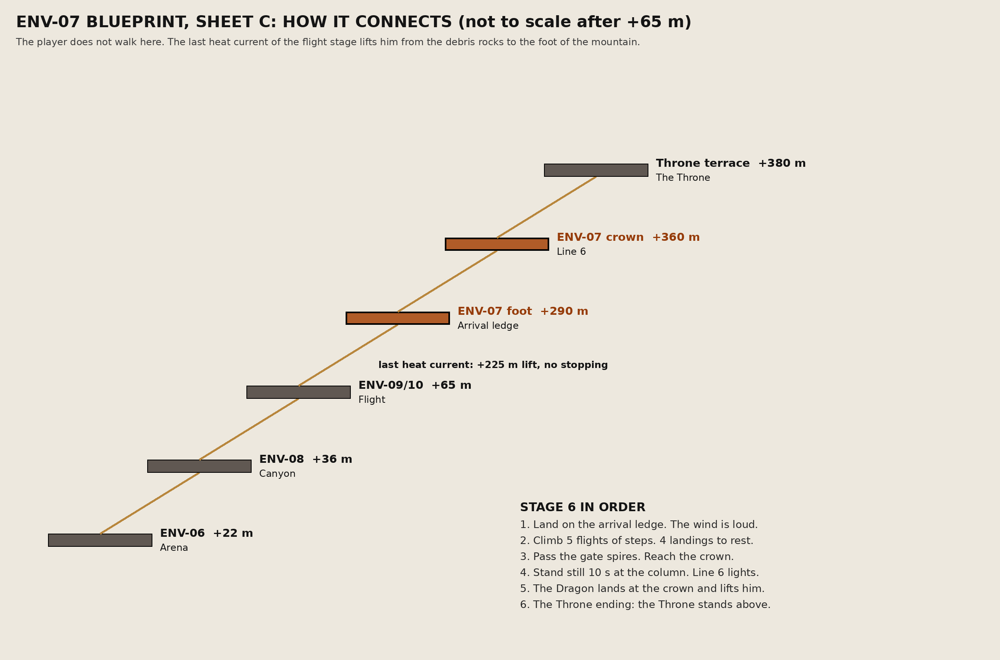

# ENV-07 Summit Peak Island

> **ATTENTION BUILDERS:** the 10 pictures have known mistakes. Read section 12 before you build. The three blueprint sheets win over the pictures.
>
> **STATUS:** redesigned and made HUGE, like the Stage 6 key art. **The Throne stands on top.** The old pictures (tan sandstone, built ring wall, arches, dead trees) are archived and wrong. The 10 new pictures are filed and have known mistakes (section 12). The three blueprint sheets are the truth.

**Units:** metres. Height 0 is the crown floor, where the stillness test happens.

## 1. What this island is
1. The tallest and by far the **largest** island. About 150 m wide and 90 m tall, on top of a long tapering root of rock about 60 m deep. It rises far above every other island.
2. A huge tiered mountain of the same dark black-brown fractured rock as ENV-01 to ENV-06.
3. **One broad path of broken, uneven rock steps** is cut into the south face. It zigzags up in **5 flights**. Each flight is wide enough for several people and climbs 14 m (70 m in all). Four flat landings (L1 to L4) join the flights. One thin bronze line runs down the middle of the path. The whole path is about 390 m long.
4. At the top is the **crown**: a wide flat platform of cracked dark rock, 40 m across. In the middle stands **one short stone column** on a round bronze base, with a faint ring of amber cracks around it.
5. Two tall natural rock spires lean toward each other like a gate where the path reaches the crown (30 m and 22 m).
6. Behind the crown a **steep stair of broken dark rock** climbs 20 m to a higher broad terrace at the very top. Six small bronze braziers stand along it, three on each side, dark and unlit until the ending.
7. **The Throne of Stillness stands on the top terrace.** It is about 40 m tall, hewn from black volcanic stone: a deep seat block with two thick armrests, a very tall narrow monolith backrest with six faint horizontal amber fissures, and two huge curved bronze dragon ribs arching inward. It faces south, down the stair, and it is the highest point of the whole island. Details: [The Throne](08-the-throne.md).
8. Two huge rock spires (40 m and 28 m) lean toward each other at the foot of the stair. One lower spire (18 m) stands on the east edge of the crown.
9. Nothing else is built. **No towers, no walls, no arches.** The path steps are carved into the rock.

## 2. What the player does (the gamer loop)
This is Stage 6: The Summit. No enemies. No combat. No dash. About 9 minutes.

1. **Arrive.** The last heat current of the flight stage lifts him to the arrival ledge at the west foot (-70 m). The wind is loud. He sees the whole mountain above him.
   - **Build:** a flat landing ledge, a respawn point, wind and music fade-in.
2. **Climb flights 1 and 2.** He walks the zigzag. The wind grows with each flight.
   - **Build:** the path, wind that rises with height.
3. **Rest on the landings.** L1 to L4 are calm spots. Edges have tiny micro-slips if he runs.
   - **Build:** 4 landings, a light edge-slip when sprinting.
4. **Pass the gate spires.** The gate spires frame the head of the path. A low pulse and a dip in the light as he walks between them.
   - **Build:** a pulse trigger between the gate spires.
5. **The crown.** The wind is huge. Everything says "move!". The Cinder locks.
   - **Build:** wind volume 60 x 30 x 60 m over the crown. Stillness zone radius 10 m around the column.
6. **Stand still for 10 seconds.** Any move starts the count again. The sound strips down to wind and one soft tone.
   - **Build:** the 10 s timer. It resets on any move.
7. **Line 6 lights.** All six fires burn. The Eye opens fully. The six fissures of the Throne above him light, one by one, as the six lines light in the sky.
8. **The Dragon lands** at the west side of the crown (blue ring on Sheet A) and he climbs on.
   - **Build:** a Dragon landing spot. Then the Throne ending starts: the Dragon flies him over the world and drops him at the foot of the stair. He climbs it. The braziers light as he passes.

## 3. In and out
| | Place | Way | Goes to |
|---|---|---|---|
| In | West foot, arrival ledge (-70 m) | The last heat current of the flight stage | From ENV-09 and ENV-10 |
| Out | Crown, west side | The Dragon carries him | To the Throne ending |
| Above | Top terrace (+20 m) | The steep stair with 6 braziers (THR-02) | The Throne (THR-03) |

## 4. What the player learns here
1. True power knows when to stop.
2. After a long climb, stillness is the last test.

## 5. Main sizes
| Part | Size |
|---|---|
| Island | about 150 m wide, 90 m tall, plus a root of about 60 m |
| Path | 5 flights, each +14 m, about 390 m long, flights wide enough for several people |
| Landings | L1 -56 m, L2 -42 m, L3 -28 m, L4 -14 m |
| Arrival ledge | -70 m, west foot |
| Crown | 40 m across, at 0 m |
| Column | short, on a round bronze base, in the middle of the crown |
| Stillness zone | radius 10 m around the column |
| Gate spires | 30 m and 22 m |
| Foot-of-rise spires | 40 m (west) and 28 m (east) |
| East single spire | 18 m |
| Steep stair and Throne terrace | +20 m, 6 braziers, terrace about 25 m across |
| The Throne | about 40 m tall, on the terrace (+20 to +60 m). It is the highest point |

World height: the crown is at +360 m. The arrival ledge is at +290 m. The terrace is at +380 m. The top of the Throne is at about +420 m.

## 6. Rock rules
1. The rock is the same dark black-brown fractured rock as ENV-01 to ENV-06. Hard, angular, cracked. Not soft or bubbly.
2. The path is carved into the rock. It is rough, worn and uneven. It is not a built stair with a wall.
3. Dry and dead. No grass, no trees, no moss.

### No props
1. The island has no props. Do not add anything without asking.
2. The made things are the thin bronze line, the one column on its round bronze base, the 6 braziers on the stair, and the Throne.
3. The old plan had a ring wall, a gatehouse tower, a slender tower, arches, chains, dead trees and lanterns. They are removed. Add them in Unreal only after approval.
4. The braziers and the Throne follow the canon in [The Throne](08-the-throne.md). Six braziers (3+3) is a proposed number.

## 7. Sounds and mood
1. Loud wind at the foot. It grows with every flight.
2. At the crown the wind is huge. Then the sound strips down to wind and one soft tone while he holds still.
3. No success chime until Line 6 lights.
4. The mood is grand, quiet and austere. The light is warm gold.

## 8. Enemies and hazards
1. None. No enemies. No combat.
2. The only pressure is the wind and the 10 s stillness test.
3. Full details: [Stage 6](stages/stage-6-the-peak.md).

## 9. How it connects
Picture: Sheet C (`art/guide/env07-blueprint-C-connection.png`).

1. Order of play: ENV-09 and ENV-10 (flight), then ENV-07, then the Throne.
2. **Flight to ENV-07.** The last heat current of Stage 5 lifts him about 225 m, from the debris rocks (+65 m) to the arrival ledge (+290 m). He must not stop.
3. **ENV-07 to the Throne.** After Line 6 the Dragon lands on the crown. It carries him over the world, then drops him at the foot of the Throne stair. The stair climbs from the crown to the terrace where the Throne stands.
4. The mountain is the last climb. It is the biggest place in the game.

## 10. The three blueprint pictures
1. Sheet A, top view: the footprint, the zigzag path, the four landings, the crown, the column and its stillness ring, the spires, the stair with its braziers and the Throne terrace.
2. Sheet B, front view: heights of the flights, the crown, the terrace, the Throne (40 m), the spires and the root.
3. Sheet C, connection: from the arena to the Throne terrace, plus Stage 6 in order.
4. The Throne look comes from the THR-01 sheet. Attach it when you make a picture.
5. Pictures for Gemini: prompts are in `prompts/assets/ENV-07/`. Start a NEW chat for each picture. Attach the ENV-06 sheet, the ENV-01 hero, the THR-01 Throne sheet, the Stage 6 key art, and Sheets A and B.

## 11. Notes for builders
1. The west end is the arrival end. In the pictures the arrival ledge is on the left, and flight 1 climbs left to right.
2. The island must look HUGE next to the others. The key art has small floating islands in the haze around it. Do not copy the ruin towers on those small islands.
3. The old Sheet v1 and its 6 renders are in `art/assets/ENV-07/_superseded`. Do not use them.
4. The pictures may differ a little from this page. Developers decide.

## 12. ATTENTION: the 10 filed pictures
The 10 pictures are filed in `art/assets/ENV-07/`. They show the mood well. They are wrong in the places below. **Sheets A, B and C win over the pictures.**

| # | The picture shows | Build it like this |
|---|---|---|
| 1 | Front and sheet: the two big gate spires lean OUTWARD, away from each other | They lean toward each other like a gate (Detail 4 is right). |
| 2 | Front, top and sheet: 8 braziers (3 each side on the stair plus 1 at each top corner) | 6 braziers, 3 on each side of the stair. This number is not decided yet. |
| 3 | Back: 4 or more thin bronze arcs like a cage around the backrest | Two dragon ribs only. Front, Detail 5 and the key art are right. |
| 4 | Top: a second small pillar on a bronze base at the left of the column | One column only. The two small bronze-based posts are the west and east gap posts, kept low. |
| 5 | Pictures: the backrest is a plain tall slab | A 40 m backrest with six faint horizontal amber cracks. See THR-01. |
| 6 | Detail 3: the title says "ENV- 07" with a gap | Ignore titles. Use the names in the tracker. |
| 7 | Front and sheet: the size note is printed in the image | The note is for the sheet only. Do not copy it into the game. |
| 8 | Underside: a lumpy ball with a thin root | One thick tapering bowl of rock down to a long root, as on Sheet B. |
| 9 | Detail 2: no bronze line on the landing | The thin bronze line crosses every landing. |

**If a picture and a sheet disagree, the sheet wins.**

## 13. Not decided yet
1. Where exactly the Throne sits. The old level data puts the seat 10 m from the column on the crown. This plan puts it on the terrace above the crown, as in the key art. The producer decides.
2. What happens if he falls on the path. The same fall options as the arena apply ([doc 25](25-env06-blueprint.md), section 2). Option A (the Cinder catch) would put him on the nearest landing.
3. The exact number of flights (5), landings (4) and braziers (6).
