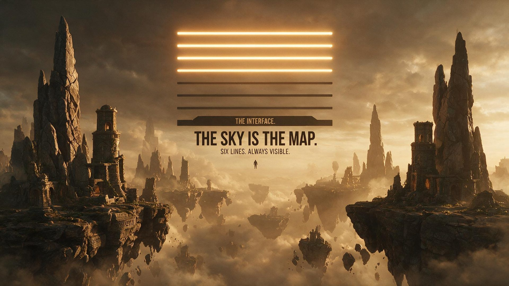

# The six pillars check

> **Rule:** every part of I-RULE01 must pass all six pillars of game design: **Fun, Game Loop, Curiosity, Skill, Motivation, Progression.** No exception. This page checks the game against each pillar, names the weak spots, and gives a fix for each one.
>
> **STATUS:** the checks below use the current canon. **Every gap is now filled in [the gamer layer](28-gamer-layer.md).** Items there marked **needs your OK** are not final until the producer says yes.

## 1. The score card

| # | Pillar | Verdict | Main weak spot | Fix (PROPOSED) |
|---|---|---|---|---|
| 1 | Fun | Pass, one risk | The first 22 minutes have no combat | Filled: the Chord and the bronze rail ([doc 28](28-gamer-layer.md#2-fun-the-chord-fills-the-first-22-minutes)) |
| 2 | Game Loop | Pass | The loop only teaches if the player rushes first | Filled: the first rush on the rusty beam ([doc 28](28-gamer-layer.md)) |
| 3 | Curiosity | **Gap** | No list of secrets for each island | Filled: the Still Secrets, one on each island ([doc 28](28-gamer-layer.md)) |
| 4 | Skill | Pass | Skilled players have little to master after stage 3 | Filled: the Mastery layer and the Still Path ([doc 28](28-gamer-layer.md)) |
| 5 | Motivation | Pass, one weak spot | Few choices, and all of them are about timing | Filled: one real choice on every stage ([doc 28](28-gamer-layer.md)) |
| 6 | Progression | Pass, one weak spot | Stages 3 and 5 are long with one line each | Filled: a beat in the middle of each ([doc 28](28-gamer-layer.md)) |

## 2. How to use this page

1. Put any new idea through the six questions below.
2. If one answer is "no", fix the idea first.
3. Do not ship an idea that fails a pillar.
4. This sits next to the older rule: no theme-only features ([doc 01](01-vision-and-pillars.md)).

---

## 3. Pillar 1: Fun

**The three questions**
1. Is the gameplay satisfying?
2. Does the game feel responsive?
3. Are interactions rewarding?

**How the game answers**
1. **Satisfying.** Rush, feel the world fight back, stop, feel it calm. That swing is the fun ([How it plays](how-it-plays.md)).
2. **Responsive.** Movement feel is gate 1. Input buffer 0.10 s. Coyote time 0.12 s. Stillness starts after 0.20 s ([doc 06](06-core-systems.md)).
3. **Rewarding.** A fire arrow shatters a shadow on an open frame. A parry drops a shield. Each ignition lights a line in the sky.

**Weak spot.** In stage 1 combat is off and the dash is punished. In stage 2 combat is off too. The first 22 minutes lean on movement and stillness only.

**Fix (PROPOSED, not decided yet).**
1. Give every clean move a small reward you can feel: a soft suit glow and a warm sound.
2. Make the first stop feel special: the sound clears and the Cinder locks.
3. Never add points, scores or popups. The world is the reward.

## 4. Pillar 2: Game Loop

**The three questions**
1. What core actions do players repeat?
2. Is the loop intuitive and compelling?
3. Does the loop offer meaningful progression?

**How the game answers**
1. **Core actions.** Move, stop, align, ignite, strike, parry, ride ([How it plays](how-it-plays.md)).
2. **Intuitive.** There is no text. Audio teaches first, then the world, then the glow on Elias and the Cinder.
3. **Progression.** Every loop ends in a line that lights.

| Loop | Length | What repeats |
|---|---|---|
| Moment | Seconds | Rush, feel the world fight back, stop, feel it calm |
| Stage | 6 to 17 minutes | Entry, Teach, Test, Ignite, Transition |
| Game | About 85 minutes | Six lines, then the Throne |

**Weak spot.** The loop only teaches if the player rushes first. A very careful player may never feel the contrast.

**Fix.** Keep the expected failure loop in every stage (already in the stage docs). Keep the playtest question: "When did you realize you had to stop moving?"

## 5. Pillar 3: Curiosity

**The three questions**
1. Does the game stimulate exploration?
2. Are surprises embedded throughout?
3. Is discovery consistently rewarded?

**How the game answers**
1. **Exploration.** Every island is a new shape. Stillness reveals hidden paths and ignition seams. Three lanes in stage 2, three heat lanes in stage 5.
2. **Surprises.** The big bat-bird flies over island 2. The Throne is seen far above from the first island. The Dragon arrives.
3. **Rewards.** Hidden paths open. The Cinder brightens.

**Weak spot (a real gap).** There is no list of surprises, one for each island. The game has no collectibles, no shops and no inventory, so a secret must be paid back by the world itself.

**Fix (PROPOSED, not decided yet): one "still secret" on each island.**
1. Each island hides one rock seam that glows only when Elias stands still near it.
2. The reward is the world, not an item: a lantern lights, the wind goes quiet, or the view opens.
3. In the ending, the lanterns he lit during the game burn a little brighter.
4. No icons. No markers. The Cinder drifts toward it very slightly.

| Island | Where the still secret could be (PROPOSED) |
|---|---|
| ENV-01 Starting Shelf | A seam beside the bronze disc |
| ENV-02 Spire | A seam on the dead tree's root |
| ENV-03 Rest | A seam on the rest stone |
| ENV-04 Crater | A seam inside the crater wall |
| ENV-05 Blade | A seam under the middle spire pair |
| ENV-06 Arena | A seam inside one dull vent, found after the fight |
| ENV-07 Summit | A seam at the foot of the stair, found while still |

## 6. Pillar 4: Skill

**The three questions**
1. Does the game challenge player abilities?
2. Are skills progressively built?
3. Is the feedback for player actions clear?

**How the game answers**
1. **Challenge.** Timing, parry (0.18 s), open frames, bridges built while still, flight, a 10 second hold.
2. **Built step by step.** The stage input locks teach one new skill at a time.
3. **Clear feedback.** Three layers on every mechanic: audio, world, and a small glow on Elias and the Cinder. No text.

| Stage | New skill | Hold |
|---|---|---|
| 1 Lurking | Stop to reveal | 2.5 s |
| 2 Emerging | Stop to make timing readable | 3 s |
| 3 The Toil | Combat, parry, storm reset | 4 s |
| 4 The Leap | Build bridges while still | 3 s |
| 5 Flying | Ride the heat currents, hold in wind | 5 s |
| 6 The Peak | Nothing but stillness | 10 s |

**Weak spot.** After stage 3 the kit does not grow. A skilled player has little extra to master.

**Fix (PROPOSED, not decided yet).**
1. Perfect actions already lower the forcing meter (open-frame hit, parry, perfect dodge). Give them a clear, rewarding sound and glow.
2. Keep the 10 second hold fixed. Do not make it shorter.
3. Do not add a skill tree. The rules say none.

## 7. Pillar 5: Motivation

**The three questions**
1. Are player goals clearly defined?
2. Is the game intrinsically rewarding?
3. Does the game provide meaningful choices?

**How the game answers**
1. **Goals.** All six lines are always visible in the sky. The Throne is seen from the first island. No quest text is needed.
2. **Intrinsic.** Calm feels good. Beauty state is the best state in the game. The ending is recognition, not a boss.
3. **Choices.** Where and when to stop is the choice.

**Weak spot.** The game is linear. Every choice is about timing and place, none about story.

**Fix (PROPOSED, not decided yet): name one real choice on every stage.**

| Stage | The choice |
|---|---|
| 1 | Where to stop (the door) and how long to wait |
| 2 | Which of the three lanes is stable |
| 3 | Which cover to use in the arena (the monolith, the rim, a gap) and when to leave it |
| 4 | Which anchor to build first |
| 5 | Which heat lane to ride |
| 6 | When to start the 10 seconds, with the wind rising |

Most of these are already in the canon. The fix is to write them down and test them.

## 8. Pillar 6: Progression

**The three questions**
1. Is there a clear sense of advancement?
2. Are milestones well distributed?
3. Does progression align with player skills?

**How the game answers**
1. **Advancement.** Six bars in the sky. Each ignition lights one. The islands also climb higher each time.
2. **Distributed.** The lines light at about 10:30, 22:30, 39:00, 53:00, 70:00 and 77:00. The Throne ends at 85:00.
3. **Aligned with skill.** Each stage adds one skill and one longer hold.

| Gap between milestones | Minutes |
|---|---|
| Start to line 1 | 10.5 |
| Line 1 to line 2 | 12 |
| Line 2 to line 3 | 16.5 |
| Line 3 to line 4 | 14 |
| Line 4 to line 5 | 17 |
| Line 5 to line 6 | 9 |
| Line 6 to the end | 6 |

**Weak spot.** Stages 3 and 5 are long (16.5 and 17 minutes) with only one big milestone.

**Fix (PROPOSED, not decided yet).**
1. Add one small beat at the half of stage 3 (after the storm reset): the Fire Eye turns a little toward Elias.
2. Add one at the half of stage 5 (first clean heat current): the Dragon answers with a long low sound.
3. No bars, no numbers, no text.

---

## 9. ENV-06 and ENV-07 against the six pillars

| Pillar | ENV-06 Arena | ENV-07 Summit Peak |
|---|---|---|
| Fun | Shatter shadows, parry knights, storm builds when he mashes | Big climb, a long calm walk, the huge Throne above |
| Game Loop | Rush, storm, cover, stop, strike once | Climb, hold, wind, hold again |
| Curiosity | Five vents, the monolith, the gaps | Gate spires, landings, the Throne in view |
| Skill | Parry (0.18 s), open frames, storm reset | Only stillness, 10 seconds in wind |
| Motivation | Line 3 lights | Line 6 lights, then the Throne |
| Progression | First big fight, the way opens | The last line, then the ending |

## 10. The open proposals against the six pillars

| Proposal (not decided yet) | Passes | Risk | Verdict |
|---|---|---|---|
| Fall option A: the Cinder catch ([doc 25](25-env06-blueprint.md)) | Fun, Skill, Progression | Could feel too easy | Passes |
| Leeches on ENV-05 | Skill | Could break the calm walk | Needs a test |
| The 3 cracking slabs | Skill, Curiosity | Could feel unfair | Needs a test |
| The ENV-01 ledge fight | Skill | Combat before stage 3 breaks the input lock | Needs a decision |
| The Shadow duel | Skill, Motivation | Could turn into a boss | Needs a decision |
| The rock gate on ENV-04 | Curiosity, Progression | None found | Passes |
| The Dragon drop at the foot of the Throne stair | Fun, Progression | None found | Passes |
| 6 braziers on the Throne stair | Motivation, Progression | None found | Passes |

## 11. What I need from you

1. Approve or change each **PROPOSED** fix above.
2. Choose the fall option for the arena (A is my pick).
3. Decide the ENV-01 ledge fight and the Shadow duel.

Continue: [Vision and pillars](01-vision-and-pillars.md) · [Core systems](06-core-systems.md) · [Stages](stages/README.md)
