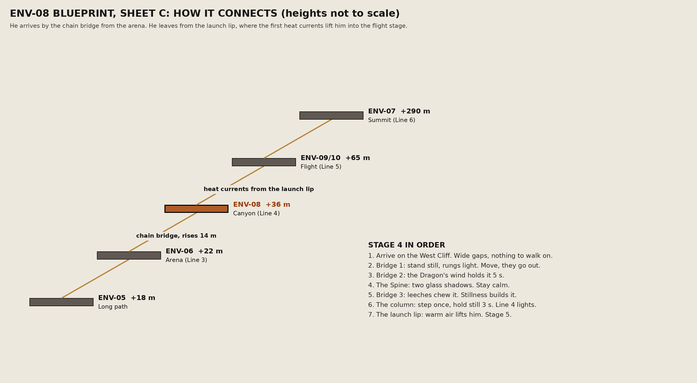

# ENV-08 Canyon Cliffs

> **STATUS:** done. 11 pictures are in (sheet, front, back, top, underside and 5 details). The pictures show **five rock masses**, so the layout below follows them. The old four-cliff layout is in `docs/archive/31-env08-blueprint-4cliff-OLD.md`. The three blueprint sheets are the truth for lengths and order.

**Units:** metres. Height 0 is the top of the cliffs (world +36 m). X runs west to east. Y runs south to north.

## 1. What this place is
1. A **chain of five floating rock masses**, two big cliffs and three shelves, about 285 m from the arrival tongue to the east edge. Stage 4: The Leap. Line 4.
2. All five are the same dark black-brown fractured boulder rock as ENV-01 to ENV-06. Natural rock only.
3. **West Cliff**, about 70 m long. He arrives here. A cluster of three black needles stands on its north rim (28, 20 and 13 m).
4. **South shelf**, about 32 m, south of the line.
5. **Middle shelf**, about 38 m, south-east of the South shelf.
6. **North shelf**, about 36 m, north of the line.
7. **East Cliff**, about 86 m, the biggest. It is the other half of the same split mountain as the West Cliff: five matching strata bands run at the same heights across both.
8. **Four chain bridges**: two bronze posts on a flat rock tongue at each end, two chains, and rungs. The first four rungs glow amber-white.
   - Bridge 1 (20 m): West Cliff to South shelf.
   - Bridge 2 (26 m): South shelf to Middle shelf.
   - Bridge 3 (20 m): North shelf to East Cliff.
   - **Long bridge** (about 72 m): West Cliff straight to the North shelf. The shortcut.
9. **The Spine**: one narrow natural rock ridge, about 21 m long and 3 m wide, joins the Middle shelf to the North shelf.
10. On the East Cliff stands **one short stone column on a round bronze base**. At its north-east edge is the **launch lip**: a flat rock tongue with heat shimmer and two low needles.
11. The West Cliff and the three shelves each have one shallow hollow. These are the four calm pockets. The East Cliff has none.
12. Nothing else is built. **No towers, no cave, no arch.**

## 2. What the player does (the gamer loop)
Stage 4. About 14 minutes (beats 39:00 to 53:00).

1. **Arrive.** He crosses the chain bridge from the arena and steps onto the West Cliff. The gap ahead is wide. Nothing to walk on.
   - **Build:** arrival tongue, respawn point, wind fade-in.
2. **Bridge 1 (about 20 m) to the South shelf.** He stands still. The rungs light one by one from his side. He moves: they go out. He stands still: they return. This is the lesson.
   - **Build:** the stillness bridge, STR-08, with a tutorial prompt.
3. **Bridge 2 (about 26 m) to the Middle shelf.** The Dragon hovers off the south side. He stands still beside it and its wind holds the bridge for 5 seconds.
   - **Build:** wind volume, a 5 s hold while he is aligned with the Dragon. A calm pocket on each shelf.
4. **The Spine.** Two Glass Shadows wait on the ridge. He stays calm and clears them. He reaches the North shelf and its calm pocket.
   - **Build:** 2 Glass Shadow spawns.
5. **Bridge 3 (about 20 m) to the East Cliff.** Leeches chew the chains from below. Stillness builds the bridge back faster than they drain it.
   - **Build:** leech drain on bridge stability. Leech underside: STR-28.
6. **The column.** He steps once, then holds still for **3 seconds**. Line 4 lights in the sky.
   - **Build:** hold ring radius 3 m. Timer resets on movement.
7. **The launch lip.** He walks to the lip. Warm air lifts him into Stage 5.
   - **Build:** a lift trigger, then the flight stage begins.

**The long bridge (decided):** from the West Cliff north rim straight to the North shelf, about 72 m. It skips steps 2 to 4. Hold 6 s to build it, with leeches below. It is the bridge-build time only. The Line 4 hold at the column stays 3 s. Reward for the brave line: a calmer wind on bridge 3.

**Fall rule (approved):** if a bridge breaks, the Cinder catches him and sets him on the last anchor tongue. A calm pocket is always near.

**Chord and rail (approved, doc 28):** clean stillness builds add notes. The bronze line is a rail boost across the bridges.

## 3. In and out
| | Place | Way | Goes to |
|---|---|---|---|
| In | West arrival tongue (-8 to 0 m) | The chain bridge from ENV-06 | From the arena |
| Out | Launch lip, north-east of the East Cliff | Warm air lifts him | To ENV-09 and ENV-10 (flight) |

## 4. What the player learns here
1. Calm builds. Rushing breaks.
2. Bridges span depth, not only distance.

## 5. Main sizes
| Part | Size (top view, metres) |
|---|---|
| West Cliff | x 0 to 70, y -26 to 26, body about 60 m deep |
| South shelf | x 86 to 120, y -52 to -28, about 30 m deep |
| Middle shelf | x 146 to 184, y -52 to -25, about 38 m deep |
| North shelf | x 140 to 176, y -4 to 22, about 34 m deep |
| East Cliff | x 195 to 281, y -30 to 30, body about 70 m deep |
| Bridge 1 | (68,-18) to (86,-30), about 20 m |
| Bridge 2 | (120,-40) to (146,-38), about 26 m |
| Spine | (160,-4) to (161,-25), about 21 m long, 3 m wide |
| Bridge 3 | (176,8) to (195,6), about 20 m |
| Long bridge | (70,14) to (141,12), about 72 m |
| Column | about (240,0), hold ring 3 m |
| Launch lip | about (270,26) |
| Calm pockets | radius 4.5 m at (14,15), (103,-42), (165,-38) and (158,11) |

All five tops are at +36 m. The bridges are level at the top strata line. The pictures draw the shelves a little lower and the cliffs taller; build to this table. Each mass hangs on a short tapering root in cloud.

## 6. Rock rules
1. Same dark black-brown fractured rock as ENV-01 to ENV-06. Hard, angular, cracked.
2. Five strata bands line up at the same heights on every cliff face.
3. Dry and dead. No grass, no trees.
4. Chains are heavy, with small low clinks.

### No props
1. The only made things are the four bridges with their posts, the one column on its bronze base, and the thin bronze line.
2. Do not add anything without asking.

## 7. Sounds and mood
1. Wind that rises with each bridge. Deep low hum from the cloud below.
2. Chains clink low and small when a bridge forms. Soft rising notes with each clean build.
3. The mood is tense and then calm. Warm gold light at the east edge.

## 8. Enemies and hazards
1. Two Glass Shadows on the Spine.
2. Leeches under bridge 3 and under the long bridge.
3. The Dragon helps at bridge 2. It does not attack here.
4. Full details: [Stage 4](stages/stage-4-the-leap.md).

## 9. How it connects
Picture: Sheet C (`art/guide/env08-blueprint-C-connection.png`).

1. Order of play: ENV-06 (arena), then ENV-08, then ENV-09 and ENV-10 (flight).
2. The arena tops out at +22 m. The chain bridge rises 14 m to the West Cliff at +36 m.
3. From the launch lip the heat currents lift him to the flight stage at +50 to +65 m.

## 10. The three blueprint pictures
1. Sheet A, top view: the five masses, four bridges, the Spine, the column, the lip, the needles, the calm pockets and the numbered beats.
2. Sheet B, side view: all five tops at +36 m, depths, the aligned strata and the bridges.
3. Sheet C, connection: the height chain and Stage 4 in order.
4. The pictures (all in the hub under ENV-08): sheet (composed from the four accepted views), front, back, top, underside, detail 1 to 5.
5. Prompts stay in `prompts/assets/ENV-08/` for any redo. Start a NEW chat for each picture.

## 11. Notes for builders
1. West is the arrival end and is on the left in every picture.
2. The old sheets are in `art/assets/ENV-08/_superseded`. Do not use them.
3. The world coordinates in [Stage 4](stages/stage-4-the-leap.md) (anchor pairs at x 110 to 210) fit a shorter chain. Place the bridges on those pairs and let the masses follow. The producer confirms.
4. **Where the pictures and this doc differ:**
   - **Bridge 1** (West Cliff to South shelf) is not drawn in any picture. Build it from Sheet A.
   - The pictures show the shelves lower than the cliff tops. Build level.
   - The pictures draw no hollow on the East Cliff. Same here.
   - The front picture hides the South shelf behind the others.
   - Detail 1 (matching strata) shows the two cliffs close together with one bridge. It is for the rock bands only. The real gap is 110 m wide.

## 12. Six pillars check
1. **Stillness is power:** every bridge is built by standing still.
2. **Rushing breaks:** movement drops the rungs.
3. **Fairness:** the Cinder catch and a calm pocket near every bridge.
4. **Awe:** the drop into cloud and one long line of cliffs.
5. **Mastery:** the chord and the rail boost reward clean builds.
6. **Clear teaching:** bridge 1 teaches, bridge 2 helps, bridge 3 tests.

## 13. Not decided yet
1. **Still Secret.** A seam low on the west face of the North shelf beside its bronze post. After 3 s of stillness within 6 m it opens and lights a lantern on the East Cliff rim. That lantern burns gold in the ending.
2. The exact world coordinates (section 11).
