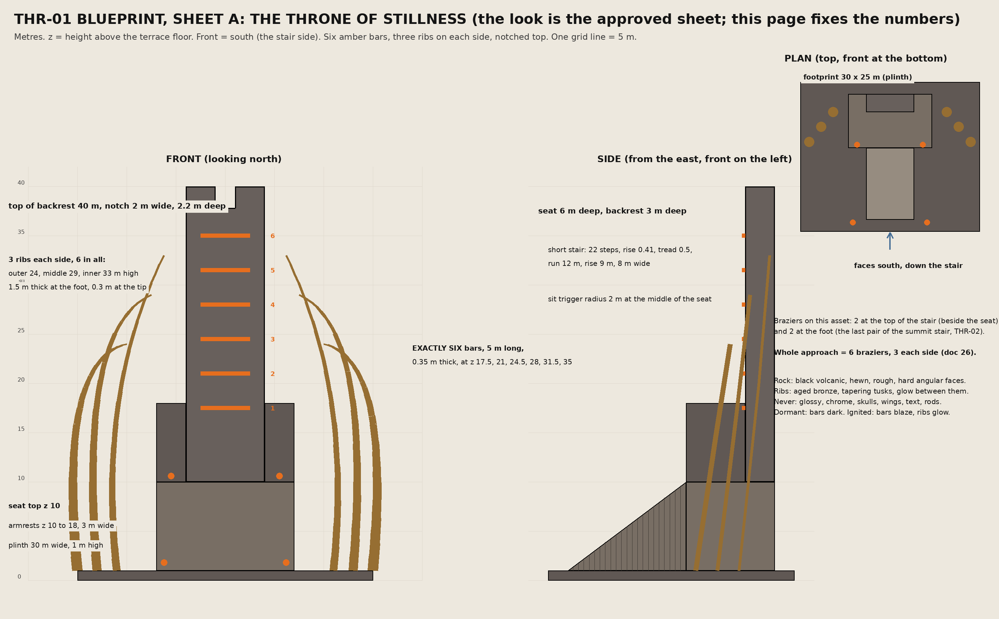

# The Throne: final blueprint (THR-01, THR-02, THR-03)

Sheets: [A the Throne](../art/guide/throne-blueprint-A-throne.png) · [B the stair and terrace](../art/guide/throne-blueprint-B-stair.png) · [C the Throne on the summit, aligned with ENV-07](../art/guide/throne-blueprint-C-summit.png)

> **LOOK: the approved THR-01 sheet** (`art/assets/THR-01/sheet.jpg`, the new one). Make every picture look like it: a tall dark notched monolith, a deep seat block with two armrests, a short steep stair, bronze braziers, bronze tusk-like ribs arching in, molten cracks. This page only fixes the numbers and the things the sheet gets wrong.
> The old sheet is in `art/assets/THR-01/_superseded/sheet-v1.jpg`. **Proposed final, not locked by the producer yet.**

## 1. Three assets, one place
| Asset | What | Size |
|---|---|---|
| **THR-01 The Throne of Stillness** | The Throne itself, on its own rough plinth, with its short seat stair | 40 m tall, footprint 30 x 25 m |
| **THR-02 The Throne Stairs and Platform** | The summit stair from the crown, and the terrace the Throne stands on | stair 50 steps, +20 m, terrace 36 x 30 m |
| **THR-03 The Throne on Summit** | THR-01 standing on THR-02's terrace at the top of ENV-07 | about 70 m from the crown to the top |

World heights ([doc 26](26-env07-blueprint.md)): crown **+360**, terrace **+380**, seat **+390**, top of the Throne **+420**. It is the highest point of the island.

## 2. THR-01 numbers (Sheet A)
| Part | Final |
|---|---|
| Plinth | rough broken rock, 30 x 25 m, 1 m high |
| Seat block | 14 m wide, 9 m deep, top at **+10 m** from the terrace |
| Seat | 8 m wide, 6 m deep. Sit trigger radius 2 m at its middle |
| Armrests | one each side, 3 m wide, top at +18 m |
| Backrest | 8 m wide, 3 m deep, straight parallel sides, up to **+40 m** |
| Top | flat, with **one** small rectangular notch in the middle, 2 m wide and 2.2 m deep |
| **Fissures** | **exactly six** short horizontal amber bars, 5 m long, 0.35 m thick, at +17.5, 21, 24.5, 28, 31.5, 35 m. Lines 1 to 6 light them bottom to top |
| **Ribs** | **three on each side, six in all.** Bronze, tapering like tusks or dragon ribs, 1.5 m thick at the foot and 0.3 m at the tip. They rise from the plinth beside the seat and arch inward over it without touching. Heights about 24, 29 and 33 m. Fire glows between them at their base |
| Seat stair | 22 steps, rise 0.41, tread 0.5, run 12 m, 8 m wide, broken black stone |
| Braziers | 2 at the top of the stair beside the seat. (The 2 at the foot are the last pair of THR-02.) |
| Surface | rough, hewn, weathered. Molten-amber cracks like lava under a crust, mostly in the lower backrest and the seat block |
| Never | glossy, chrome, mirror-black, floating on rods, skulls, wings, readable text |

## 3. THR-02 numbers (Sheet B)
1. Stair 8 m wide, from the crown floor (+360) to the terrace (+380). **Two flights of 25 steps** (rise 0.4, tread 0.9, 22.5 m run each) with **one flat landing 4 m deep** at +370. Total run 49 m, walking length about 53 m.
2. Broken black volcanic stone. Uneven, worn, carved into the rock, no walls and no rail.
3. **Four bronze braziers on the stair, two on each side**: pair 1 at step 12, pair 2 at step 40. With the pair at the top beside the seat (THR-01) the whole approach has **six, three on each side**, as in doc 26. They stay dark until the ending, then light one by one as Elias passes.
4. The terrace: broad, flat, cracked, thin amber veins, rough broken rim, **36 m wide and 30 m deep**. The Throne plinth sits in the middle, 3 m back from the stair top. Nothing else stands there.

## 4. THR-03 (Sheet C)
THR-03 is THR-01 on the THR-02 terrace on top of ENV-07. It faces **south, down the stair**. Below it: the stair, the flat crown with its low column, and the two gate spires leaning together. Everything is natural dark rock around it. No towers, walls or arches.

## 5. Alignment with the summit (ENV-07, doc 26)
| Item | Was | Now |
|---|---|---|
| Throne 40 m on the terrace, top +420 | yes | same |
| Stair +20 m, six braziers (3 + 3) | yes | same, and now split 4 on the stair + 2 at the seat |
| Faces south, dark until the ending | yes | same |
| **Terrace size** | about 25 m across | **36 x 30 m**, because the Throne with its ribs is 30 m wide. Doc 26 is updated |
| **Ribs** | two only | **three each side**, to match the approved sheet. Docs 08 and 26 are updated |
| Fissures | six | six. The approved sheet draws **five**. Build six |

## 6. Pictures
1. **THR-01: done.** The sheet and 14 pictures are filed (no high 45 view, not needed). Six bars, three ribs each side and four braziers are right in every picture. Known mistakes: the top view has 4 bars; the stair and seat look low; titles are misspelled. **Doc 40 and the sheets win over the pictures.**
2. THR-02: no pictures yet. Attach Sheet B and the ENV-07 sheet.
3. THR-03: no pictures yet. Attach the THR-01 sheet, Sheet C and the Stage 6 key art.
4. A new Gemini chat for every picture.

## 7. Not decided yet
1. Three ribs each side instead of two (follows the approved sheet).
2. The 36 x 30 m terrace (was 25 m).
3. Where the Throne sits: on the terrace (proposed) or 10 m from the column ([doc 26](26-env07-blueprint.md), section 13).
4. How Elias sits: the seat is 10 m up the short stair. The seat trigger is 2 m radius.
