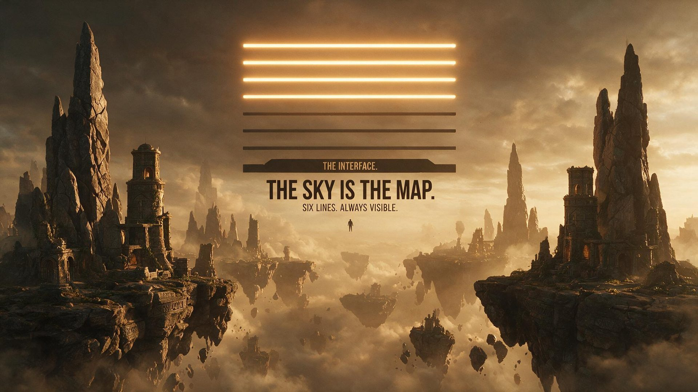

# Stages

Six stages, one line each, then the Throne. All six lines are visible from the first moment, so the player can always see the whole journey. Each stage follows **Entry -> Teach -> Test -> Ignite -> Transition**, with mandatory low-energy rest pockets.

**Target full-game time (first clean completion): about 85 minutes.** Skilled players about 70-80, new players about 90-110.

| Stage | Document | Target | Hold | Line |
|---|---|---|---|---|
| 1 | [Lurking](stage-1-lurking.md) | 10:30 | 2.5 s | 1 |
| 2 | [Emerging](stage-2-emerging.md) | 12:00 | 3 s | 2 |
| 3 | [The Toil](stage-3-the-toil.md) | 16:30 | 4 s | 3 |
| 4 | [The Leap](stage-4-the-leap.md) | 14:00 | 3 s | 4 |
| 5 | [Flying](stage-5-flying.md) | 17:00 | 5 s | 5 |
| 6 | [The Peak](stage-6-the-peak.md) | 9:00 | 10 s | 6 |
| End | [The Throne](the-throne-ending.md) | 6:00 | | |
| | **Total** | **85:00** | | |

**Stage names:** the key art uses Lurking, Emerging, The Toil, The Leap, Flying and The Peak / The Summit. The pitch-deck brief uses Entering the Dark, Finding Direction, The Trial of Force, Shared Fire, Flight and The Still Peak. They refer to the same stages (see [canon](../13-canon-and-open-decisions.md)).

## Non-negotiable UX beats
- The player must realise stillness wins **without text**.
- Audio is the primary teacher.
- The Fire Eye and six lines are visible early and stay visible.

## How the stages ramp
| Stage | Skin of the stillness mechanic |
|---|---|
| 1 | Find the discovery: stop to reveal |
| 2 | Stop to make timing readable |
| 3 | Stop to clear a storm in combat |
| 4 | Stop to build bridges |
| 5 | Commit to flow; hold still in wind to ignite |
| 6 | Stop for 10 seconds, nothing else |

## Rules applied
Applied 15 Nov 2026 from [doc 32](../32-rules-of-successful-games.md). See [doc 33](../33-rules-applied.md).

1. Before each stage, the camera drifts to the next empty Line. After it, the Line lighting is the ceremony.
2. After 3 failures in a row at one spot, the world helps. Hold times never change.
3. Every failure resets in under 5 seconds. No game over.
