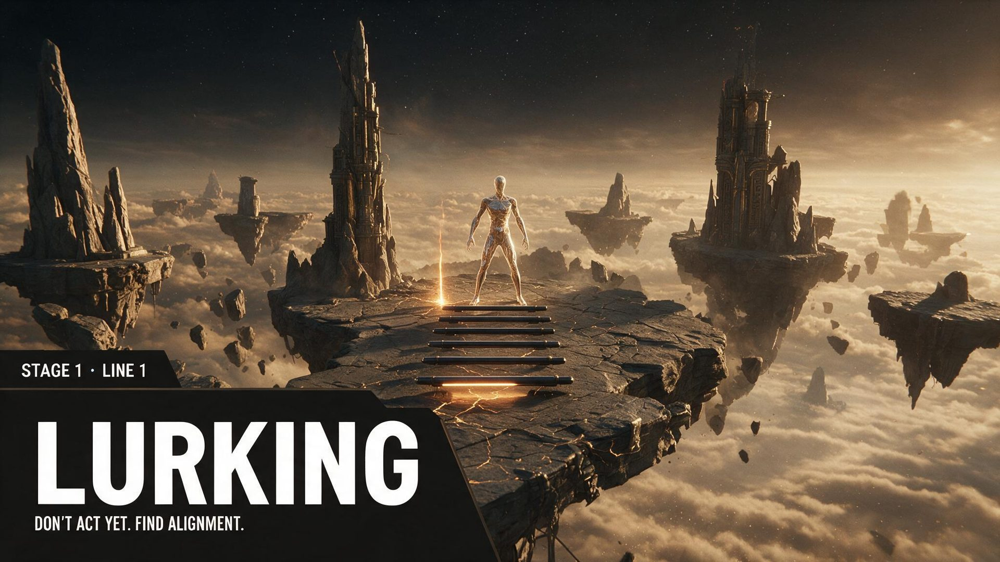

# Stage 1: Lurking (Entering the Dark)

| Item | Detail |
|---|---|
| **Theme** | Entropy · Orientation |
| **Line ignited** | Line 1 |
| **Target time** | 10:30 (first-time golden path) |
| **Stillness hold** | 2.5 s |
| **Lesson** | *Do not act yet. Find alignment first.* |

No enemies. The game teaches "do not act yet." Combat is disabled; dash is allowed but penalised (+0.08 forcing each).

## Level
Southwest. Spawn (-290, 0, -290). Footprint about 140 x 140 m. Ignition column (-210, 0, -210), trigger radius 3.0, hold 2.5 s. Gate arch to Stage 2 at (-190, 0, -190).

**Uses:** ENV-01 Starting Shelf, ENV-02 Stepping Island, ENV-03 Medium Island + ENV-13 Windbreak Ridge. Gate light beam, meditation disc (STR-09), ignition column (STR-10), plank bridges. No enemies.

## Beat plan
Times are mm:ss from game start on the golden path. Includes intentional low-energy rest pockets and one expected failure loop.

| Time | What the player experiences |
|---|---|
| 00:00-00:25 | Black, wind, a faint harmonic drone. Fade in on Elias on an obsidian shelf. The Fire Eye is a distant dark geometry; six lines visible but unlit. |
| 00:25-01:10 | Control given. Camera close and grounded. No UI except a minimal reticle. The Cinder is barely visible (dim). |
| 01:10-02:20 | First traversal: small gaps, safe edges. Quiet world. Suit glow off. |
| 02:20-03:10 | A distant dormant lantern anchor. Facing the correct direction faintly brightens a suit seam; the Cinder drifts subtly forward. |
| 03:10-04:20 | Moving fast gives a subtle entropy response: dust rises, audio noise creeps in, the path feels less stable. |
| 04:20-05:00 | First alignment pocket (calm zone). Standing still 2 s slightly clears the sound. |
| 05:00-06:15 | Approach the first ignition column (engineered fire receptacle). It does nothing while the player fidgets. |
| 06:15-07:10 | Discovery: standing still makes the Cinder lock position; a low harmonic pulse appears; the ignition seam becomes readable. |
| 07:10-08:20 | Align facing the column and hold still. Engineered amber fire appears briefly. |
| 08:20-09:40 | The column ignites with a chord resolution. **Line 1** (bottom bar) lights, clean amber. |
| 09:40-10:30 | World brightness rises slightly. A far lantern anchor flickers alive. The blocked exit path opens. |

## Failure correction loop
If the player rushes continuously for about 30 s: entropy intensifies (audio noise, dust, slight camera instability, path detours block). The solution is not to fight: **stop for 2 s** and calm returns.

## Pass condition
Ignite the first column via alignment plus stillness. Line 1 ignites.

## Audio
- `AUDIO_S1_WindOnly_In`: wind 0.75, all else near 0
- `AUDIO_S1_LowDrone_FadeIn`: low drone ramps to 0.25 over 12 s
- `AUDIO_S1_ClarityTone_Ready`: high clarity 0.10, harmony 0.15 only when aligned, noise max 0.12
- `AUDIO_S1_IgnitionHold_Tone`: soft hold tone while holding; on cancel stop immediately, no stinger

---
[All stages](README.md) · [Next: Stage 2: Emerging (Finding Direction)](stage-2-emerging.md)
