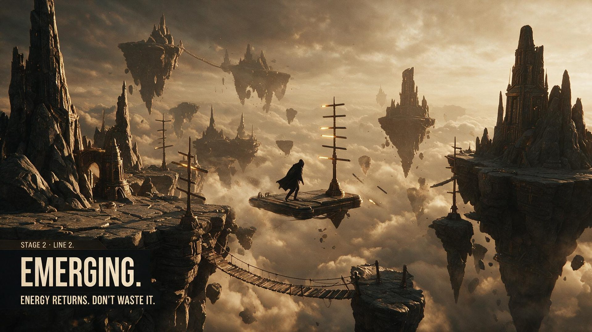

# Stage 2: Emerging (Finding Direction)

| Item | Detail |
|---|---|
| **Theme** | Freshness · Timing |
| **Line ignited** | Line 2 |
| **Target time** | 12:00 (first-time golden path) |
| **Stillness hold** | 3 s |
| **Lesson** | *Energy returns. Do not waste it.* |

Platforms begin moving. Timing is taught; speed is punished. Combat disabled; dash cooldown rises to 1.4 s if used twice in 3 s.

## Level
South-central. Centre (-80, 0, -200), about 180 x 120 m. Direction-gate hub (-40, 0, -190) with three lanes (left / centre / right); only one stable when aligned. Ignition column (-10, 0, -110), hold 3.0 s. Gate arch to Stage 3 at (20, 0, -80).

**Uses:** ENV-11 Moving Platform Slab x6, ENV-04 Large Plateau. Signal masts (STR-20) as rhythm markers; beacon on the plateau. Falling resets to a safe platform.

## Beat plan
Times are mm:ss from game start on the golden path. Includes intentional low-energy rest pockets and one expected failure loop.

| Time | What the player experiences |
|---|---|
| 10:30-11:20 | Transition onto a wider, slightly brighter shelf. |
| 11:20-12:40 | Slow moving platforms introduced. Distant lanterns flicker when facing the correct heading. |
| 12:40-14:00 | First timing challenge: moving platform plus gap. Sprinting or panic-turning increases platform tremors. |
| 14:00-15:20 | First **direction gate**: three paths look plausible, only one is aligned. Suit and Cinder give subtle confirmation. |
| 15:20-17:00 | An energy reservoir zone. Stepping in without alignment does nothing. |
| 17:00-18:40 | Stillness unlock: stand still, a resonance tone plays and platform cycles become predictable (audio cue sync). |
| 18:40-20:10 | Cross a set of four platforms with timing and minimal movement. |
| 20:10-21:30 | Second ignition column. Face the correct heading and stand still 3 s while platforms move nearby (pressure without enemies). |
| 21:30-22:30 | **Line 2** ignites. World brightness and traversal smoothness increase. |
| 22:30 | The stage exit opens into a darker corridor leading to the Stage 3 arena. |

## Failure correction loop
Rushing causes missed platforms and a soft reset to the last anchor. Stillness restores clarity: platform timing becomes easier as the audio stabilises.

## Pass condition
Timing traversal plus alignment hold. Line 2 ignites.

## Audio
- `AUDIO_S2_WindDrone_BlendIn`: wind 0.65, drone 0.30, harmony 0.12, noise 0.10
- `AUDIO_S2_TimingPulse_Subtle`: pulse 0.18, audible only in platform timing zones; noise ducked while pulsing

---
[Previous: Stage 1: Lurking (Entering the Dark)](stage-1-lurking.md) · [All stages](README.md) · [Next: Stage 3: The Toil (The Trial of Force)](stage-3-the-toil.md)
