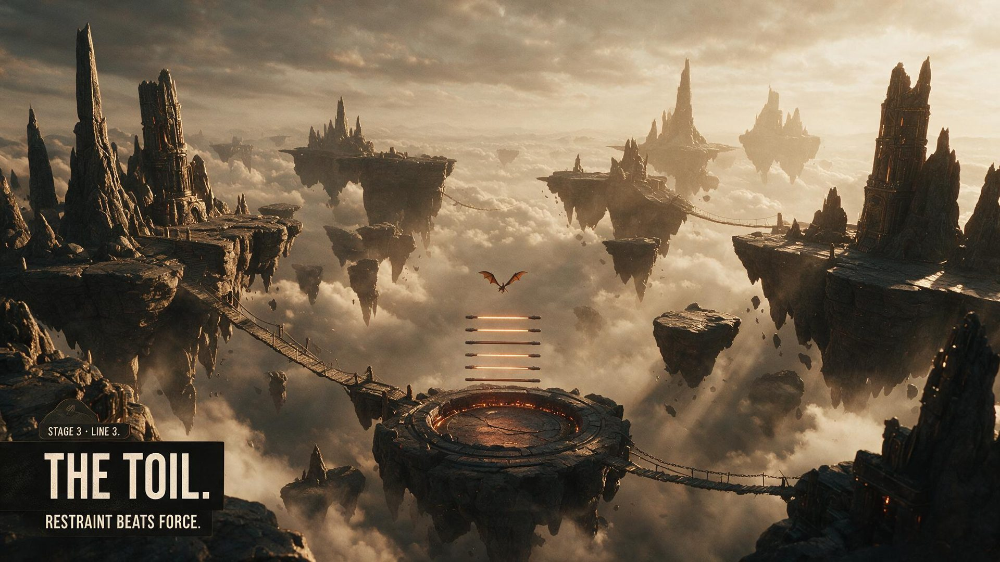

# Stage 3: The Toil (The Trial of Force)

| Item | Detail |
|---|---|
| **Theme** | Danger · Misuse of power |
| **Line ignited** | Line 3 |
| **Target time** | 16:30 (first-time golden path) |
| **Stillness hold** | 4 s |
| **Lesson** | *Power without restraint creates chaos.* |

First combat. Anti-spam design. Entropy storms become explicit. Full combat kit enabled. The Sacred Arc is activated here.

## Level
Southeast. Arena centre (160, 0, -180): a circular obsidian plateau with broken edges (fall risk), five heat vents, a large monolith for line-of-sight breaks at (150, 0, -185), calm pocket at (146, 0, -190), radius 4.5. Ignition column (170, 0, -180), hold 4.0 s. Entry gate (120, 0, -140), exit gate (210, 0, -210).

**Uses:** ENV-05 Causeway, ENV-12 Brittle Slabs, ENV-06 Arena Island. The way in: stone bridge from ENV-04, 3 brittle slabs, the 80 m causeway, then a chain and plank bridge up to the arena (see [docs/23](../23-env05-blueprint.md)). **PROPOSED:** a few Ember Leeches climb up from under the causeway before the arena. Not decided yet. Five heat vents (STR-17). Glass Shadows, Burn Knight, Storm Wraith. Dragon glimpsed overhead.

## Beat plan
Times are mm:ss from game start on the golden path. Includes intentional low-energy rest pockets and one expected failure loop.

| Time | What the player experiences |
|---|---|
| 22:30-23:30 | Entry corridor narrows. Wind lowers: a "pressure silence" before combat. |
| 23:30-24:20 | Arena reveal. Heat vents pulse. The Cinder stabilises slightly (brighter). |
| 24:20-25:00 | First two Glass Shadows spawn. The player tests attacks. |
| 25:00-26:10 | Anti-spam lesson: mashing makes enemies split; audio noise rises; dust lifts. |
| 26:10-27:20 | Storm threshold tutorial (implicit): sound distorts, camera shake rises slightly, one platform edge fractures. |
| 27:20-28:10 | Correct storm reset: use the monolith cover, break line of sight, hold still 2 s. The storm fades and harmony returns. |
| 28:10-30:20 | Second wave: Glass Shadows plus Ember Leeches on the arena edges (platform stability pressure). |
| 30:20-32:00 | **Burn Knight** intro (1). A perfect dodge or parry is needed to drop its shield. |
| 32:00-33:30 | "Clean execution": perfect timing widens openings, enemies shatter quickly, audio steadies. |
| 33:30-35:00 | The arena stabilises. Heat vents calm. A final alignment pocket appears. |
| 35:00-36:20 | An ignition column emerges from the floor. Stand still 4 s while faint threats circle but do not attack if the player is calm. |
| 36:20-37:30 | **Line 3** ignites. |
| 37:30-39:00 | The **Fire Dragon** appears at a distance: not friendly, not attacking. A single pass overhead. Audio: a deep low harmonic recognition. |

**Wave script (locked):** wave 1, two Glass Shadows; wave 2, Glass Shadows plus Ember Leeches on edges; wave 3, one Burn Knight.

## Failure correction loop
Spam makes the storm trigger faster and edges crumble quicker. The reset is always: break line of sight plus stillness 2 s. Falling is correction (soft reset), not punishment.

## Pass condition
Complete the combat trial, stabilise the arena, ignition hold. Line 3 ignites.

## Audio
- `AUDIO_S3_TensionBed_In`: wind 0.60, drone 0.35, noise base 0.18; subtle distortion on Entropy entry
- `AUDIO_S3_CalmWindow_Ready`: noise drops to 0.08 over 1.5 s, harmony rises to 0.20 over 2.0 s, pulse off for combat clarity

---
[Previous: Stage 2: Emerging (Finding Direction)](stage-2-emerging.md) · [All stages](README.md) · [Next: Stage 4: The Leap (Shared Fire)](stage-4-the-leap.md)
