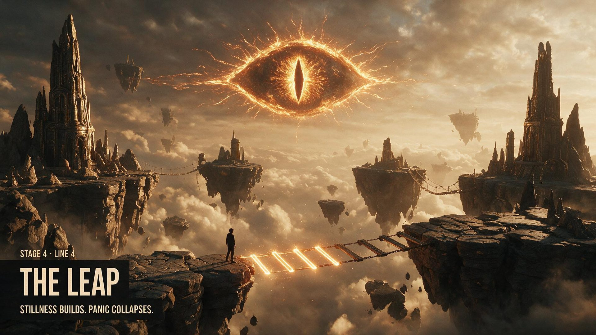

# Stage 4: The Leap (Shared Fire)

| Item | Detail |
|---|---|
| **Theme** | Coordination · Structure |
| **Line ignited** | Line 4 |
| **Target time** | 14:00 (first-time golden path) |
| **Stillness hold** | 3 s |
| **Lesson** | *Creative power is structured, not wild.* |

Bridges and puzzles plus combat. The Dragon assists only when the player is aligned. Light bridges form only while Elias is still.

## Level
Central-east. Centre (140, 0, -20). Void canyon module (48 m) along X. Three bridge-anchor pairs: (110,0,-20)/(130,0,-20), (150,0,-10)/(170,0,-10), (190,0,5)/(210,0,5). Narrow combat span at (160, 0, -30) with two Glass Shadow spawns. Ignition column (230, 0, 20), hold 3.0 s. Gate to Stage 5 at (200, 0, 60).

**Uses:** ENV-08 Canyon Cliffs (five rock masses, four bridges, the Spine: [doc 31](../31-env08-blueprint.md)), STR-08 Light Bridge. The bridge assembles only during stillness; lantern anchors become structural. The Dragon assists or disrupts.

## Beat plan
Times are mm:ss from game start on the golden path. Includes intentional low-energy rest pockets and one expected failure loop.

| Time | What the player experiences |
|---|---|
| 39:00-40:10 | Open traversal with wider gaps. Dormant structures appear across the voids. |
| 40:10-41:40 | First **bridge anchor**: the bridge only forms while Elias is still. Movement breaks construction. |
| 41:40-43:10 | Bridge 1 done, rest on the South shelf (low stakes). Optional: the long bridge (72 m, 6 s build) skips to the North shelf. |
| 43:10-45:00 | Dragon interaction at bridge 2: aligned and still at a specific anchor, the Dragon's wind current stabilises the bridge for 5 s (assist only when aligned). |
| 45:00-47:20 | Combat interleave on the Spine: Glass Shadows on a narrow ridge. Rushing multiplies threats; calm timing clears. |
| 47:20-50:20 | Bridge chain puzzle 2 (pressure): leeches drain stability; stillness builds, motion breaks. |
| 50:20-52:00 | Ignition column: build the final bridge segment while still, step once (clean), then hold still 3 s. |
| 52:00-53:00 | **Line 4** ignites. The lantern network across the world responds (more lanterns awaken). The Eye opens wider. |

## Failure correction loop
A broken bridge causes a short rewind to the last anchor. A calm pocket always exists nearby to reset the state to Freshness / Beauty.

## Pass condition
Complete the structured bridge chain plus ignition hold. Line 4 ignites.

## Audio
- `AUDIO_S4_HarmonyBias_Up`: harmony bias +0.10 baseline, wind 0.60, drone 0.30, noise cap 0.18

---
[Previous: Stage 3: The Toil (The Trial of Force)](stage-3-the-toil.md) · [All stages](README.md) · [Next: Stage 5: Flying (Flight)](stage-5-flying.md)
