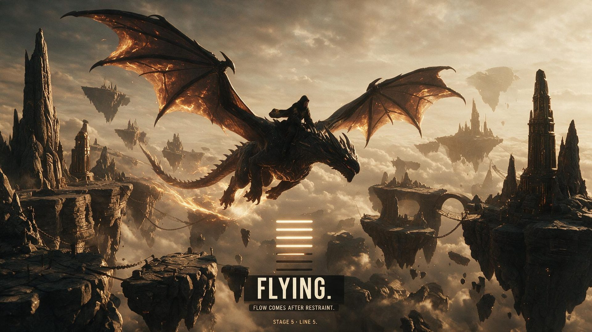

# Stage 5: Flying (Flight)

| Item | Detail |
|---|---|
| **Theme** | Freshness in motion · Flow |
| **Line ignited** | Line 5 |
| **Target time** | 17:00 (first-time golden path) |
| **Stillness hold** | 5 s |
| **Lesson** | *Flow only follows restraint. When alignment is complete, action feels effortless.* |

Heat currents, high-speed traversal and Dragon flight segments. No bridges. Hesitation causes a fall.

## Level
North-central. Centre (40, 0, 120). Launch terrace (40, 0, 80) facing north. Three readable heat-current lanes (centre, left, right) climbing from y=10 to y=18. Throne silhouette reveal camera marker (40, 20, 170). Dragon carry trigger (40, 0, 205), landing (40, 0, 210), drop (0, 0, 250). Ignition column (0, 0, 260), hold 5.0 s. Gate to Stage 6 at (0, 0, 290).

**Uses:** ENV-09 Drifting Fragment Cluster ([doc 35](../35-env09-blueprint.md): seven fragments, six heat currents, Dragon carry over a 48 m void, last current lifts him 225 m to ENV-07), ENV-10 Debris ([doc 36](../36-env10-blueprint.md): six stepping rocks into the last heat current). Heat-current flight with the Fire Dragon (CRE-02). No bridges.

## Beat plan
Times are mm:ss from game start on the golden path. Includes intentional low-energy rest pockets and one expected failure loop.

| Time | What the player experiences |
|---|---|
| 53:00-54:20 | Heat-current tutorial zone. Movement feels smoother; the sky feels wider. |
| 54:20-56:10 | First heat ride: the player must commit; hesitation causes a fall. Over-correcting triggers instability. |
| 56:10-58:20 | Dragon flight segment 1 (short): the Dragon carries Elias across a massive void. Forcing increases turbulence; aligned flight is clean and silent. |
| 58:20-61:00 | Flow course: three heat currents, two collapsing platforms, one enemy cluster that can be bypassed by flow (non-combat success). |
| 61:00-64:00 | "Effortless action": when alignment is complete, traversal feels frictionless. Audio becomes pure. |
| 64:00-66:30 | The pre-peak ascent reveals the **Throne silhouette** far above. |
| 66:30-68:40 | Ignition column: ride a final heat current without hesitation, land, then hold still 5 s in high wind. |
| 68:40-70:00 | **Line 5** ignites. The Eye is nearly fully open. The world's glow becomes legible everywhere. |

## Failure correction loop
A hesitation fall soft-resets to the previous launch ledge. Over-forcing causes turbulence and dust; the fix is to stop micro-correcting and commit to flow.

## Pass condition
Complete the flow traversal plus stillness hold. Line 5 ignites.

## Audio
- `AUDIO_S5_FlowBed_In`: wind 0.55, drone 0.25, harmony 0.22, pulse 0.15 only during heat currents; dust reduced (the air feels cleaner)

---
[Previous: Stage 4: The Leap (Shared Fire)](stage-4-the-leap.md) · [All stages](README.md) · [Next: Stage 6: The Peak (The Still Peak)](stage-6-the-peak.md)
