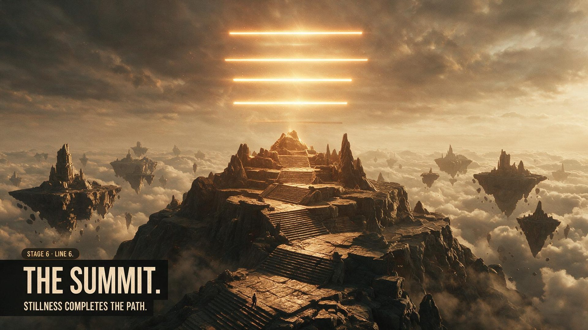

# Stage 6: The Peak (The Still Peak)

| Item | Detail |
|---|---|
| **Theme** | Beauty · Non-action |
| **Line ignited** | Line 6 |
| **Target time** | 9:00 (first-time golden path) |
| **Stillness hold** | **10 s** |
| **Lesson** | *True power knows when to stop.* |

No enemies, no hazards. The final test is stillness under pressure at the one moment every instinct says to move. Combat and dash disabled.

## Level
Far north. Peak platform (0, 80, 340): the only major elevation shift in the source layout. Wind volume (60 x 30 x 60). Stillness timer zone radius 10 m. Ignition column (0, 80, 360); the ignition fires when the timer completes. Dragon landing (-8, 80, 332).

**Uses:** ENV-07 Summit Peak, STR-22 Staircase, THR-03 Throne on Summit. 10-second stillness, then the Dragon lifts Elias to the Throne.

## Beat plan
Times are mm:ss from game start on the golden path. Includes intentional low-energy rest pockets and one expected failure loop.

| Time | What the player experiences |
|---|---|
| 70:00-71:20 | Arrival at the highest monolith platform. Extreme wind. Narrow safe zones. |
| 71:20-72:30 | The player's instinct is to move; the world subtly punishes over-movement (micro-slips, edge instability). |
| 72:30-74:30 | The final mechanic: **stop moving for 10 seconds.** Any movement resets. Audio strips down to wind and a distant harmonic. The Cinder locks and becomes perfectly calm. |
| 74:30-75:00 | **Line 6** ignites (top bar). All six glow: a vertical ladder of fire in the sky. The Eye fully opens. |
| 75:00-76:00 | The Dragon lands, lifts Elias and carries him to the Throne. |

## Failure correction loop
Any movement resets the timer. If resets feel unfair, widen look tolerance (mouse 0.35 -> 0.45) and velocity tolerance (0.06 -> 0.08). Do not reduce the 10 s requirement except in a demo-only build (the demo cut uses 6 s).

## Pass condition
10 s of total stillness. Line 6 ignites.

## Audio
- `AUDIO_S6_SilenceBias_In`: wind 0.70, drone 0.10, harmony 0.10 (very soft), noise 0, pulse 0
- `AUDIO_S6_StillnessTone_Subtle`: a barely-there clarity tone starts with the timer and rises linearly; **no success chime until ignition completes**

---
[Previous: Stage 5: Flying (Flight)](stage-5-flying.md) · [All stages](README.md) · [Next: The Throne](the-throne-ending.md)
