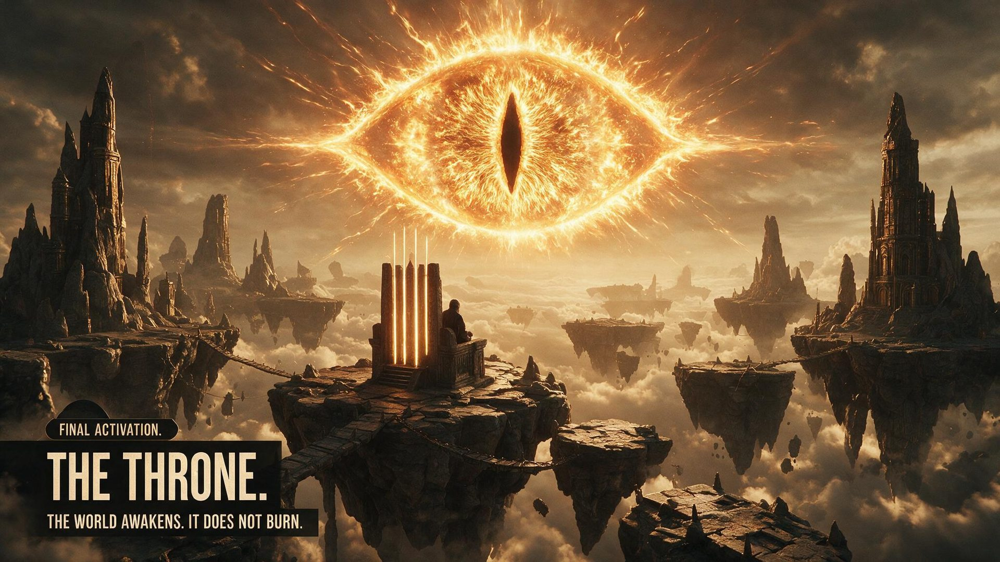

# The Throne: ending sequence

*Legacy key art (pre-redesign). The Throne has since been redesigned: see [The Throne](../08-the-throne.md).*

> **No boss. No explosion. Completion is calm.**

| Item | Detail |
|---|---|
| **Target time** | 6:00 (76:00-85:00 of the golden path; the ending budget is 360 s) |
| **Player input** | The only moment of pure choice: pressing to sit |

## Beat plan
| Time | What happens |
|---|---|
| 76:00-77:20 | Dragon flight to the Throne platform. Full view of the world: lanterns, structures, planets, the Eye. |
| 77:20-78:10 | Elias approaches the Throne. **The Throne does nothing until the player stops.** |
| 78:10-79:00 | Elias sits. The Cinder dissolves into the suit. |
| 79:00-81:30 | The Fire Eye opens fully. A **Ring of Fire** spreads along structures, through lantern anchors and across platforms. |
| 81:30-83:30 | Lanterns ignite sequentially, then all together. Architecture glows with internal fire veins. Planets reflect firelight. |
| 83:30-84:30 | The Fire Eye slowly closes. Audio resolves to wind and near-silence. |
| 84:30-85:00 | Fade out. End screen: **I-RULE01 COMPLETE.** No speech, no lore dump. |

## Rules
- The Ring of Fire reads as **activation, not destruction**: internal circuitry waking up. No explosions, no debris, no burning decay.
- The six lines ignite bottom to top as Elias sits; the locked light beam from Stage 1 finally transfers into him.
- Technical propagation spec: [Core systems, section 7](../06-core-systems.md#7-ring-of-fire-world-ignition).

## Audio
- `AUDIO_END_WindOnly`: wind 0.75, everything else 0.
- `AUDIO_END_EyeOpenChord`: ignition chord resolves over 4-6 s; harmony rises to 0.40; noise forced to 0.
- `AUDIO_END_HarmonyMax`: harmony peaks at 0.65; drone 0.35; wind 0.55.
- `AUDIO_END_HarmonyDecay_ToWind`: harmony decays to 0 over 40-60 s; drone fades; wind stays 0.65-0.75.

---
[Previous: Stage 6](stage-6-the-peak.md) · [All stages](README.md)
